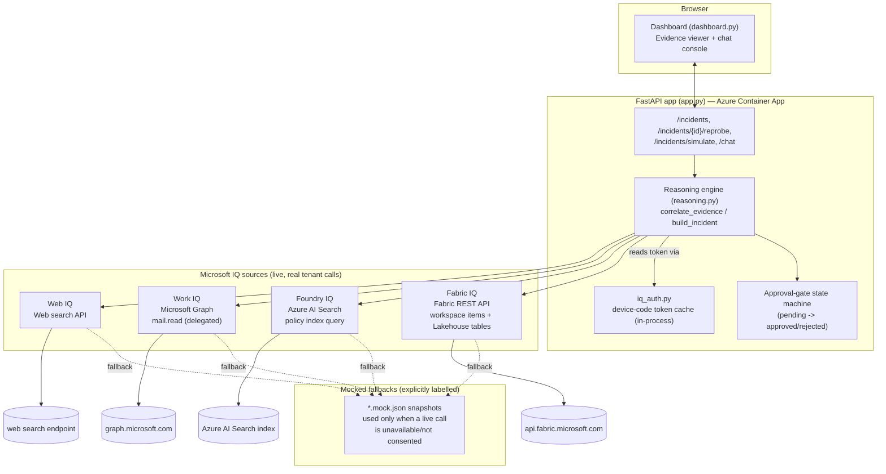
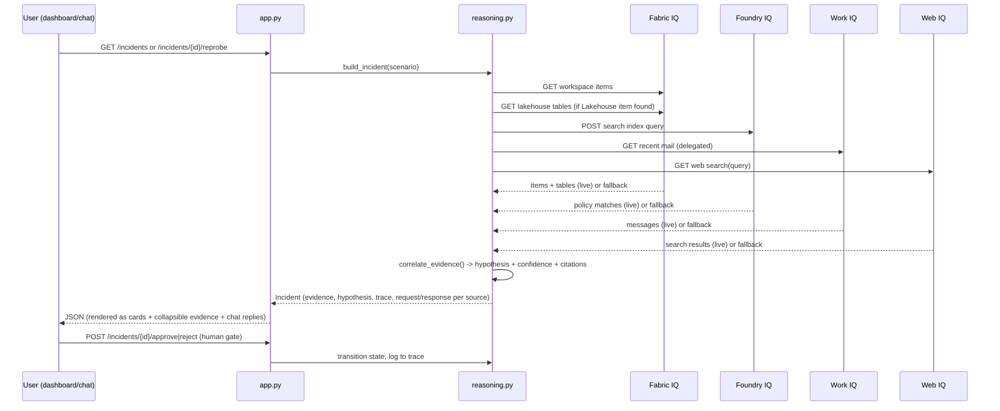
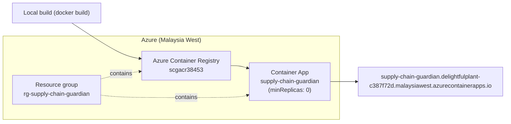

# Supply Chain Guardian — Architecture

Autonomous agent that detects manufacturing supply-chain disruptions by correlating
evidence from four live "Microsoft IQ" sources, forms a root-cause hypothesis, and
gates any consequential mitigation action behind explicit human approval.

## System overview

## Evidence correlation flow (per incident)

## Key design principles

- **Live-first, mock-fallback-explicit**: every IQ source attempts a real, read-only
  API call first; a mocked snapshot is used only on failure/no-consent, and every
  evidence block is labelled `mocked: true|false` so the UI never conflates the two.
- **Full request/response transparency**: each live probe returns the exact
  `request` (`method`, `url`, `body`) it issued and the `raw_response` it received,
  so the dashboard can show precisely what was called and what came back — not just
  a summarized chip.
- **Human-gated actions**: the agent can propose mitigations (informed by the
  correlated hypothesis and matched governed policies) but every consequential
  action requires an explicit `approve` via the API/chat before it is considered
  taken.
- **Bounded resilience**: each live probe has a single bounded retry (timeout/429/5xx
  only) and fails closed to the mocked snapshot rather than propagating errors to the
  user.
- **In-process auth only**: Fabric/Foundry/Work tokens are cached via device-code
  consent in `iq_auth.py` and held in process memory (no Container App secret
  persistence). Because the app has `minReplicas: 0`, a scale-to-zero cold start
  clears these tokens and the affected sources revert to "not consented" until the
  user re-authenticates from the UI.

## Deployment topology

