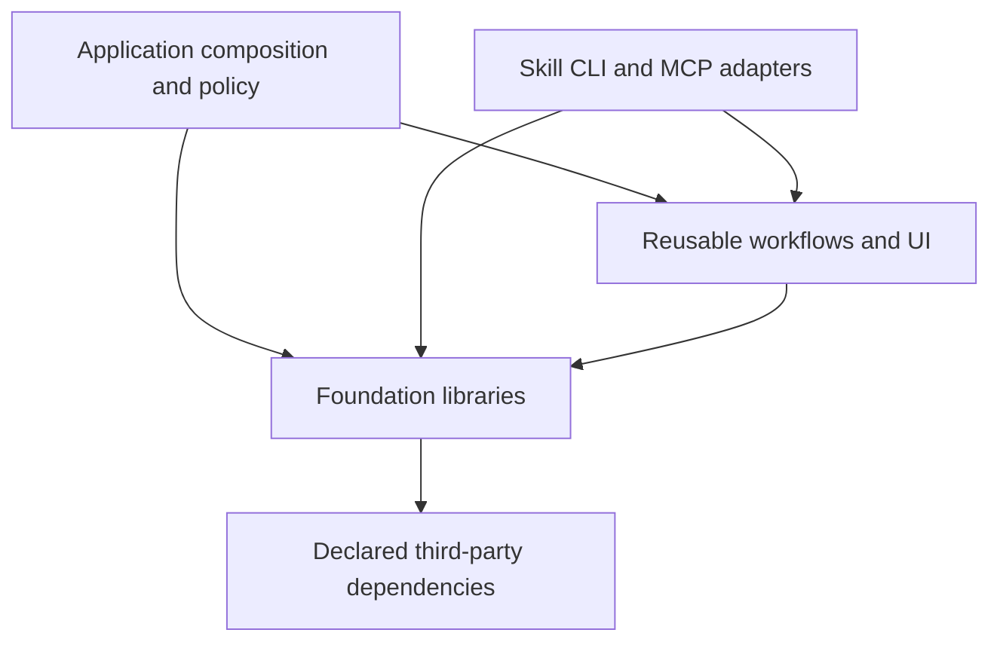

# Reusable Capability Libraries

Status: **Proposed for discussion. No implementation or migration authorized by this document.**
Evidence refreshed: 2026-09-14.

Capability-specific refinement: [Azure Data Connectors](azure-data-connectors/README.md) is
now the first proposed pilot. Its fixed public interface supersedes the earlier sequencing
and interface guidance below for that capability; other portfolio proposals remain unchanged.

## 1. Decision And Objective

Build one maintained implementation of each reusable capability under
`libraries/<capability>/`. Make the investigation template and skill tooling consumers of
those implementations. Reduce skill entry points where several entries describe one user
task, without losing their procedures, discoverability, safety controls or callable APIs.

The goal makes sense. Its two outcomes are related but independent:

1. **Runtime consolidation:** change a shared rule once, then verify its real consumers.
2. **Skill consolidation:** give an agent fewer overlapping task entry points, with precise
   references to the libraries and specialist procedures it needs.

A library module is not necessarily a skill, and a skill can compose several libraries.
Neither directory count nor moving code out of sight proves either outcome.

The first falsifiable hypothesis is that small duplicated capabilities can be extracted
without new runtime abstractions. The pilot passes only when the existing application
caller and an isolated skill-package consumer use one implementation with unchanged
behavior. A need for caller-specific branches would disprove that hypothesis for the pilot.

### Scope

- Design source ownership, public contracts, packaging, skill routing and staged adoption.
- Cover the remaining investigation components and executable code currently inside skills.
- Preserve domain behavior, persisted records, wire contracts and authorization decisions.
- Do not implement a plugin framework, universal service client or application rewrite.
- Do not move data, enable cloud access, install dependencies, retire skills, change MCP
  tools, or remove components as part of this design-only step.
- Keep upstream repositories and independently edited workspace paths outside the change.

## 2. Current Evidence

The [skill inventory](../.github/skills/README.md) describes 31 capability skills, six
embedded entries, and eight separately authored protocols. The
[machine catalogue](../.github/skills/catalogue.json) contains 39 top-level records because
it also represents those eight protocols. These are different counts, not a discrepancy.

The [component directory](../template_apps/investigation_app/app/components) currently
contains 13 capability directories, plus tests. Its
[README](../template_apps/investigation_app/app/components/README.md) records intended
independence, but actual code also contains application policy and inherited defaults.

Four representative source pairs were rechecked by byte hash for this design:

| Application Source | Skill Source | Observed Result |
| --- | --- | --- |
| [SSE decoder](../template_apps/investigation_app/app/components/event_stream/frontend/read-events.ts) | [event-stream](../.github/skills/event-stream/frontend/read-events.ts) | Byte-identical |
| [Source viewer](../template_apps/investigation_app/app/components/source_code/frontend/SourceCodeViewer.tsx) | [source-code](../.github/skills/source-code/frontend/SourceCodeViewer.tsx) | Byte-identical |
| [Rule battery](../template_apps/investigation_app/app/components/situation_detector/battery.py) | [situation-detector](../.github/skills/situation-detector/python/situation_detector/battery.py) | Byte-identical |
| [SQLite reader](../template_apps/investigation_app/app/components/local_query/reader.py) | [Optimization's private reader](../.github/skills/agent-optimization/python/agent_optimization/_local_query/reader.py) | Byte-identical, including domain policy |

These examples prove source duplication, not complete package interchangeability. The
earlier whole-tree duplicate count is not a release baseline: skills have since changed.
Freeze and compare the exact files again when each migration starts.

Many skills already have Python or npm package metadata. Extraction should preserve useful
APIs and tests, not create new names merely because the owning source directory changes.
Current package publication, clean-install compatibility and application-wide behavior
have not been established by this design exercise.

No repository-root architecture manifest or architecture overview currently exists. The
dependency graph below is proposed, not a claim that an existing checker enforces it.
No notebook mechanism is installed; this document is the durable design record.

## 3. What Generic Means

Generic means domain-independent behavior with explicit inputs, injected dependencies and
bounded, documented outputs. It does not mean every function works with every provider.
Azure-specific clients are useful reusable libraries. A stateful client need not become
a stateless function; a workflow need not become a bag of utilities.

Use three classifications:

| Classification | Belongs In | Examples |
| --- | --- | --- |
| Foundation | A small library with a stable contract | SSE framing, bounded content, SQL authorization mechanics, credential acquisition |
| Reusable specialized capability | A library that composes foundations | Azure Search, resource inventory, signed access, optimization ledger, PTY terminal |
| Application policy and composition | The consuming application | Dataset schemas, tenant policy, prompts, grades, resource targets, routes and storage locations |

### Generalization Rules

1. Parameterize genuine variation already required by consumers, not every constant.
2. Inject a dependency when its owner is outside the capability: credential, transport,
   clock, store, source probe, model caller, authorizer or scoring policy.
3. Put reusable service-specific rules in the owning service adapter. Do not require every
   application to relearn Kusto ingestion or Search partial-batch behavior.
4. Separate trusted operator policy from request input. A user-editable configuration
   document cannot widen access or name code to execute.
5. Keep security and correctness bounds enforced by the capability. Domain labels can vary;
   replay protection, ownership checks and integrity validation cannot disappear.
6. Preserve different contracts when the semantics differ. A failed read represented as a
   status is not interchangeable with a failed write represented as an exception.
7. Introduce a shared abstraction only for a demonstrated common contract. Similar HTTP,
   retry or JSON code alone is insufficient.
8. Importing a library must not start servers, read project environment files, acquire
   credentials, create data directories, access the network or depend on the current directory.

### Concrete Contract Changes

The names below describe proposed responsibilities, not approved signatures.

| Capability | Library Owns | Host Supplies | Observable Contract |
| --- | --- | --- | --- |
| Event stream | UTF-8 decoding, SSE framing, JSON dispatch, reader cleanup | A byte stream and event handling | Ordered decoded events or explicit parse failure |
| Local query | Read-only connection, SQLite authorizer, function restrictions, deadlines and result limits | Database path and trusted query policy | Bounded rows with truncation, or a typed refusal |
| Model access | Client lifetime, provider protocol, stream failure detection and embedding alignment | Credential, endpoint allowlist, deployment and budgets | Raw or typed results with documented failure semantics |
| Resource inventory | Node identities, selection, bounded tree/detail/content results and caching | Registry, probes, authorization and provenance labels | Typed read results with distinct unavailable/forbidden/empty states |
| Signed access | Canonical bytes, signature validation, replay claims and denial behavior | Public key, mandatory ledger, principal factory and route policy | Verified identity evidence or refusal; never an access grant inferred from installation |
| Optimization | Immutable generations, probe receipts, cohort measurement and replay | Authorized owner, datasets, grades, prompts, predictors and storage roots | Persisted, owner-checked results and comparable measurements |

For local query, the current reader only permits `evidence`, `cases` and `training_profile`,
and always excludes `labels`. A synthetic probe already confirmed it refuses an unrelated
`orders` table even when explicitly requested. The reusable reader should accept a trusted
construction-time table policy; per-query selection can only narrow it. Omitted policy
denies access. The optimization host retains its evaluation-table and label restrictions,
with refusal tests proving extraction does not expose hidden labels.

For inventory, the current
[service default](../template_apps/investigation_app/app/components/resource_explorer/backend/service.py)
asserts that data is a historical replay. That statement belongs to the registered source,
not to every caller of the library. Unknown provenance must remain unknown, not become
an invented claim of either live or historical data.

## 4. Source Ownership And Packaging

`<capability>` is a descriptive capability name, not a literal directory named `capability`
and not a generic `common`, `utils` or `manager` module.

Proposed layout, instantiated only when a capability migrates:

```text
libraries/
  DESIGN.md
  <capability>/
    README.md               outcome, consumers, installation and limits
    CONTRACT.md             public behavior and versioned contracts
    python/                 only when Python is needed
      pyproject.toml
      src/<import_name>/
      tests/
    frontend/               only when browser code is needed
      package.json
      src/
      tests/
```

One capability can own both languages without merging their build or deployment lifecycles.
Retain existing import and distribution names where practical; changing `app.components.*`
callers is necessary, renaming every existing skill package is not. Final package names and
registry availability require checking before publication.

### Dependency Direction



- Libraries never import `template_apps`, application configuration or `.github/skills`.
- Applications and adapters import declared public packages, not source paths or private files.
- No `sys.path` edits, imports from a template root, or reliance on `@components` aliases
  outside the application migration boundary.
- Higher-level optimization may depend on detection, local query and terminal capabilities;
  none of those foundations may import optimization.
- Authentication mechanisms remain separate from each host's authorization decision.
- SDKs, React and privileged terminal runtime dependencies stay optional or capability-local.
  A parser consumer must not install the entire Azure or browser stack.
- Inject Azure credentials from the composition root. The current
  [ARM-to-LLM credential import](../template_apps/investigation_app/app/components/azure_arm/client.py)
  motivates a small shared credential capability, not a new universal identity framework.

### One Catalogue, Different Views

Extend the existing capability catalogue as migrations are approved; do not create a second
hand-maintained registry under `libraries`. Evolve its schema and reader deliberately so
library-only capabilities are not incorrectly required to have a native `SKILL.md`.

Each capability needs a stable ID, classification, owner, source roots, public exports,
real consumers, dependency IDs, configuration/authorization boundary, verification command
and status (`existing`, `proposed`, `migrating`, `retired`). A separate task-entry field maps
skills and historical aliases to those IDs. Include backend and frontend under one outcome.

This separates two currently coupled facts: **what can be called** and **which instruction
entry should be loaded**. Source catalogue, native discovery metadata and distributable
inventories can then be generated views of one authority. Do not claim this exists today.

### Distribution Contract

- Local development uses declared editable Python dependencies and package-manager workspace
  links. Release consumers use versioned wheels and npm packages built from canonical source.
- A skill's loading does not install packages, activate MCP or grant access. Its instructions
  name prerequisites and the exact public entry points.
- Prefer documentation-only skills plus separately installed library packages. A host that
  requires a self-contained skill/plugin may receive generated, version-pinned artifacts.
- Generate any such bundle from the library owner during packaging. Include a source revision,
  hashes, dependency versions and required notices. Never hand-edit the bundled copy.
- Validate a bundle outside the repository with no sibling source directory, network download,
  application checkout or existing developer environment to hide a missing dependency.
- Existing reference snapshots and historical evaluation evidence remain labelled evidence;
  they are not alternate runtime sources. Never ship private datasets or credentials as fixtures.
- Changes to package exports, CLI flags, MCP tool names or wire/storage schemas are explicit
  compatibility decisions. Source movement alone must not silently change them.
- Repository MIT coverage does not establish third-party rights. The copied terminal's
  [provenance](../template_apps/investigation_app/app/components/copilot_terminal/PROVENANCE.md)
  records an unresolved licence; reconcile that record and applicable notices before distribution.

### Python Dependencies And Publication

**Proposed tooling: uv for Python dependency resolution, environments, locks, builds and
publication. One development workspace; independently publishable capability packages.**
This section is a design, not an installed workspace. It authorizes no metadata changes,
dependency installation, package upload or edits to another capability owner's files.

Official uv guidance reviewed on 2026-09-14:
[workspaces](https://docs.astral.sh/uv/concepts/projects/workspaces/),
[dependencies](https://docs.astral.sh/uv/concepts/projects/dependencies/),
[locking and syncing](https://docs.astral.sh/uv/concepts/projects/sync/), and
[building and publishing](https://docs.astral.sh/uv/guides/package/).

The [access dependency design](azure-access-management/README.md#proposed-dependency-set)
names its proposed optional Azure SDKs. The existing
[connector metadata](azure-data-connectors/pyproject.toml) already defines distribution
`azdata`, version `4.0.0a1`, Python `>=3.11`, a setuptools build backend and an optional
`identity` dependency. Retain that backend during tooling adoption: uv can use an existing
PEP 517 build system; choosing uv does not require switching to `uv_build`.

#### Workspace Ownership

```text
libraries/
  DESIGN.md
  pyproject.toml                      non-package workspace coordination root
  uv.lock                             one committed Python resolution
  .venv/                              ignored local environment
  azure-data-connectors/
    pyproject.toml                    distribution metadata and owned dependencies
    src/azdata/
  azure-access-management/
    README.md                         design only until implementation is authorized
    pyproject.toml                    future member metadata, not created now
    src/azaccess/                     future canonical implementation
```

- Keep an explicit `[tool.uv.workspace].members` list. Initially only the implemented
  connector is eligible; add access management when its package metadata and baseline
  exist. Do not use a broad glob that enrolls design-only or unrelated directories.
- Keep the root non-publishable and free of application code. Each member owns its own
  `pyproject.toml`, `src/` layout, public imports, version and build configuration.
  A workspace is a development arrangement, not a Python import package or one wheel.
- One writer coordinates root configuration and `uv.lock`. Member owners request dependency
  changes; the coordinating change resolves the lock and runs the affected checks. No
  second authoritative member lockfile inside the same workspace.
- Commit `uv.lock`; ignore environments, caches and build output. Keep skill packages and
  template applications outside this workspace unless a separate consumer migration admits
  them. In particular, do not install old and new packages providing `azdata` into one
  environment and mistake import-order behavior for compatibility.
- Workspaces require a compatible combined resolution. The shared Python range is the
  intersection of member `requires-python` values. That development constraint must not
  silently raise an individual distribution's published minimum Python version.
- uv resolves workspace dependencies together, including extras and dependency groups.
  Selecting one package or extra for installation does not create an independent lock.
  If members need incompatible requirements or independent resolutions, use separate uv
  projects and locks, with explicit local sources where needed, instead of forcing a workspace.
- A workspace uses one environment by default. Concurrent CI jobs or agents must use
  separate worktrees/environments, such as a unique `UV_PROJECT_ENVIRONMENT`, rather than
  concurrently synchronizing the same `.venv`. The lockfile still has one writer.
- uv does not manage frontend npm dependencies or install Azure CLI, Bicep or OS-level
  ODBC drivers. Preserve their existing package managers and deployment/tool prerequisites.

#### Dependency Rules

| Metadata | What Belongs There | Publication Meaning |
| --- | --- | --- |
| `[project].dependencies` | Runtime imports required by that member | Standard requirements recorded in its wheel/sdist metadata |
| `[project.optional-dependencies]` | User-selectable provider or integration extras | Published features, installed only when selected; not authorization grants |
| `[dependency-groups]` | Tests, lint and other development tools | Local development requirements, not runtime extras shipped to consumers |
| `[build-system].requires` | The member's supported build backend/tooling | Build-environment requirements; keep separate from application runtime dependencies |
| `[tool.uv.sources]` | Explicit local workspace/path or development-index resolution | uv-specific source choice; not a substitute for standard published requirements |
| `uv.lock` | Exact resolved development dependencies | Reproducible workspace snapshot, not a dependency lock imposed on package consumers |

Declare dependencies where imported, including SDK support libraries used directly. Do
not centralize every member's runtime imports into the workspace root or rely on another
member's transitive packages. A workspace environment can hide undeclared dependencies;
uv cannot enforce Python import isolation between members.

Published libraries use tested minimum versions and evidence-based compatibility limits,
not exact pins for every transitive package. The lock records exact development versions.
Test supported lower bounds as well as the normal locked combination; a lock alone proves
neither the minimum nor all versions allowed by a requirement. Keep development tool
versions reproducible without making them customer runtime dependencies.

For a real dependency between libraries, declare its distribution name and version range
in the consuming member's standard metadata, then use `{ workspace = true }` in
`[tool.uv.sources]` for local development. Do not add an access-to-data-connector dependency
just because they share a repository. Published installs must resolve without local paths,
Git checkout dependencies or a sibling skill directory.

#### Development And CI

After workspace creation is separately approved, representative commands from `libraries/`:

```bash
uv lock
uv lock --check
uv sync --locked --package azdata --no-default-groups
uv run --locked --package azdata --no-default-groups python -m unittest discover -s azure-data-connectors/tests/contract -v
uv build --no-sources --package azdata --out-dir dist/azdata
```

These commands are proposed, not run by this design change. `--package` selects the
distribution's declared project name, not its directory name. Use existing test commands;
uv adoption is not a reason to replace unittest, add a new test framework or run live tests.

Use `uv add --package <member> --optional <extra> <dependency>` for a provider extra and
`uv add --package <member> --group <group> <tool>` for member development tooling. Review
the resulting version bounds and lock changes; a solver accepting a version does not
establish SDK parity. Upgrade selected dependencies deliberately, with the same checks.

CI installs a pinned uv release, checks lock freshness and uses `--locked` for runs/syncs.
`--frozen` skips the freshness check and is not equivalent acceptance evidence. Select
extras and groups explicitly. Dependency resolution and ordinary package tests must not
request Azure tokens, create resources, grant access or activate live test suites.

#### Publication Model

Prefer one distribution per capability with independent versions. A uv workspace is not
published as a unit: release each selected member's wheel and source distribution. Users
may install those artifacts with pip or another standards-compatible tool; uv is not a
runtime requirement. The development lock is not the public dependency contract.

For a future single install command, add a separately named **metapackage** with optional
extras referencing released capability distributions. For example, an illustrative
`agentcraft-libraries[access,data]` could select both. The name is unreserved, not a
published package. A metapackage owns no copied implementation and does not require every
consumer to install all Azure SDKs. It also does not create a unified Python import API.
Choose a single code-bearing distribution only if unified versions, Python support and
release cadence become a deliberate requirement, not because the source shares a folder.

Release acceptance, independent of workspace success:

1. Check distribution-name availability, version policy, Python support, README/license
   metadata, public imports and third-party notices. Existing local names are not evidence
   of ownership on PyPI. Keep runtime packages free of skills, datasets and credentials.
2. Build the selected package with `uv build --no-sources` so local source overrides do not
   hide missing standard metadata. Build and inspect wheel and sdist; check a rebuild from
   the sdist. Workspace locking is not a claim of locked build-isolation dependencies.
3. Install each artifact into a fresh environment outside the checkout, with no
   `PYTHONPATH`, editable sibling or developer packages. Exercise a synthetic consumer,
   its declared extras and refusal cases. Test each member's minimum supported Python
   independently when the shared workspace cannot run that version.
4. Test real inter-package dependency resolution against released artifacts or a controlled
   staging index/wheel set. An unpublished sibling is a release blocker, not a reason to
   publish a local path requirement. Release dependencies before their consumers/metapackage.
5. Publish only reviewed, tested artifact paths, not every old file in a shared `dist/`.
   Use `uv publish` with PyPI Trusted Publishing/OIDC in a protected release job when PyPI
   is selected. Private registries require their documented auth/index setup; no credential
   value in TOML, lockfiles, committed URLs or logs. Do not broadly mix private and public
   indexes as an unreviewed fallback for internal package names.
6. Verify a clean install from the selected registry and retain artifact hashes and test
   evidence. Publishing is a separately authorized external action; no upload happens here.

## 5. Strategic Component Replacement

Every target below is proposed. Select the canonical variant by contract and test evidence,
not by assuming the application or skill copy is automatically newer or better.

| Current Component | Proposed Library Owner(s) | Reuse Decision And Required Boundary |
| --- | --- | --- |
| `event_stream` | `event-stream` | Reuse existing decoder. Application HTTP/authentication and event meaning remain outside. First pilot. |
| `source_code` | `source-code` | Reuse viewer. Preserve text-only rendering, cancellation, copying and wrapping; reconcile React/Shiki peer ranges and CSS exports. |
| `situation_detector` | `situation-detector` | Reuse ordered sync/async/streamed runner. Hosts provide query execution and processing; configuration never imports or evaluates code. |
| `local_query` | `local-query` | Extract SQLite mechanics from the duplicated reader. Move table policy to trusted hosts, retaining optimization label isolation. |
| `azure_llm` | `azure-models`, with `azure-credentials` shared below it | Reconcile application `AzureLlmClient`, `azllm` and `modelaccess`. Compare raw Responses behavior, sync/async lifetime, token scopes, endpoint trust, errors and embeddings before choosing an API. Preserve the response-stream bridge where its caller requires it. |
| `azure_arm` | `azure-arm`, using `azure-credentials` | Reuse bounded ARM transport and resource-path handling. Remove its dependency on model access; resource semantics remain in service adapters. |
| `azure_search` | `azure-search` | Reuse schema, client and transport contracts from the compatible variant. Preserve per-document failure inspection, read-back and explicit credential injection. |
| `data_connector_library` | `data-content`, `azure-data-connectors`, `adx-event-store`, `azure-search` | Dismantle the application umbrella after callers select public capabilities. Consolidate duplicate content/status contracts; reconcile ADX and Gremlin adapters without conflating read, write and provisioning authority. |
| `entra_auth` | `entra-auth` | Consolidate compatible validation, JWKS, PKCE and expiring-store mechanisms with the browser skill package. Compare the separate API-auth contract before merging it; hosts retain issuer/audience policy and principal ownership. |
| `signed_dev_access` | `signed-access` | Preserve the application's explicit atomic replay ledger and denial bounds. The skill's optional per-process cache is not an equivalent replacement; compatibility must not silently downgrade replay protection. |
| `resource_explorer` | `resource-inventory` | Consolidate the application explorer with the skill's embedded inventory. Inject source labels and probes. Keep subscription-wide `resource-explorer` behavior separate unless its contract comparison supports merging. |
| `copilot_terminal` | `copilot-terminal` | Adopt the compatible runtime/frontend package after parity and provenance review. Preserve ownership, control keys, origin checks, bounded output and process cleanup. Local trusted operation is not multi-user sandboxing. |
| `agent_optimization` | `agent-optimization` | Reuse one vertical workflow package depending on detection, query and terminal libraries. Keep immutable generation/persistence semantics. Domain prompts, datasets, grades and authorization remain in the host. |

The `data-content` and `azure-credentials` proposals have named multiple consumers. They
are not invitations to extract every JSON helper, cache or retry loop into a foundation.
Keep service-specific variation local until a compatible shared rule is demonstrated.

### The Investigation App After Migration

The application keeps its composition root, routes, response adaptation, identity model,
inventory registration, detector configuration, prompts, datasets, grading rules and target
configuration. Those are meaningful application responsibilities, not extraction failures.

Examples of existing callers to migrate in place:

- [Browser event handling](../template_apps/investigation_app/app/cybereye/frontend/src/shared/api/api.ts)
  imports the event-stream package; it continues to own HTTP, auth and event semantics.
- [Optimization dataset adapter](../template_apps/investigation_app/app/cybereye/backend/optimization/dataset.py)
  constructs the local reader with its restricted policy rather than teaching the library its schema.
- [Security composition](../template_apps/investigation_app/app/cybereye/backend/security/composition.py)
  wires caller authentication and replay storage; libraries do not select a tenant or an authorized user.
- [Optimization composition](../template_apps/investigation_app/app/cybereye/backend/optimization/service.py)
  supplies the host profile, dataset and authorization to the shared workflow.

Replace imports and remove superseded implementations in the same verified batch. A temporary
compatibility facade is allowed only for named remaining consumers, with a removal condition;
it must contain no independent rules. The desired end state is no duplicated general-purpose
runtime under `app/components`, not an arbitrary requirement that the directory be empty.

## 6. Reducing Skills Without Reducing Capability

Keep a skill when it teaches a distinct task or carries substantial failure knowledge. Put
simple API usage in library documentation, reached through a broader task-oriented skill.
Library count and skill count should not be forced to match.

First consolidation proposal:

| Existing Native Skills | Proposed Surviving Entry | Routing And Preservation Requirement | Entry Reduction |
| --- | --- | --- | --- |
| `azure-llm-connectors`, `managed-identity-model-clients` | `managed-identity-model-clients` | One model-integration entry; compare and version runtime APIs separately. Preserve streaming, embeddings, identity and old-name lookup. | 1 |
| `adx-event-store`, `azure-data-connectors`, `azure-search` | `azure-data-connectors` | A short service selector loads ADX ingestion, query, Search schema or mutation procedures on demand. Separate write and provisioning grants remain explicit. | 2 |
| `event-stream`, `source-code`, `frontend-implementation` | `frontend-implementation` | Parser/viewer installation and contracts become focused references. Add explicit SSE and source-viewer discovery terms; do not inline full implementations into the skill. | 2 |
| `entra-auth-container-apps`, `deploy-container-apps` | `deploy-container-apps` | Tenant-scoped deployment authentication becomes a required deployment branch. Keep standalone JWT validation and Azure permission management separate. | 1 |

This scenario changes **31 capability skill entries to 25** while preserving capabilities.
It is arithmetic over the proposal, not a measured improvement, approved deletion set or quota.
The eight protocol workflows are not part of that reduction. Six embedded entries keep their
parent relationships unless a separate decision changes them.

The other 21 current capability skill entries remain unchanged in this first scenario:

- `agent-optimization`, `architecture-placement`, `azure-access-management`, `azure-sky-styling`;
- `bicep-managed-identity`, `codebase-cleanup`, `content-from-a-store`, `entra-api-auth`;
- `ghcp-cli-frontend`, `harness-guide`, `hyperframes-motion`, `investigation-notebook`;
- `modular-agents`, `portable-app-composition`, `recoverable-jobs`, `resource-explorer`;
- `runbook-replay`, `signed-dev-access`, `situation-detector`, `ui-experience-audit`, `web-resource`.

In particular, detection must remain discoverable without asking for optimization; Bicep
identity work is not necessarily a Container Apps deployment; access grants and caller
authentication are different tasks. Preserve those entry points for now.

### Additional Library Sources In Skills

Existing executable capabilities without an application-component twin are still candidates:

| Skill | Library Treatment |
| --- | --- |
| `portable-app-composition` | Relocate its existing canonical-document and allowlisted composition implementation; reuse its API if configuration-driven assembly is actually needed. Do not introduce another plugin engine. |
| `recoverable-jobs` | Relocate `workrecovery` as a completed-output preservation library. Scheduling and optimization generation storage are different contracts, not automatic replacements. |
| `azure-access-management` | Keep inspection and explicit policy/grant execution together, with privileged adapters separate from harmless status/plan calls. |
| `web-resource` | Reuse acquisition, URL safety, provenance and capture implementation; optional browser tooling remains optional. |
| `modular-agents` | Keep a higher-level agent configuration/runtime/tooling capability, sharing model access only after compatibility checks. |
| `resource-explorer` | Keep estate-wide exploration distinct from registered-source inventory; share only compatible content and data clients. |
| `architecture-placement`, `codebase-cleanup`, `harness-guide`, `investigation-notebook` | Retain their distinct workflows. Relocate reusable checkers/readers only with a named consumer and unchanged CLI/record contracts. |
| `azure-sky-styling`, `hyperframes-motion` | Treat reusable UI or render code as optional specialized packages, not base-library dependencies. Deleting the template's style studies did not authorize retiring these skills. |
| `content-from-a-store` | Extract from its worked example only when a real consumer needs the contract. Do not manufacture a library because an example contains functions. |

Guidance-only deployment, frontend, replay and audit procedures stay guidance. Their value is
the sequence and decision knowledge, not the number of source files moved into a package.

### Discovery Is An Acceptance Criterion

Before removing a skill, test a fixed set of representative tasks: SSE parsing, code viewing,
ADX CSV ingestion, Search partial failures, model streaming, PKCE, signed access and
tenant-restricted deployment. Each task must reach the surviving entry and its exact reference.

Use catalogue keyword and alias checks as structural evidence. Separately check the client's
native discovery: a historical catalogue alias does not automatically create a native skill
name or preserve a slash command. If the user cannot find the specialized procedure without
prior knowledge, retain the old entry and revise the projected count.

Measure relevant context loaded and unnecessary routing steps before and after. A larger
combined instruction file can be worse than several narrowly loaded skills. Do not replace
distributed discoverability with a mandatory read of a giant umbrella document.

## 7. Migration Sequence

Each row is a separately authorized, reversible batch, not one bulk move.

| Batch | Outcome | Required Evidence Before Retiring Copies |
| --- | --- | --- |
| 0. Freeze contracts | Name owners, enumerate actual consumers and capture current package/API behavior | Scoped file hashes, dependency records and existing focused tests; identify missing dependencies or baseline failures honestly |
| 1. Event-stream pilot | One library serves the application and a skill distribution | Split UTF-8/CRLF, multiline/trailing frames, JSON/error cleanup checks; actual app event consumption; isolated package import with no source checkout |
| 2. Viewer and detector | Migrate each independently through existing callers | Viewer build/browser behavior and hostile-text/refusal cases; detector ordering, explicit windows, digests and configured-code refusal |
| 3. Query policy | Shared SQLite reader, host-owned evaluation access policy | Authorized generic table succeeds; writes, disallowed functions/tables and hidden optimization labels refuse; deadline/row bounds retained |
| 4. Azure foundations | Explicit credentials, compatible model/Search/ADX ownership | Fake-transport and identity-lifetime tests, partial failures, embedding alignment and denied writes; approve live checks separately |
| 5. Authentication and inventory | Preserve strict auth and resource-result contracts | Positive and negative identity/ownership cases, replay race/outage behavior, inventory status and integrated read-back |
| 6. Terminal and optimization | Higher-level packages depend on migrated foundations | Private session controls, stop/cleanup, immutable generations, frozen cohorts and old-result replay; synthetic fixtures, no paid inference by default |
| 7. Remaining library adoption | Move other skill runtimes when their consumers justify it | Public imports, focused contract tests and isolated packaging checks for each capability |

Skill routing consolidation follows the relevant completed batches, rather than waiting for
every library or happening before a replacement is usable. Do not merge several risky
contracts into one change just because they share a future skill entry.

For each batch:

1. Resolve overlapping writers and freeze only the paths owned by the batch.
2. Select reuse, extend or keep-separate against actual contracts. Never silently combine policies.
3. Establish canonical source and public packaging using existing tests and local tooling.
4. Migrate named application and skill consumers, including scripts, build inputs and examples.
5. Run focused tests immediately; operate affected UI and read back stored results where relevant.
6. Remove authorized superseded code, then update catalogue, notices and generated bundles.
7. Record rollback inputs and remaining consumers; stop if an external consumer lacks a plan.

No automatic data migration belongs in a source extraction. Persisted optimization records,
auth ledgers and configuration digests need explicit compatibility tests. A changed schema
or digest algorithm requires its own versioned migration and authorization.

## 8. Verification And Success Measures

The following are proposed migration gates, **not tests run by preparing this document**.
Take exact commands from the existing package/test owner when starting each batch. Avoid
adding a second test framework or asserting that absent infrastructure already works.

| Risk | Evidence That Closes It |
| --- | --- |
| Another independent implementation survives | Canonical owner and source hashes; consumer imports; distribution manifest identifies generated artifacts separately |
| A library only works inside this checkout | Install its built artifact in an isolated environment and run a synthetic consumer without sibling application or skill paths |
| Hidden dependencies or cycles | Declared public edges plus real import/build checks; report dynamic edges as unknown until exercised |
| Behavior changes during relocation | Existing consumer checks and matching negative/refusal cases; representative workflow and persisted result read-back |
| Skill reduction hides functionality | Fixed task-to-entry/reference checks and observed native discovery; preserve or revise aliases explicitly |
| A small capability inherits large dependencies | Dependency metadata/import tests prove optional Azure, browser and terminal stacks are not required for unrelated consumers |
| Packaging bypasses authentication or expands authority | Status/import/installation performs no live calls; operator configuration and request authorization remain distinct; denied operations still refuse |
| Packaging overwrites customizations | Generated ownership is explicit; modified or unknown files are reported, never silently overwritten or deleted |
| Documentation describes the intended rather than actual state | Catalogue and project state distinguish proposed, migrated and unverified capabilities |

Record: maintained implementation count per contract, real migrated consumers, remaining
compatibility facades, focused test results, package isolation results, native skill count
and discovery coverage. Measure dependency size and context cost only when relevant and
actually observed. Do not estimate line-count savings as a claim of success.

## 9. Alternatives And Open Decisions

| Alternative | Decision And Reason |
| --- | --- |
| One monolithic `agentcraft` package and one mega-skill | Reject as default: unnecessary SDK/UI dependencies, privileged surfaces and discovery costs become coupled. A thin optional dependency bundle can be considered after demand exists. |
| Keep runtime authority under `.github/skills` | Reject as target: applications become tied to instruction-package layout and independent copies remain easy to create. |
| Rename/move everything before testing | Reject: conceals security, lifecycle and persistence differences behind a directory operation. |
| A universal connector/auth/result interface | Reject without matching invariants: service semantics and authorization boundaries differ. Reuse existing libraries and third-party SDKs before inventing new frameworks. |
| Leave all skills and only deduplicate code | Valid intermediate state, but does not address overlapping task discovery. Revisit routing after runtime ownership is real. |

Recommended defaults for discussion:

- Keep the library family in this repository first; external publication is a later decision.
- Build independently consumable Python/frontend packages only at real capability boundaries.
- Preserve public package names where possible; defer final namespace and version policy until
  the first package's external consumer inventory is known.
- Prefer injected credentials and host authorization over global factories or implicit config.
- Reconcile model-client and authentication contracts before selecting the canonical APIs;
  the current design does not nominate one variant as a drop-in replacement for all callers.
- Aim initially for the six proposed skill-entry removals, subject to discovery evidence;
  do not sacrifice a distinct workflow to reach the count.

Unknowns to resolve during approved implementation: external consumers, clean package-build
requirements, third-party redistribution rights, model/API parity, frontend peer compatibility,
live cloud behavior, and native-client alias/discovery behavior.

The first implementation decision is therefore small: authorize the event-stream pilot,
validate the ownership and packaging model against its two consumer paths, then revise this
proposal from that evidence before migrating larger capabilities.
