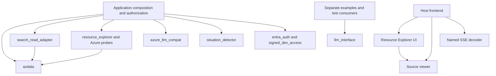

# Framework Migration

> **Superseded for the unified migration:** [final specification](../specs/20260916T045818Z_UNIFIED_LIBRARY_SPEC/README.md).
> Retained as a historical input, not a separate active plan. The final spec's library-first
> decisions, mandatory runtime removal, app-adoption status and verification gates control.

Status: **Audit and proposal for discussion; no runtime migration authorized.**
Audit date: 2026-09-16. Scope: first-party capabilities under `libraries/`, their
declared public surfaces, real consumers, and cross-capability contracts.
Source snapshot: repository revision `015d1bf`; this audit adds documentation only.

Companion strategy: [documentation and interface design](DOCUMENTATION_AND_INTERFACE_DESIGN.md)
defines the proposed knowledge structure, page contracts and caller-first design loop.
Its recommendations support the standards below; neither document implements them.

## Objective

Make these libraries coherent to install, learn, compose, operate and verify as one
framework without forcing unrelated capabilities through a universal operation API.
Shared source ownership is established; a shared framework contract is not.

Working hypothesis: common configuration, identity injection, lifecycle, failure metadata,
budgets and observability can make independently owned capabilities feel like one tool
while preserving native data/model/UI contracts. A pilot requiring duplicate policy logic,
weaker guarantees or caller-specific framework branches would disprove that design.

This document consolidates the audit and proposed migration decisions. Existing package
contracts remain runtime authorities. The [library guide](README.md) owns packaging;
the [earlier portfolio design](DESIGN.md) records extraction rationale; the
[Investigation migration record](../template_apps/investigation_app/docs/LIBRARY_MIGRATION.md)
records completed consumer consolidation. No new registry, package, dependency, cloud
operation, credential, source removal or API change is introduced by this document.

## Audit Method

Inventory meaningful capabilities, not just directories or exported names. For each:

- Outcome, current owner, source roots and classification.
- Public imports, classes/functions, CLI, HTTP, frontend and configuration surfaces.
- Inputs, outputs, empty/partial/failure meanings, state and lifetime.
- Caller authentication, host authorization, workload credentials and operation grants.
- Direct consumers, declared dependencies and observed composition paths.
- Existing verification, evidence class, unsupported behavior and unverified claims.
- Proposed disposition: reuse, harmonize, adapt, keep separate, retire or defer.

Mark observations separately from proposals. Source and declared tests establish intended
contracts, not new execution evidence. Historic passes remain dated; an absent measurement
stays unknown. Existing domain/UI behavior and matching security refusals are preservation
requirements, not optional cleanup.

## Initial Findings

- [The root workspace](pyproject.toml) is not a code-bearing distribution. Seven Python
  members share resolution; `azure-llm-compat` is explicitly excluded.
- [The bounded model package](llm-interface/pyproject.toml) selects OpenAI 3.x, while
  [raw compatibility](azure-llm-compat/pyproject.toml) requires 2.x. One supported combined
  installation is not established.
- Data and model APIs both use `connect`, `Policy` and `Limits`, but these are different
  types and contracts, not shared implementations or interchangeable arguments.
- Search adaptation and Azure catalogue probes reuse canonical data access. Other
  capabilities are deliberately independent and are assembled by their application hosts.
- Domain-specific APIs need not be identical. Cross-cutting guarantees and the developer
  path through setup, work, failures and shutdown do need a deliberate common standard.

Recommendation: **approve the inventory and standard before choosing the framework API**.
Prefer a modular SDK with one supported installation/composition experience. Do not turn
the directory into a monolith, make every package depend on every other package, or expose
every operation as `execute(dict)`. A common standard is stronger than common spelling.

## 1. Audit Coverage And Evidence

Read-only inspection covered every first-party capability directory's package metadata,
public Python exports/submodules, frontend barrels and representative controlling code.
Python syntax inspection enumerated callable methods without importing SDKs. Literal
cross-package imports were checked separately from declared dependencies.

Observed scope: **11 capability directories, eight Python distributions and three npm
packages**. Resource Explorer spans both languages; Agent Optimization is research-only.
Seven Python distributions are workspace members; model compatibility is separate.
Hidden environments, build outputs and acquired research artifacts are not capabilities.

Evidence labels used below:

- **Observed:** supported by current source/manifests. Public helpers/constants are grouped
  under their owning feature; linked export files are the exact symbol inventory.
- **Recorded:** earlier test/installed-artifact/live evidence, not rerun for this audit.
- **Proposed:** a standard, API direction or migration decision that is not implemented.
- **Unknown:** external consumers, untested combinations or behavior not established here.

This is a capability-level audit, not a claim of exhaustive provider behavior or a fresh
security certification. Each migration must freeze its exact symbols, signatures, call
sites and expected results from the linked sources before changing them. Root notebook
tooling is absent; this requested document is the durable design record, not another
runtime registry. The existing [skill catalogue](../.github/skills/catalogue.json) describes
task entry points; it does not yet describe every runtime capability and public contract.

## 2. Package And Ownership Inventory

| Capability / Owner | Distribution And Access | Runtime And Current Consumers | Verification Authority |
| --- | --- | --- | --- |
| Azure data access | [azdata 4.0.0a4](azure-data-connectors/pyproject.toml); Python `azdata`, `.adx_read`, `.graph_read`, `.event_store` | Python >=3.11; Azure Core base, service extras; Investigation, Search adapter, Azure catalogue probes and operator callers | [Contract](azure-data-connectors/CONTRACT.md), [verification](azure-data-connectors/VERIFICATION.md) |
| Bounded models/agents | [llm-interface 0.1.0a1](llm-interface/pyproject.toml); Python `llm_interface` | Python >=3.11; Agent Framework core, Foundry/OpenAI extras; examples and tests, not current Investigation model runtime | [Contract](llm-interface/CONTRACT.md), [validation](llm-interface/VALIDATION.md) |
| Raw model compatibility | [azure-llm-compat 0.1.0a1](azure-llm-compat/pyproject.toml); Python `azure_llm_compat` | Python >=3.12, OpenAI 2.x, Azure Identity; both templates | [Public exports](azure-llm-compat/src/azure_llm_compat/__init__.py), [caller guide](azure-llm-compat/README.md) |
| Human authentication primitives | [entra-auth 1.0.0](entra-auth/pyproject.toml); Python `entra_auth` | Python >=3.12, PyJWT, cryptography, optional Azure Table; Investigation security/sign-in | [Public exports](entra-auth/src/entra_auth/__init__.py), [guide](entra-auth/README.md) |
| Signed caller verification | [signed-dev-access 1.0.0](signed-dev-access/pyproject.toml); Python `signed_dev_access`, pure ASGI middleware | Python >=3.12, cryptography, optional Azure Table; Investigation's signed caller path | [Public exports](signed-dev-access/src/signed_dev_access/__init__.py), [guide](signed-dev-access/README.md) |
| Rule execution | [situation-detector 0.1.0a1](situation-detector/pyproject.toml); Python `situation_detector` | Python >=3.12, no runtime dependencies; Investigation detector and Custom Optimizer | [Public exports](situation-detector/src/situation_detector/__init__.py), [guide](situation-detector/README.md) |
| Inventory and previews | [resource-explorer 0.1.0a1](resource-explorer/pyproject.toml); Python `resource_explorer`, `.content`, `.probes` | Python >=3.12, FastAPI/Pydantic, optional `azure` extra; Investigation catalogue | [Python exports](resource-explorer/src/resource_explorer/__init__.py), [guide](resource-explorer/README.md) |
| Inventory UI, same owner | [@agentcraft/resource-explorer 0.1.0](resource-explorer/package.json); TypeScript public barrel | React 19/Lucide peers; source-code peer; Investigation frontend | [Frontend exports](resource-explorer/frontend/index.ts), host frontend checks |
| Fixed-index Search adaptation | [search-read-adapter 0.1.0a1](search-read-adapter/pyproject.toml); Python `search_read_adapter` | Python >=3.12, `azdata[search]==4.0.0a4`; both templates' knowledge readers | [Guide](search-read-adapter/README.md), [read tests](search-read-adapter/tests/test_read.py) |
| Source viewing | [@agentcraft/source-code 0.1.0](source-code/package.json); React `SourceCodeViewer` | React 19, Lucide, Shiki peers; Resource Explorer and both frontends | [Public barrel](source-code/frontend/index.ts), [guide](source-code/README.md) |
| Named SSE framing | [@agentcraft/event-stream 0.1.0](event-stream/package.json); framework-free TypeScript functions | Browser ReadableStream; Investigation scan/chat callers | [Implementation/exports](event-stream/frontend/read-events.ts), [guide](event-stream/README.md) |
| Evaluation/optimization/observability research | [agent-optimization](agent-optimization/README.md) | No Python/npm runtime distribution or callable surface; source research, not the separate Custom Optimizer implementation | Research provenance only; no evaluation or optimization runtime acceptance |

All eight Python manifests use setuptools and normal distribution requirements. Python
support, extras and versions remain independent. The three npm packages export TypeScript
source, not a common compiled JavaScript/typing release format. None of these manifests
declares a console script or package-wide executable. That does not exclude callable
`python -m` modules, HTTP contributions or host tooling, which are recorded below.

## 3. Capability And Access-Surface Audit

IDs below are document cross-references, not a new registry or implemented framework API.
For each row, preserve its stated contract or explicitly approve a versioned change.

### 3.1 Data Access

| ID / Feature | Current Public Surface And Result | Authority, State And Important Limits |
| --- | --- | --- |
| D1 Uniform access | `azdata.connect(service, config, credential=..., policy=...) -> DataConnector`; async `create`, `read`, `update`, `upsert`, `delete`, `query`, `ingest`, `schema`, `provision`, `status`, each taking its typed request and returning `OperationResult` | Fixed target and immutable `Policy`; default read/query, no default mutations; host principal is not authentication; unsupported operations refuse before provider I/O |
| D2 Discovery of supported operations | `describe() -> ConnectorDescription`; `Capabilities`-like information lives in `OperationCapability`, plus caveats; `aclose()` and async context management | Description does not contact services; support is not readiness or authorization. This is capability description, not estate/resource discovery |
| D3 Results, evidence and continuation | Request/result/config/limit types from [root exports](azure-data-connectors/src/azdata/__init__.py); `confirmation_digest`, `to_dict()`, `AsyncTransport` injection | Ordered per-item outcomes, exact keys/versions, partial/pending/unknown effects, read-back evidence, bounded connector-local continuation; serialization includes payload and is not log-safe |
| D4 Synchronous ADX reader | [azdata.adx_read](azure-data-connectors/src/azdata/adx_read.py): `AdxQueryClient.query`, `health`, `library_identity`, `close`; `QueryRows`, `bind_parameters` | One worker loop/thread, explicit query-only policy, borrowed identity; native schema/order/parameters and attempt counts; host owns table allowlist; different result/error contract from D1 |
| D5 Existing graph reader | [azdata.graph_read](azure-data-connectors/src/azdata/graph_read.py): `GraphReadConfig`, `GremlinReader.query`, `sample`, `element_count`, `describe`, `close`; `scalar`, `flatten_element`, `flatten_edge` | Explicit `allow_reads`, fixed graph, injected identity/key provider; native Cosmos read-only-key lookup, memory-only key, parsed read traversal, one dropped-read retry; decoded bounds are not raw-frame or whole-operation deadline guarantees |
| D6 Operator Kusto query/schema | [azdata.event_store](azure-data-connectors/docs/event-store/CONTRACT.md): `AdxConnector`, `AdxClient`, `AdxConfig`, `ColumnSpec`, `TableSchema`, `QueryResult`, `infer_schema`, identifier/type validation | Sync native SDK contract with query/command/scalar/paging/ping, table schema/list/create, ingestion settings and health; optional lazy credential discovery; `EventStorePolicy` is not D1 `Policy` |
| D7 Operator append/replacement workflows | `repository() -> CrudRepository`: insert/get/read/count/exists/latest_by/update, soft/delete variants, purge/truncate/drop, extent/tag operations; `UpsertStrategy` | Trusted operator predicates/KQL; explicit mutation grants and exact destructive confirmations; append-oriented semantics, not transactional keyed CRUD or permanent exactly-once writes |
| D8 Ingestion and verification | `Ingestor.ingest_file`, `ingest_rows`, `inline_command`; `IngestMode`, `IngestResult`; connector `load_csv`, `wait_for_rows`, `ingestion_failures`, schema inference | Queued/managed native ingestion and batch-scoped verification; accepted is not arrived, idempotency is retention-bounded; no common-v4 byte/cancellation guarantee on this operator API |
| D9 Operator provisioning | `AdxProvisioner.cluster_exists`, `ensure_cluster`, `wait_for_running`, `ensure_database`, `teardown_cluster`; `ClusterInfo`, connector `ensure_infrastructure` | Explicit provisioning/deletion policy and separately authorized target/ownership; refusal on uncertain existence; distinct from uniformly unsupported D1 `provision` |
| D10 Bootstrap CLI | `python -m azdata.event_store.bootstrap`, [main(argv)](azure-data-connectors/src/azdata/event_store/bootstrap.py): CSV/schema, target, expected count, timeout/report, provision/recreate options | Database/table confirmations, headered CSV, content-derived batch identity and exact batch-count read-back; privileged operator surface, not an app tool automatically enabled by installation |

D1's ten service profiles do not implement every method. Current [operation matrix](azure-data-connectors/CONTRACT.md#uniform-operations):

| Profiles | Implemented Feature Family | Material Exclusions |
| --- | --- | --- |
| Search | Document read/delete, merge update, merge/replace upsert; keyword/full/semantic/vector queries, counts/facets/answers/captions; constrained index schema CRUD | Create-if-absent document guarantee and document versions unavailable; schema updates additive/version-bound; index listing is configured-index scoped |
| Cosmos NoSQL | Partitioned document create/read/delete, replace update/upsert, parameterized SQL queries and native continuation | No merge/transaction batch; only explicit supported partition and object-result shapes |
| Blob | Block-blob create/read/delete/replace/upsert; prefix listing and native continuation | No append/page-blob, lease or arbitrary historical-version workflow |
| Table | Composite-key entity CRUD, merge/replace update/upsert, bound OData, ETags and continuation | No nested/null entity values or conditional upsert |
| ADX and Eventhouse | Parameterized bounded KQL, streaming append acknowledgment, table schema read; shared implementation | No keyed CRUD, snapshot cursor or batch-content guarantee from streaming acknowledgment |
| Fabric GraphModel | Preview-gated read GQL, definition read, existing-source refresh and scoped job status | No vertex/edge CRUD, undocumented parameter interpolation or durable cross-instance job reference |
| Cosmos Gremlin | Partitioned vertex create/read/merge/delete, parsed read traversals | Requires caller-supplied resource token; no upsert/transactions; D5's read-only-key path is separate, not a fallback |
| SQL and PostgreSQL | Keyed row CRUD, merge updates, transactional merge-upsert, parsed SELECT and column schema | No full replacement, cross-request transaction or arbitrary table/function access; native timeout/buffering limitations differ from HTTP |

### 3.2 Models And Agent Execution

| ID / Feature | Current Public Surface And Result | Authority, State And Important Limits |
| --- | --- | --- |
| M1 Bounded model binding | [llm_interface](llm-interface/CONTRACT.md): `connect`, `ConnectionConfig`, `Policy`, `Limits`, `Capabilities`, `describe`, `aclose` | Fixed operator endpoint/model, borrowed credential, no default model/tool grants; one loop per connection; no import/construction inference |
| M2 Chat/structured output/streaming | `connection.chat.get_response(messages, stream=..., options=...)`; native framework `Message`, `Content`, `ChatOptions`, `ChatResponse`, `ChatResponseUpdate`, final-response access | Supported sampling/schema/reasoning-summary options and finite limits; unknown/raw override options refuse; explicit terminal evidence, no raw Responses escape hatch |
| M3 Embeddings | `connection.embeddings.get_embeddings(texts, options=...) -> GeneratedEmbeddings` | Explicit embedding deployment; index/cardinality/dimension/finite-vector validation before normalization; separate connection for another account; no implicit embedding fallback |
| M4 Tools and agents | `connection.agent`, `bind_agent`, `AgentBinding.run`, framework `tool` and FunctionTools, `ToolCall`, `authorize_tool`, `report_progress` | One native Agent Framework tool loop; granted names and validated arguments; host establishes principal and authorizes tools; no grant implied by a valid schema |
| M5 Sessions and run events | `create_session(principal=...)`, `Session.result`, `RunEvent`, `AgentResponse`; async streamed runs | Owner-bound, serialized in-memory history under `store=False`; final response available without another call; versioned events and run-local sequence; no durable transcript, replay/resume or provider conversation-ID adoption |
| M6 Provider extension | `from_clients` with explicit chat factory/embedding client, capabilities, policy and owned resources | Built-ins: Foundry, Azure OpenAI Responses/Completions, OpenAI Responses/Completions. Adapter author owns native-target/embedding/bounds proof; config never imports arbitrary code |
| M7 Raw compatibility clients | [azure_llm_compat](azure-llm-compat/src/azure_llm_compat/__init__.py): `AzureLlmClient`, `LlmConfig.from_env`, `respond`, `respond_text`, `stream`, `embed`, `describe`, `close`, SDK client access | Native Responses objects/options and separate embedding endpoint; OpenAI 2.x; host authorizes inference; injected or legacy-discovered credential; not M1 policy/session semantics |
| M8 Compatibility streaming/tools | `response_events`, `stream_tool_turn`, `azure_credential`, `bearer_token_provider`, `set_credential_factory` | Injected event/execution callbacks, native response IDs, tuple wire events, iteration/token settings, cleanup; raw tool error details and different budget model remain; host owns tool/session authorization |

M1-M6 use [the bounded contract](llm-interface/CONTRACT.md); M7-M8 preserve existing template
behavior under [the compatibility contract](azure-llm-compat/README.md). Neither is a
drop-in implementation of the other. M7/M8 include a separate tool-loop implementation;
source extraction did not consolidate it into Agent Framework.

### 3.3 Authentication, State And Rule Execution

| ID / Feature | Current Public Surface And Result | Authority, State And Important Limits |
| --- | --- | --- |
| A1 Entra token validation | `EntraAuthConfig`, `TokenValidator.authenticate/validate_token`, `VerifiedToken`, bearer/header helpers | Tenant/audience/issuer/algorithm/expiry/scope/role checks; service callers require opt-in; verified claims are not host authorization or workload identity |
| A2 Signing-key acquisition/cache | `JWKSCache.get_key/clear/loaded/age_seconds`, `Fetcher`, `default_fetcher`, `build_rsa_pem`; `AuthError`, `EntraConfigurationError` | Async JWKS lookup, refresh cooldown and bounded stale keys; fixed refusal messages/log fields; no disabled auth mode |
| A3 Browser sign-in primitives | `SignInFlow`, `new_flow`, `authorize_url`, `logout_url`, `new_session_id`, `session_lookup_key`, `constant_time_equals` | Authorization Code + PKCE/state primitives; host owns callback/token exchange, cookies, CSRF, session retention/revocation and routes |
| A4 Expiring records | [RecordStore](entra-auth/src/entra_auth/_store.py), `InProcessRecordStore`, `AzureTableRecordStore`: put/get/consume/delete/purge_expired, Azure close | Typed unavailability; expiring and atomically consumed records; in-process and shared-service durability differ; not a general conversation database |
| A5 Signed-request verification | `verify -> VerifyResult`, `canonical_string`, `public_key_fingerprint`; wire constants | Ed25519 signature over exact request representation; time/body bounds; verification produces evidence, not app authorization |
| A6 Signed ASGI adapter | `install_signed_request_auth`, `SignedRequestASGIMiddleware`; injected identity factory and scope key | Optional configured caller path, empty-body 401 on refusal, unchanged host gate; canonical signed bytes and route behavior must survive proxies |
| A7 Replay protection | [ReplayLedger](signed-dev-access/src/signed_dev_access/_replay.py), `InProcessReplayLedger`, `AzureTableReplayLedger`, `claim_or_deny`, purge/close and unavailable error | Atomic claim-once with expiry, fail-closed capacity/provider refusal; one process is not replica-wide protection; not the same invariant as A4 CRUD/consume |
| R1 Rule configuration | `normalize_config`, `normalize_window`, `selected_rules`, `configuration_digest`; constants and `ConfigurationError` | Explicit bounded config/window, deterministic identity; host queries/processors supplied as callables, never code imported from config |
| R2 Battery execution | [run_battery, run_battery_async, stream_battery](situation-detector/src/situation_detector/battery.py), `RuleExecutionError` | Sequential sync or concurrent async execution; final declaration order, observations/timing/digest; `rule_started`, `rule_completed`, `battery_completed` dict events; host owns query policy and observation meaning |

[Entra exports](entra-auth/src/entra_auth/__init__.py),
[signed-access exports](signed-dev-access/src/signed_dev_access/__init__.py), and
[detector exports](situation-detector/src/situation_detector/__init__.py) define the exact
public helper/constants sets. No shared principal/session model spans these packages today.

### 3.4 Catalogue, Search And Frontend

| ID / Feature | Current Public Surface And Result | Authority, State And Important Limits |
| --- | --- | --- |
| C1 Registry and selection | `InventoryRegistry`, `UseCase`, `InventorySource`, `SourceBinding`; `Selection`, `parse_selection`, opaque node encode/decode helpers | Configured use-case/source tree, not subscription-wide discovery; per-request selection can narrow configured sources but is not an authorization control |
| C2 Inventory service | `InventoryService.selection_report/tree/resource/content`, `SourceProbe`, `ProbeReport`; typed Pydantic wire responses/errors | Host-injected registry/probes, metadata cache, bounded previews and distinct status/absence; no automatic host authentication or resource provisioning |
| C3 Content/discovery primitives | [resource_explorer.content](resource-explorer/src/resource_explorer/content/__init__.py): bounds, row/content/discovery results, normalize/bound/failure helpers; `GraphReader`, `GraphTarget`, `GraphElementSource` | Six-status discovery model plus content states; vocabulary-neutral injected graph samples; optional-SDK load/override helpers are also publicly exported and require classification before retirement |
| C4 Azure probes | [resource_explorer.probes](resource-explorer/src/resource_explorer/probes.py): `AdxProbe`, `SearchProbe`, `GremlinProbe`; metadata/preview, connector description/accounting and applicable close/aclose | Azure extra, explicit credential provider/policy, bounded count/schema/sample reads through D1; graph factory/allowed account injected; no independent datastore transport |
| C5 HTTP contribution | [build_inventory_router](resource-explorer/src/resource_explorer/backend/router.py): GET `/selection`, `/tree`, `/resource`, `/content` under configurable prefix, currently default `/api/cyber/inventory` | No-store/private responses; selection header, opaque node and row limit; invalid 400/422 and disabled-source 409; host installs auth and owns app lifespan |
| C6 React catalogue | `ResourceExplorer`, `AgentToolDetail`, `InventoryExplorer`, `ExplorerLayout`, `TreeView`, `DetailPane`, `RowsTable`, `StatusBadge`, `StatusNote`, props/types | Source/agent/tool presentation, dependencies, bounded previews; host supplies loaders/callbacks and API configuration; not a second agent/tool execution engine |
| C7 Browser client/state/helpers | [frontend exports](resource-explorer/frontend/index.ts): `createClient`, wire parsers/types/constants, selection persistence/header helpers, tree reducer/selectors, keyboard movement, row formatting/sorting, status text/remedies | Fetch and browser selection are separate from server authority; client errors include disabled/stale selection; CSS loaded by barrel; exported helpers are compatibility surfaces too |
| C8 Fixed-index Search reader | [SearchReadClient](search-read-adapter/src/search_read_adapter/read.py): search/search_count/get_document/describe/close and sync context manager; `SearchError`, `safe_key` | Converts canonical data results to existing sync knowledge shape; one operation, one attempt, bounded output, missing count is unknown/error; active-loop calls refuse; host owns filters, projections and citations |
| U1 Source viewer | [SourceCodeViewer](source-code/frontend/SourceCodeViewer.tsx), `SourceCodeViewerProps`: code, filename/language, startLine, maxHeight, truncated, defaultWrap | Safe text highlighting, original line numbers, copy feedback, wrap and stale-highlight cancellation; no source execution/upload/fetch; no auth/data transport |
| U2 Named SSE framing | [readEventFrames, readJsonEvents, EventFrame](event-stream/frontend/read-events.ts) | ReadableStream UTF-8/CRLF framing, multiline/trailing events and JSON parse errors; releases reader lock; no HTTP/auth/reconnect/replay or semantic schema validation; unnamed events and `id`/`retry` are not this subset's contract |
| X1 Research | [agent-optimization](agent-optimization/README.md) | Evaluation, optimization and observability research/provenance only; do not mark SDK features or measured model gains implemented |

### 3.5 Host And Distribution Surfaces

- The [Investigation composition root](../template_apps/investigation_app/app/cybereye/backend/main.py)
  currently binds identities, data/models, rules, sessions, cache, router and cleanup.
  Both templates are real consumers, not library-internal framework implementations.
- [Root deployment](../deploy/deploy.sh) exposes host-owned resource/ADX/live/test commands;
  [Investigation deployment](../template_apps/investigation_app/deploy/deploy.sh) exposes
  local startup, API/browser verification and replay-baseline preparation. These are
  operational/acceptance adapters, not a library-wide CLI or grants to provision resources.
- Existing skill MCP registrations remain separate adapters; [retirement assessment](CONNECTOR_RETIREMENT.md)
  identifies legacy data/model MCP contracts. No audited library manifest installs one
  unified MCP server, framework CLI or root framework distribution.
- Examples, tests, selftests and live-test runners are evidence surfaces, not new production
  capabilities. Framework packaging must deliberately decide which of those ship.

## 4. Actual Composition And Dependencies

Literal Python imports under canonical `src` roots show only these cross-package edges:
`resource-explorer -> azdata` and `search-read-adapter -> azdata`. Their manifests declare
those requirements. Model/data interaction today happens in host tool callbacks, not a
direct `llm_interface -> azdata` dependency. Detector callbacks likewise remain host-owned.

Frontend metadata declares `@agentcraft/resource-explorer -> @agentcraft/source-code` as
a peer; host manifests supply React, Lucide and Shiki. Event framing needs no React.
Local source mappings are not dependencies: signed-access metadata names an `entra-auth`
workspace source but no runtime requirement/import edge was found. Dynamic/import hooks,
out-of-repository callers and arbitrary injected callbacks are not proven by this scan.

This graph is observed composition, not a proposed requirement for more dependencies.
Independent libraries are a strength; users should compose them without relearning
cross-cutting rules or rebuilding missing integration glue.

## 5. Common-Standard Gap Analysis

| Area | Observed Gap / Evidence | Proposed Standard Or Explicit Exception |
| --- | --- | --- |
| Installation | Eight independently versioned Python packages; seven share a lock. [Bounded models](llm-interface/pyproject.toml) require OpenAI 3.13.x; [compatibility](azure-llm-compat/pyproject.toml) requires <3. Combined model extras cannot satisfy both ranges | Publish a tested feature-profile/version matrix before a metapackage. Decide native M1-M6 adoption versus supported legacy profile; never call separate environments one compatible runtime |
| Public access | Namespaces, constructors, request objects, sync/async methods, CLI and frontend contributions differ; root workspace is non-package | One discoverable SDK/composition entry path with typed capability handles; retain specialized data/model/auth/UI APIs and explicit operator surface |
| Configuration | Data/model immutable configs; legacy `from_env` and credential helpers; registry coordinates; graph bool grants and frontend URL/selection options | Config enters at host edge, is validated/versioned and passed down. Secret references/injected credentials only. No imports, callables, endpoints or grants supplied by untrusted request config |
| Identity and grants | [Data Policy](azure-data-connectors/src/azdata/policy.py), [model Policy](llm-interface/src/llm_interface/config.py), `EventStorePolicy`, graph `allow_reads`, claims and signed principals all differ | Common terminology and mapping for caller evidence, host authorization and workload credential. Operation-specific least-privilege grants remain distinct; nested calls never union or manufacture grants |
| No-I/O setup | Main data/model descriptions are lazy; `AdxQueryClient` creates a loop/thread at construction; legacy identity discovery and SDK properties have different costs | Declare construction/describe/startup costs; framework describe is offline. Readiness/probes require explicit permission and budget, never inferred from configured/supported |
| Results and errors | Data returns `OperationResult`; ADX/graph/Search use rows/lists and exceptions; LLM native responses and `LlmError`; inventory uses Pydantic statuses; auth has its own refusals | Shared safe diagnostic/effect metadata where meaningful, with explicit mappings and native payloads preserved. Empty/not-found/denied/unsupported/partial/pending/unknown must not collapse |
| Resource lifetime | Async `aclose`, sync `close`, native contexts, store interfaces, thread ownership and stateless functions coexist | Async I/O lifecycle as composition default; explicit sync adapters and stateless/UI exceptions. Own only created resources; reverse-order cleanup/partial-start rollback and exactly-once close |
| Cancellation | [Rule battery](situation-detector/src/situation_detector/battery.py) wraps `BaseException` into rule errors, unlike data/model cancellation propagation; graph lock/close waits and sync workers have different guarantees | Characterize and version cancellation mappings. Never imply rollback or zero cost; no blind retries after effects; cancellation and terminal delivery tested independently |
| Budgets | Data per-operation limits, model per-run budgets, sync graph limits and battery fan-out are not aggregate end-to-end limits | Define units and accounting first: calls/attempts/items/bytes/tokens/concurrency and wait scope. Propagate narrowing budgets; label unknowns and off-thread limits. Do not add a second retry engine |
| Streams | `RunEvent` versus rule dict events versus legacy tuple events; named SSE framing decodes JSON but does not validate the application event schema | Common optional correlation/terminal metadata and adapters; keep semantic event types. Streaming finish/abort/refusal/error and backpressure are explicit; decoder alone proves no completion/replay |
| State | In-memory model sessions, host-owned saved outputs, expiring records, replay claims, process-local continuations and browser selection differ | A capability states state owner, durability, expiry, isolation and restart behavior. Do not turn authentication records/replay ledgers into a generic conversation store or cache |
| Framework neutrality | [Inventory default provenance](resource-explorer/src/resource_explorer/backend/service.py) still asserts historical replay; router prefix defaults to a cyber path; some module prose names retired app paths | Host supplies domain claims and prefixes; neutral defaults must be versioned with current callers explicitly preserving their wording and routes. Moving files did not prove complete generalization |
| Observability | Data metrics, model run receipts and package-specific descriptions exist, but no shared tracing contract. Raw compatibility/rule failures can carry exception detail | Prefer native OpenTelemetry integration plus optional safe metadata hooks. No payload/credentials in default logs; auth HTTP denial remains deliberately terse; count only measured usage |
| Frontend packaging | Source TypeScript exports and package-specific CSS/peers; Python schema version numbers do not establish TS wire compatibility | Supported host/bundler/React matrix, declared assets/styles, stable export/type contracts and wire fixtures. Python-only use must not install frontend dependencies |
| Tests and documentation | Capability suites and an installed-library app journey exist; not a shared conformance kit for every package/profile. Some inherited docs are stale | One versioned framework standard and evidence matrix; each requirement maps to a test/exception and affected workflow, never a score inferred from file location |

These are harmonization work items, not permission to change behavior during this audit.
In particular, matching type names, version `1` fields or matching method names do not
establish compatible semantics.

## 6. Proposed Framework Shape

**Preferred direction: a modular SDK with a thin composition layer and a small shared
contract only where actual consumers need it.** Package/import names are undecided;
examples of a future root name are not reserved distributions or implemented APIs.

1. One maintained developer entry point explains installation profiles, typed capability
   access, configuration, authorization, execution, read-back, diagnosis and cleanup.
2. The composition layer wires explicit handles/resources and shared diagnostics; it does
   not reimplement provider protocols, token acquisition, model loops, business rules or
   data verification. Reuse native SDKs, framework types and standard context-management APIs.
3. Shared contracts contain only proven cross-capability semantics. Candidate concepts are
   capability descriptions, safe failure metadata and execution correlation/budget context;
   exact fields and class names require the pilot. No mandatory base class for pure/UI code.
4. Specialized capability owners stay below composition. They never import the assembling
   app/framework root. Plugins, if later needed, resolve through a host allowlist; no dynamic
   code loading from untrusted manifests. A plugin system is not a prerequisite for coherence.
5. HTTP, CLI, browser and optional MCP adapters call the same owning capability. Callable
   does not mean publicly exposed, automatically authorized or automatically deployed.
6. A metapackage may select released compatible extras, but owns no copied implementation.
   A common import namespace is an ergonomics choice, not proof of compatibility. Keep heavy
   provider/browser dependencies optional and useful standalone packages independently usable.

Reject the alternatives of a single opaque `execute(payload)` service, all-to-all imports,
one massive mandatory dependency set, and a facade that merely hides incompatible profiles.
A facade is justified only if it measurably removes repeated host setup and error/lifetime
glue without changing the capability's rules or adding caller-name branches.

### Standards To Agree Before Implementation

| Standard | Required Decision And Acceptance |
| --- | --- |
| F1 Capability identity | Stable ID, owner/public exports, operation/profile support, schema/API version, state/permission boundary and machine-readable compatibility metadata; extend existing catalogue deliberately, not a second hand-maintained registry |
| F2 Installation | Python/platform support, optional dependency profiles, frontend build/peer contract, compatible versions, lock/release policy and isolated artifact checks |
| F3 Configuration/security | Explicit root config, three identity/authority concepts, least-privilege grants, no secret values in config/logs, no ambient escalation or automatic cloud actions |
| F4 Results/diagnostics | Native values preserved; safe category/code/action/correlation mapping; unknown effects remain unknown; programming defects distinct from expected refusals; no auth refusal payload expansion |
| F5 Lifecycle | Offline describe, explicit active-loop/sync behavior, startup rollback, shared resource ownership, close once, cancellation and backpressure contract with stateless exceptions |
| F6 Execution budgets | Bound units/scope, retries and verification-call accounting, nested narrowing and no automatic replay of uncertain effects; process-local limits are not distributed quotas |
| F7 Events/state | Correlation and terminal semantics; wire compatibility; retention/expiry/ownership and restart behavior. Persistence is named, not inferred from a completed response |
| F8 Quality/extension | Native SDK reuse, typed public exports, capability conformance/refusal fixtures, integration scenarios, provenance/notices, deprecation policy and explicit evidence class |

## 7. Per-Owner Migration Disposition

| Owner | Proposed Disposition | Removal/Completion Condition |
| --- | --- | --- |
| `azdata` uniform API | Reuse; first candidate for common diagnostics/configuration conventions | Typed operations, support/refusal matrix, bounds and effect/read-back meanings preserved; no new universal provider escape hatch |
| `azdata.adx_read` | Retain explicit sync adapter or migrate named async consumers incrementally | Close/parameter/row/unknown-attempt tests and current scanner/evidence behavior preserved; remove only with no sync consumers |
| `azdata.graph_read` | Keep credential/buffering contract separate; harmonize descriptor/errors/lifetime | Demonstrated alternative for existing read-only-key workflow plus all navigation/refusal checks; no resource-token or authority assumption |
| `azdata.event_store` | Keep explicit privileged operator API; align policy terminology and metadata | Bootstrap, query/schema/ingestion/provisioning workflows and exact confirmations all have owners; no lossy conversion to D1 |
| `llm_interface` | Preferred bounded model/agent owner for new composition | Tool authorization, sessions, terminal events, output integrity, lifecycle and real provider support characterized |
| `azure_llm_compat` | Compatibility decision required before unified model installation | Choose to migrate consumers to M1-M6 with explicit wire/session changes, or validate a dependency-compatible native path. Separate-process legacy profile is transitional, not one in-process framework. Remove only after consumers/tests migrate |
| `search_read_adapter` | Reuse current facade; evaluate placement under data ownership if sync semantics align | Both knowledge consumers preserve key/ranking/null/error/lifetime contract; no second Search transport or wrapper kept without consumers |
| `resource_explorer` | Reuse service/UI; harmonize Azure probes and remove domain assumptions explicitly | Existing source selection, wire states, prefixes, provenance and frontend geometry preserved; optional Azure dependency stays explicit |
| `entra_auth`, `signed_dev_access` | Reuse independent mechanisms with host mappings | Positive and matching denial/replay/session cases pass; never merge caller authentication with workload or data grants; extract shared storage only if invariants truly match |
| `situation_detector` | Reuse pure battery; standardize declared event/cancellation/budget integration | Ordering/digest/observation failures preserved; sync/async/cancellation tested; no model/data dependency added to the battery |
| `source_code`, `event_stream` | Reuse small frontend primitives; align packaging and semantic adapters where necessary | Safe rendering/clipboard and byte-framing/error/cleanup contracts preserved; no imposed Python framework runtime |
| `agent-optimization` | Defer runtime inclusion; retain research as such | Separate authorized implementation and acceptance required; no zero-code facade advertises evaluation/optimization as shipped |

## 8. Migration Sequence And Gates

| Stage | Smallest Deliverable | Discriminating Gate / Stop Condition |
| --- | --- | --- |
| 0 Audit, this document | Feature/surface/dependency/contract inventory, explicit gaps and evidence limits | Every packaged owner, operator/frontend contribution and research-only area classified; linked controlling sources, no runtime changes |
| 1 Agree the standard | Resolve F1-F8 and the model/dependency/profile decisions; choose a supported first consumer | User approves behavior changes and scope. No kernel/facade implementation while result/security/lifetime semantics remain ambiguous |
| 2 Prove dependency compatibility | One frozen minimal framework profile; test install/base/extras and independent artifacts | New environment outside checkout imports all selected capabilities; declared dependencies satisfiable. Metadata-only constraints are insufficient proof of runtime compatibility |
| 3 Pilot composition | One callable workflow through existing APIs: authenticate/authorize at host, bounded Search or ADX read, rule processing, result/read-back and clean shutdown | Offline success and corresponding denial/timeout/cancellation; same selected host workflow. Count setup/glue eliminated versus added; added duplication or weaker guarantees rejects the pilot |
| 4 Pilot model/tool composition | On an approved model profile, one bounded authorized data tool and a streamed/session-bound result | Unknown tool/owner/target refused, nested budgets enforced, terminal evidence and stream closure proven. Synthetic offline tests first; inference only with separately approved model/call/token limits |
| 5 Harmonize one owner at a time | Small adapters/contract changes, real consumers moved, superseded glue removed | Narrow package/consumer checks immediately after each block; existing Perth/graph/MITRE localhost API/browser gate after affected blocks. No new datasets or writes for read-only acceptance |
| 6 Distribution and documentation | Unified install/discovery guide, versioned contract/conformance kit and chosen optional frontends/adapters | Wheel/sdist/npm contents and clean-host use checked; no editable/skill/template dependencies, leaked secrets, duplicate owners or broken public references |
| 7 Retire and close | Explicit old-surface-to-replacement map and approved deprecations | No supported consumers remain on retired surfaces; negative/security behavior preserved, final integrated workflow and published evidence match shipped artifacts |

A stage is not complete because files moved or tests somewhere passed. Require a row-level
mapping from each affected capability/surface to its replacement, retained exception or
approved retirement, with exact before/after results and consumers. Roll back only owned
reversible edits/artifacts when a block fails; do not erase user changes or service data.

Stages 1 onward are proposals. No cloud mutation, restart, grant, secret retrieval, paid
inference, publication or deletion follows from this document or from previously granted
authority for the earlier migration. New execution agrees its own exact target and scope.

## 9. Verification Baseline And Definition Of Done

[Recorded local migration evidence](../deploy/records/library-migration-20260916.json) reports
603 app/compatibility checks with 10 prerequisite skips; 190 data and 221 extracted-library
checks; 80 isolated-wheel checks; 23 API and 72 browser checks on existing Perth/graph/MITRE.
Those are scoped earlier observations, not fresh passes from this documentation audit, not
full model/operator/deployed-auth coverage, and not a single-framework acceptance result.

Reuse the [library verification guide](README.md#development-commands), package test owners,
and [local app verification entry point](../template_apps/investigation_app/deploy/README.md).
The [library-development guidance](LIBRARY_DEV_SKILL.md) supplies packaging/live-evidence
discipline where implementation is authorized; it grants no new proving environment here.

The future framework closes only when:

- One approved consumer installs a supported profile without source-path/import-order tricks.
- Every advertised capability/surface in this audit is retained, migrated or explicitly retired;
  unavailable/experimental/research-only profiles are clearly distinguished.
- Common rules have one owner and meaningful conformance tests; exceptions have named reasons,
  consumers and removal conditions rather than silent fallback behavior.
- One composite workflow proves auth/authorization, data/model policy, failure interpretation,
  cancellation/cleanup and read-back using installed artifacts; UI checks operate real controls.
- Independent calls remain possible: no browser, service gateway, Azure deployment or plugin
  framework is mandatory for a pure decoder, rule battery, validator or direct client.
- Package, contract, docs and evidence versions agree. Re-running one documented sequence
  reproduces the claimed result and refuses missing authority/prerequisites.
- Setup effort and glue reduction are measured against a frozen example. File counts or a
  new namespace alone are not proof of developer usability, performance or memory savings.

## 10. Decisions Needed Next

1. Confirm the target: one modular framework experience, not one identical domain API.
2. Choose the first supported composition profile and whether raw Responses compatibility
   must join it, migrate out, or remain an explicitly separate legacy product profile.
3. Agree common configuration/diagnostic/lifecycle/budget semantics and their deliberate
   domain/auth/UI exceptions before selecting names or writing shared base classes.
4. Select the first measurable pilot and authority for its tests. Recommendation: reuse the
   existing read-only data/rule workflow first; resolve model installation compatibility
   before adding a model-enabled profile.

No implementation is proposed for execution until those decisions are settled. This audit
should be corrected when source evidence changes; existing contracts are not silently
superseded by proposed standards.