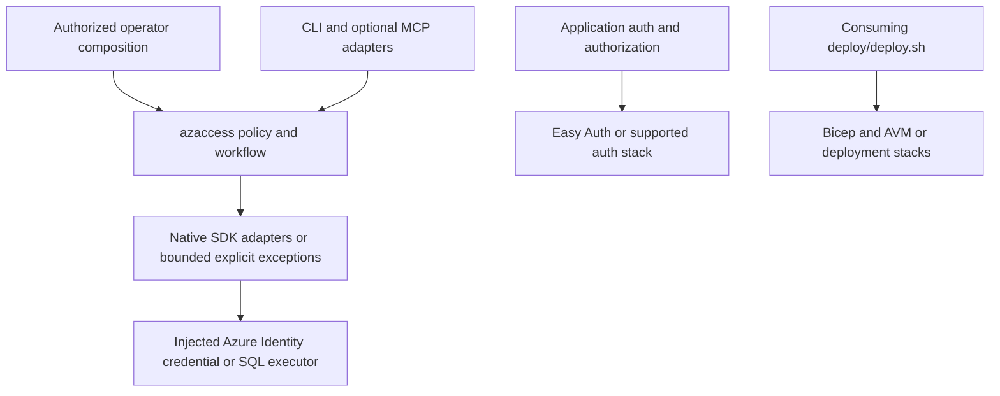

# Azure Access Management

**Approved dependency-first plan; first offline increment verified, 2026-09-14.** The
shared uv foundation and test-only Azure RBAC SDK comparison pass. No consolidated
access package, full SDK parity or live behavior is claimed yet. Source/consumer retirement,
authentication changes, cloud operations and package publication remain outside this increment.

The [libraries README](../README.md) owns the approved dependency and release workflow.

**Purpose: review, execute and verify a bounded access change using official Azure
clients. The value is the reusable workflow around the operation, not another way to
call the Azure API.**

**Implementation direction:**

- **Bring in:** Azure Identity and the Azure management/Graph clients as dependencies.
- **Retain:** existing `azaccess` policy checks, reviewed plans, conservative ownership,
  read-back and explicit uncertainty, with their refusal behavior preserved.
- **Add selectively:** SDK adapters, plane-aware inspection, read-only reconciliation
  and operation-prerequisite reports. Only a test-only RBAC adapter exists so far;
  production adapters and the other additions remain proposed.
- **Keep outside:** authentication/session implementations and infrastructure lifecycle.
  Skills compose MSAL, framework validation, Easy Auth, Bicep/AVM and deployment tooling.

The product is one small access-administration library, not an identity library family.
Existing custom implementations remain unchanged until a scoped migration proves a
suitable replacement. Source code remains in the current skill package; the first
comparison reuses that installed owner rather than copying the whole package or its rules.

### Execution Status

| Increment | Current State | Gate |
| --- | --- | --- |
| Shared uv workspace | Verified first increment | Connector lock/sync, 32 contract tests, 1 integration test, wheel/sdist build and isolated wheel import; no connector source changes |
| Azure RBAC SDK comparison | Test-only slice verified | 11 tests pass using SDK 4.0.0 and Azure Core 1.41.0; existing access baseline: 271 checks, 0 failures |
| Canonical access package and consumer migration | Not started | SDK parity, named consumers and independent install checks before retiring source copies |
| Other providers and new gaps | Deferred | Consumer need and separate focused acceptance; no automatic five-plane parity claim |

The [comparison record](tests/comparison/README.md) carries reproducible commands and
limitations. The probe is not a public provider and performs no live Azure requests.

Start the review with [value above the dependencies](#value-above-official-sdks),
[the dependency set](#proposed-dependency-set),
[proposed gaps](#gaps-worth-adding) and [review decisions](#review-decisions).

This narrows the earlier proposal in this document after comparison with Microsoft
documentation. It refines the access proposal in the [library-family design](../DESIGN.md);
it does not change other library work or authorize moving any of the four skills.

## 1. Decision And Intended Outcome

Evaluate these four existing capabilities, without assuming all their code belongs here:

- [entra-api-auth](../../.github/skills/entra-api-auth/SKILL.md), including its embedded
  [browser/session capability](../../.github/skills/entra-api-auth/browser/SKILL.md).
- [azure-access-management](../../.github/skills/azure-access-management/SKILL.md).
- [bicep-managed-identity](../../.github/skills/bicep-managed-identity/SKILL.md).
- [entra-auth-container-apps](../../.github/skills/entra-auth-container-apps/SKILL.md),
  whose contribution is deployment guidance, not a runtime implementation to extract.

The library should own the repeatable access workflow that remains after using native
tools: trusted scope/policy enforcement, reviewed plans, target-bound confirmations,
exact versus inherited comparison, conservative assignment ownership, bounded read-back,
and explicit partial, pending or unknown outcomes.

It should not own another OAuth client, credential chain, JWT cryptography implementation,
generic Graph client, identity-provisioning framework or deployment-state engine.
Use supported platform features and SDKs for those mechanisms. Skills teach the operator
which mechanism to use, what authority is required and how to verify the application.

### Value Above Official SDKs

**Official SDKs implement service operations. This library implements the host's approved
access-change workflow around those operations. Azure remains the permission authority.**
The comparison is about responsibility, not a claim that Azure lacks policy enforcement,
read APIs, long-running-operation support or declarative resource ownership.

The safeguards below already have implementations in the existing
[access contract](../../.github/skills/azure-access-management/CONTRACT.md). They are
**existing source to retain**, not new features invented by this proposal. The existing
source self-test passed 271 checks in the first execution increment. The 11-test SDK
comparison covers only its named subset; production SDK replacement remains unverified.

| User Need | Official Baseline | Our Additional Contract | Observable Acceptance |
| --- | --- | --- | --- |
| Change only the approved target | SDK sends native requests; Azure enforces the credential's permissions | Apply the host's narrower tenant, scope, plane, role-tier and self-grant policy to each operation | A locally disallowed request never reaches the SDK transport, even if the injected operator credential could perform it |
| Execute what was reviewed | Native APIs execute the supplied operation | Frozen declaration/plan identities and target-bound, single-use confirmations where operator policy requires them; recheck policy during apply | Wrong-plan, wrong-target, expired or reused confirmation refuses before mutation |
| Distinguish desired state from merely having access | Native APIs return assignments and their scopes | Compare exact declarations separately from inherited-only, missing and excess assignments | An inherited grant is reported as inherited, not as the requested exact assignment; excess is not automatically deleted |
| Know whether the change actually landed | SDKs expose responses, reads and provider operation status | Bounded read-back of declared assignment state; report partial, pending or unknown evidence without turning it into success | An accepted unresolved create retains its target id; a failed read is unknown, not absent; a mismatched read-back is not success |
| Remove our grant without deleting someone else's | Native delete removes an addressed assignment; IaC tracks resources it owns | Imperative ownership records distinguish created from adopted/unverified grants; delete only created or explicitly authorized exact ids and verify absence | A pre-existing or another writer's assignment survives; unresolved deletion retains cleanup evidence |
| Apply the correct permission mechanism | Separate Azure RBAC, Cosmos, Kusto, Graph and SQL APIs | Preserve native plane semantics behind the access workflow and return evidence identifying the plane and its limits | An ARM assignment is not accepted as proof of a Cosmos SQL, Kusto database, Graph or SQL database permission |

A careful host script could implement these rules too. The package earns its maintenance
cost only when named callers reuse the same tested implementation. Moving files, renaming
methods, adding a universal result wrapper or generating more adapters is not value by
itself. The existing lifecycle example, CLI and fixture MCP adapter are initial consumers
to prove; production adoption, time savings and reduced defect rates are not yet measured.

### Concrete Workflow

Example requirement: give one named workload principal a declared reader role on one
specified resource, then later remove only the assignment this workflow created.
Assumes an operator has separately authorized that target and supplied suitable credentials.

1. The host constructs the bounded policy and explicit declaration; request data cannot
  expand either or supply its own approval.
2. `plan` reads existing state and reports create/noop/refusal and inherited access.
  The operator reviews the effects and supplies required target-bound confirmations.
3. `apply` checks policy and required confirmations, then a thin adapter invokes the
  official SDK. No custom token acquisition, generic HTTP stack or hidden role grant.
4. `verify` reads declared assignment state. The result records what is confirmed and
  what remains pending/unknown; a failed ownership-ledger save retains the known id.
5. A separately authorized `revoke` removes only an eligible exact assignment id and
  verifies its absence. Existing, adopted, unresolved or IaC-owned grants are protected.

Steps 1, 2, 4 and the ownership rule in step 5 are the main reuse value. The SDK owns the
native operation in step 3 and the service calls needed for read-back/deletion. Verifying
an assignment is not proof of data-plane reachability or application authorization; a
separately scoped read-only probe may provide additional, still bounded evidence.

### When Not To Use This Library

- A single operator-reviewed SDK/CLI call is sufficient and nobody needs a reusable
  review, verification or recovery contract. Keep the smaller host procedure.
- Bicep, an Azure deployment stack or another IaC system already owns the resource or
  grant lifecycle. Inspect if needed; do not add a competing writer or cleanup ledger.
- The requirement is browser sign-in, incoming-token validation, user/group lifecycle,
  secret management or general Azure resource provisioning. Use its existing owner.
- The caller expects a complete effective-access decision or a sandbox against code
  holding the same credential. This wrapper provides neither.

Costs to justify: SDK dependency footprint, adapter/version compatibility work, operator
review integration and ownership-evidence handling. If the native-client comparison
shows no meaningful shared rule beyond a short call, remove that proposed abstraction
instead of expanding the package to justify it.

### What Microsoft Already Provides

These official pages were retrieved and read on 2026-09-14. The last column is the design
conclusion, not a claim that Microsoft endorses this package or that a replacement was tested.

| Need | Official Source And Existing Capability | Consequence For This Proposal |
| --- | --- | --- |
| Sign-in and client token handling | [MSAL overview](https://learn.microsoft.com/en-us/entra/msal/overview): token acquisition, caching, refresh and OAuth protocol handling | Use MSAL for a matching client flow; do not promote custom PKCE/session plumbing by default |
| Python authorization-code flow | [MSAL Python token acquisition](https://learn.microsoft.com/en-us/entra/msal/python/getting-started/acquiring-tokens): flow initiation and code redemption | Prefer its supported flow APIs; redirect type, token-cache storage and web-session security still need host integration |
| Workload credentials | [Azure Identity for Python](https://learn.microsoft.com/en-us/python/api/overview/azure/identity-readme?view=azure-python): `TokenCredential`, managed identity and token caching | Inject an explicitly selected supported credential; do not implement token acquisition/refresh here |
| Incoming API tokens | [Microsoft identity platform access tokens](https://learn.microsoft.com/en-us/entra/identity-platform/access-tokens): the resource API validates tokens intended for its audience | MSAL token acquisition and Azure Identity are not an incoming-token validation replacement; prefer platform/framework validation or a maintained JWT/OIDC library |
| Container Apps sign-in | [Container Apps authentication](https://learn.microsoft.com/en-us/azure/container-apps/authentication): platform-side authentication, sessions and identity headers | Prefer Easy Auth where it fits; retain host authorization and deployment refusal tests instead of creating an Easy Auth wrapper |
| Azure RBAC operations | [Authorization SDK for Python](https://learn.microsoft.com/en-us/python/api/overview/azure/mgmt-authorization-readme?view=azure-python) and [role-assignment REST API](https://learn.microsoft.com/en-us/rest/api/authorization/role-assignments?view=rest-authorization-2022-04-01): native assignment operations | Reuse SDK operations; retain only the policy, review, ownership and verification behavior required above them |
| Directory API plumbing | [Microsoft Graph SDKs](https://learn.microsoft.com/en-us/graph/sdks/sdks-overview): generated models/builders, authentication integration, retry and paging; Kiota is an option for a smaller client | Compare supported Graph clients before preserving a private general-purpose transport; inspect redirect/retry behavior against this contract |
| Declarative role grants | [Bicep RBAC guidance](https://learn.microsoft.com/en-us/azure/azure-resource-manager/bicep/scenarios-rbac): resource scope, deterministic assignment names and principal type | These are established Azure practices, not a proprietary reason to create another library |
| Managed identity resources | [User-assigned identity reference](https://learn.microsoft.com/en-us/azure/templates/microsoft.managedidentity/userassignedidentities): links the Azure Verified Module for this resource | Prefer a pinned Azure Verified Module when its contract fits; keep project-specific grant composition in deployment code |
| Declarative resource lifecycle | [Deployment stacks](https://learn.microsoft.com/en-us/azure/azure-resource-manager/bicep/deployment-stacks): tracks managed resources and their update, detach or deletion lifecycle | Prefer native IaC ownership for resources it manages; do not add a competing cleanup ledger for the same resources |

MSAL does not remove the need for server-side access-token validation, application
authorization, secure cookies or safe token-cache persistence. Easy Auth is a hosting
choice, not a portable runtime package. A Bicep module for an identity does not prove
parity with our complete grant composition. These distinctions prevent replacing one
custom abstraction with a mismatched dependency.

### Proposed Dependency Set

The following remain proposed published extras. The RBAC SDK and Azure Core are installed
only in the comparison development group, not a new access runtime package. Keep the
policy/value core standard-library-only where its imports permit.
Expose implemented provider adapters through optional extras, not a default install of
every SDK. An extra is advertised only once its adapter and offline checks exist.

| Distribution | Proposed Extra | Responsibility And Source |
| --- | --- | --- |
| `azure-identity` | `identity` | Host-selected credentials and token caching; [Azure Identity](https://learn.microsoft.com/en-us/python/api/overview/azure/identity-readme?view=azure-python) |
| `azure-mgmt-authorization` | `rbac` | Native Azure RBAC assignments; [Authorization SDK](https://learn.microsoft.com/en-us/python/api/overview/azure/mgmt-authorization-readme?view=azure-python) |
| `azure-mgmt-cosmosdb` | `cosmos` | Native Cosmos NoSQL SQL role assignments; [Cosmos management SDK](https://learn.microsoft.com/en-us/python/api/overview/azure/mgmt-cosmosdb-readme?view=azure-python) |
| `azure-mgmt-kusto` | `kusto` | ADX database principal assignments; [Kusto management SDK](https://learn.microsoft.com/en-us/python/api/overview/azure/mgmt-kusto-readme?view=azure-python) |
| `msgraph-sdk` | `graph` | Native Graph app-role clients; [Graph SDK guidance](https://learn.microsoft.com/en-us/graph/sdks/sdks-overview). Compare its async interface with the existing synchronous contract before adoption |

- Preserve credential injection: a host with a compatible credential need not select the
  `identity` convenience extra. The existing skill package's `live` extra remains a
  compatibility decision, not an alias silently removed during extraction.
- The comparator directly imports `azure-core`, so the development group declares it
  explicitly alongside `azure-mgmt-authorization`. Future adapters must likewise declare
  directly used SDK support libraries in the appropriate runtime extra.
- Retain `mcp` and `pydantic` in an optional `mcp` adapter extra when required by actual
  imports. These are adapter dependencies, not Azure provider or policy-core dependencies.
- SQL keeps the injected executor contract. Selecting a database driver is host-owned;
  an OS-level Microsoft ODBC driver is not installed by uv or bundled into this library.
- MSAL (`msal` for Python), any JWT/framework integration and session storage belong to
  their consuming auth project. Easy Auth, Azure CLI, Bicep and AVM are platform/tooling
  choices, not Python dependencies of `azaccess`.
- Declare tested minimum versions and meaningful compatibility limits in each package's
  metadata. Resolve exact versions in the development lockfile; do not copy every locked
  transitive pin into published runtime requirements. SDK `4.0.0` and Azure Core `1.41.0`
  are observed comparison versions, not a tested lower-bound or future compatibility range.

The [approved library workflow](../README.md) defines the uv workspace, lock ownership
and independent release checks. SDK versions are selected only for the first comparison;
installing dependencies alone does not make the proposed adapters available.

### The Remaining Library Case

Keep a capability here only when a named consumer needs an executable rule beyond calling
the native API. The initial candidates are the access lifecycle example and the existing
CLI/MCP callers. Do not claim broader application adoption before inventorying it.

The first falsifiable claim: those callers can share a policy-enforcing `azaccess` package,
preserving their positive/refusal results, while native clients handle compatible provider
operations. If the required workflow is adequately expressed by an existing SDK or
deployment stack plus a short host-owned call, do not build an extra facade for it.

The review establishes overlapping native capabilities, not an exhaustive search proving
that no other product implements the residual workflow. The first offline SDK slice now
passes; canonical access-package installation and live Azure parity remain untested.
Library import grants no authority.

## 2. Ownership And Reuse Decisions

| Existing Surface | Revised Decision | Library Versus Skill Boundary |
| --- | --- | --- |
| `azaccess` policy, planning, reports, ownership and verification | Candidate canonical implementation under this directory | Library executes shared rules; skill chooses targets, reviews plans and obtains operator authority |
| `azaccess` provider operations and transport | Reuse supported Azure/Graph SDKs where their observable behavior satisfies the contract | Thin semantic adapters may remain; no SDK replacement or automatic broad rewrite |
| Strict `entra_auth` and legacy `entraauth` | Keep existing consumers intact; neither moves into this library by default | `entra-api-auth` becomes integration guidance around a suitable platform/framework/MSAL/JWT stack; separately justify any reusable host adapter |
| Bicep identity modules and scripts | Compare with pinned Azure Verified Modules and native deployment lifecycle tooling | `bicep-managed-identity` remains a skill; host `deploy/` owns composition and targets, not this Python package |
| Container Apps sign-in instructions | Keep the operational skill/reference | Compose Easy Auth and host authorization; no new runtime library |
| Application ownership, sessions and principal mapping | Keep application-owned | Generic code qualifies for separate extraction only after a named shared requirement and native-alternative comparison |

Being a skill does not mean copying runtime code into every application. Skills should
reference installed, maintained dependencies. Nor does it authorize deleting existing
helpers: both authentication APIs have distinct behavior and require explicit consumer
migration. The inventory below records those differences without promoting them into
the access library's future surface.

## 3. Proposed Structure

This directory contains the design and [test-only comparison](tests/comparison/README.md).
The following runtime tree remains a target, not an existing access package or a request
to create empty directories and wrappers. No runtime source has migrated yet.

```text
libraries/azure-access-management/
  README.md                          design, source comparison and adoption status
  CONTRACT.md                        access workflow and authority guarantees
  pyproject.toml                     optional provider dependencies
  src/azaccess/
    __init__.py                      existing public API, unless explicitly versioned
    cli.py                           operator adapter over the same workflow
    authorization.py                 policy bounds and confirmations
    identity.py                      principal coordinates, not identity creation
    scopes.py
    roles.py
    model.py                         declarations, plans and honest result states
    planner.py
    engine.py                        reviewed apply/verify/revoke workflow
    ledger.py                        imperative assignment evidence, not IaC state
    probe.py
    matrix.py
    providers/                       thin native-plane/SDK adapters where justified
  tests/                             existing suites and named consumer checks
  examples/                          synthetic reviewed-access workflows
```

Existing internal modules not expanded in this sketch remain under their current owner
until a named migration decides their treatment; the tree is not a deletion manifest.
Retain useful source organization and tests. A native-client replacement must name the
old implementation it supersedes and pass its relevant tests first.

No `authentication/`, identity-infrastructure bundle or legacy-auth compatibility package
is proposed here. Keep the existing `azaccess` import name. Distribution name/version
decisions and external consumer compatibility precede publication; no name is reserved
by this proposal. Deployment definitions stay under the consuming project's `deploy/`.

## 4. Public Contracts And Dependency Direction

| Proposed Library Surface | Public Interaction | Boundary |
| --- | --- | --- |
| Access administration | `AccessManager(providers, policy=...)` | Existing synchronous, operation-specific plans/reports; trusted host constructs authority |
| Review and approval | `plan`, `diff`, `confirm` and their existing values | Describe/review effects; local confirmation is not an Azure permission grant |
| Verified mutation | `apply`, `verify`, `revoke` | Policy-bounded native operations and conservative ownership/read-back |
| Diagnostics | `inspect`, `AccessProbe`, role/scope values and support matrix | Bounded observations; incomplete evidence remains incomplete |
| CLI/MCP consumers | Existing commands and tool names | Call the same library; no request-supplied authority or new mutation tools |



- No access-library dependency on request authentication, sessions or infrastructure.
  An operator can hold an authorized credential without hosting a web API.
- Libraries never import `.github/skills`, `template_apps` or a consuming composition root.
- Configuration and credentials enter through explicit construction, not deep environment
  discovery. Provider SDK use must retain endpoint, scope, retry and evidence bounds.
- No new dependency on the separately owned data-connector library is required. Hosts
  inject credentials into consumers; a data query must not acquire permission to grant itself access.
- The local policy layer is not a process sandbox or an alternative to Azure/Entra
  enforcement. Code holding the credential can bypass a wrapper; host isolation and
  least-privilege credentials still determine the real authority boundary.

No architecture overview or root architecture manifest was found during this review.
These edges are proposed, not a graph currently enforced by a repository checker.

## 5. Authentication Inventory, Outside This Library

Inventory evidence comes from the existing
[API contract](../../.github/skills/entra-api-auth/CONTRACT.md),
[API exports](../../.github/skills/entra-api-auth/entraauth/__init__.py), and
[strict browser/session contract](../../.github/skills/entra-api-auth/browser/python/entra_auth/README.md).
Features below describe those source contracts; no runtime suite was rerun to prepare this design.

This is a compatibility inventory, not an extraction commitment. Prefer Easy Auth or
supported framework validation when suitable, MSAL for token acquisition, and maintained
JWT/OIDC dependencies when the API itself validates incoming tokens. A separate shared
adapter is justified only by a demonstrated host requirement that those tools do not
already satisfy. Do not retire existing authentication code on documentation evidence alone.

### Strict Authentication And Browser Sessions

| Capability                   | Features To Preserve                                                                                                                 | Limit Or Host Responsibility                                                                               |
| ---------------------------- | ------------------------------------------------------------------------------------------------------------------------------------ | ---------------------------------------------------------------------------------------------------------- |
| Trust configuration          | Frozen`EntraAuthConfig`; explicit tenant, audience, claim rules and cache intervals; invalid configuration refuses                 | Single tenant; no`common`, `organizations`, `consumers` or disabled mode                             |
| Bearer extraction            | Case-insensitive header lookup and explicit malformed/missing-token refusal                                                          | HTTP routing remains outside the core                                                                      |
| JWT verification             | Token-size bound; RS256 allowlist; signature, audience, expiry and not-before checks                                                 | No token issuance, alternate issuer discovery from a request or algorithm negotiation                      |
| Tenant and claim validation  | Exact tenant v1/v2 issuers; key-issuer cross-check;`tid`; required `oid`, `tid`, `exp`, `iat`; future-issued-token refusal | Host chooses its approved tenant and audience                                                              |
| Caller kind and permissions  | User/service-principal distinction; configured scope requirements; service-principal opt-in and required roles                       | Token validity and an accepted role do not establish record ownership or administrative authority          |
| Verified output              | `VerifiedToken` carries neutral verified claims                                                                                    | Host maps claims into its own stable, tenant-aware identity and owner keys                                 |
| Signing-key management       | `JWKSCache`, RSA key reconstruction, refresh policy and injected fetcher; bounded stale-key use                                    | Stale keys fail closed after the configured maximum; provider outage is not proof of an invalid credential |
| Failure handling             | Typed`AuthError`, fixed public messages and bounded diagnostic context                                                             | Raw tokens and token-derived values must not leak through error messages or logs                           |
| Sign-in flow construction    | `SignInFlow`, `new_flow`, server-generated state, nonce and PKCE verifier; authorize/logout URL builders                         | Helpers perform no HTTP or persistence; host verifies the callback and controls one-time verifier release  |
| Session identifiers          | Opaque session-id generation, lookup digests and constant-time comparison helpers                                                    | Cookie flags, CSRF defenses, session ceiling and principal mapping remain host-owned                       |
| Expiring stores              | `RecordStore`, in-process and optional Azure Table implementations; unavailable-store signal                                       | Expiry enforced on read; purge is separate housekeeping, not server-side Table TTL                         |
| Testability and dependencies | Injected signing keys/stores; no web-framework dependency; Azure SDK loaded only for the configured optional store                   | Existing Table tests use a fake, not a live account                                                        |

The browser helpers do not redeem authorization codes or handle refresh tokens. Redirect
platform, code exchange and session-expiry enforcement must be implemented by the host.
The current browser integration describes SPA-platform redemption in the callback page;
do not present it as a generic server-side OAuth client. Sessions must not outlive the
validated access token or the host's configured ceiling.

### Legacy API Compatibility

The existing `entraauth` contract also supplies:

- `AuthConfig`, multiple accepted audiences, tenant-specific and `common` issuer handling.
- `TokenValidator`, `JWKSCache`, scheduled refresh, single-flight fetch and rotation cooldown.
- `Principal`, verified-claim mapping, user/service kind and `kind_certain` distinction.
- `OwnershipPolicy`: own-record read/write, shared read-only records, optional unowned
  reads, and deliberate 404-versus-403 behavior.
- Optional FastAPI installation, exception handlers, principal dependency, scope/role
  guards and a public sign-in configuration endpoint.
- A trusted ASGI-scope principal handoff for an independently verified caller path.
- Token diagnostics and offline adversarial cases using injected keys.
- An existing disabled development mode with developer identity headers. This is a legacy
  behavior to isolate, never the recommended runtime mode or evidence of secure deployment.

### Compatibility Decisions That Cannot Be Hidden By A Move

| Concern                           | Legacy`entraauth`                   | Strict`entra_auth`                      | Proposed Treatment                                                                     |
| --------------------------------- | ------------------------------------- | ----------------------------------------- | -------------------------------------------------------------------------------------- |
| Authentication result             | Application-oriented`Principal`     | Neutral`VerifiedToken`                  | Explicit host mapping; no silent return-type substitution                              |
| Tenancy                           | Includes`common` mode               | Single tenant only                        | Migration requires an approved trust-policy choice                                     |
| Disabled auth                     | Existing development branch           | No such branch                            | Strict default for new hosts; deployed legacy hosts must require enabled configuration |
| Required claims and caller policy | Legacy defaults and kind inference    | Stricter tenant/time/scope/service checks | Positive and refusal parity evaluated per consumer, not assumed                        |
| Stale signing keys                | Warm-cache fallback                   | Explicit maximum stale age                | Preserve documented differences until a deliberate policy change                       |
| Record policy and routes          | Generic ownership and FastAPI helpers | Host-owned                                | Retain public helpers where needed; application rules remain application-owned         |

Do not stack validators on one request or implement a universal policy switchboard.
Reuse compatible internal mechanisms only after their accepted/rejected input sets and
failure semantics are compared. A legacy adapter may delegate where behavior matches;
it may not recreate unsafe modes inside the strict core to make migration appear complete.

## 6. Access-Administration Capability Inventory

Reuse [the existing `azaccess` contract](../../.github/skills/azure-access-management/CONTRACT.md)
and [public exports](../../.github/skills/azure-access-management/azaccess/__init__.py).
The six workflow verbs remain `inspect`, `plan`, `diff`, `apply`, `verify`, and `revoke`;
`confirm`, `verify_one` and `adopt_from_ledger` remain supporting operations.

This inventory separates behavior to retain from implementation to replace. Scope and
approval checks, result semantics and conservative ownership remain library candidates.
Token acquisition, generated request models, ordinary CRUD and transport plumbing should
use native clients when the tests establish equivalent observable behavior. A frozen
interface is not an obligation to preserve every private HTTP implementation.

SDK comparison must check more than a successful call: target validation before credential
use, redirects, retry safety, time/paging bounds, exact status and assignment-id evidence,
long-running operations, and injected test transports. Native retries must not silently
turn an uncertain mutation into a duplicate. The 11-test comparator covers a bounded
subset; the remaining gates are named in its record before any production promotion.

### Values, Authority And Execution

| Capability                    | Features To Preserve                                                                                                                                              |
| ----------------------------- | ----------------------------------------------------------------------------------------------------------------------------------------------------------------- |
| Identity coordinates          | Typed principal kind, object id, tenant id, client id and resource id; reject malformed/confused coordinates and non-assignable application objects               |
| Scope model                   | Structural validation, exact matching, segment-safe containment and derivable ancestors; no guessed management-group ancestry                                     |
| Role catalogue                | Plane, service, tier and explicit custom-role registration; cataloguing an administrative role does not authorize granting it                                     |
| Access declarations           | Frozen target values, role/condition identity, target fingerprints and effect-based plan digests                                                                  |
| Operator authority            | Read-only default; tenant/scope/plane bounds; role-tier limits, explicit exceptions and self-grant refusal; requests cannot carry their own authorization         |
| Confirmations                 | Opaque, expiring, single-use tokens bound to plan and target; invalid presentation cannot consume a valid token for another target                                |
| Inspection                    | Exact and inherited assignments separated;`partial` or `unknown` completeness with named unevaluated semantics                                                |
| Planning                      | Ordered create/noop/revoke steps; visible refusals; inherited access is not an exact desired-state match                                                          |
| Difference reporting          | Satisfied, inherited-only, missing and excess assignments; excess is reported, not automatically removed                                                          |
| Apply                         | Recheck policy; consume confirmations where required; provider write and bounded exact read-back; aggregate refusals retained                                     |
| Unresolved writes             | Pending target ids retained for accepted but unresolved operations; no claim of success based on an accepted response                                             |
| Verification                  | Present, absent, revert-suspected and unknown results; bounded waits and duplicate reporting                                                                      |
| Revocation                    | Delete only exact owned or explicitly authorized assignment ids; preserve another writer's grant; verify that exact id is gone                                    |
| Ownership evidence            | Optional atomic, content-addressed ledger; adopted/pending/rehydrated records do not grant delete authority                                                       |
| Persistence failure reporting | A failed ledger write after successful creation returns the created id and a non-success report; failed deletion/read-back retains recovery evidence              |
| Diagnostics                   | Read-only`AccessProbe` distinguishes authentication, authorization, hidden/not-found and service failures without returning data-plane bodies                   |
| Transport                     | Recording transport; read-only Azure CLI transport; injected token-credential HTTP transport with exact status/header handling                                    |
| Network and output bounds     | Cloud/audience allowlists before credential acquisition; redirect refusal; bounded same-origin pagination; malformed response refusal and sanitized error details |
| Cloud configuration           | Public, US Government, China or host-constructed endpoint sets; no automatic cloud/tenant switching                                                               |
| Support reporting             | Matrix derived from adapter declarations; implemented, delegated, documented and unsupported are distinct claims, none implying live verification                 |

`AzureCliTransport` permits only GET/HEAD because it cannot report exact HTTP statuses
and headers needed for mutation ownership. Preserve this limit; do not add a shell-based
write fallback. SQL execution is separately injected, not tunneled through HTTP.

`AccessManager` remains synchronous during extraction. Do not wrap it with hidden
`asyncio.run()` or claim its SDK/transport calls are non-blocking. An async facade would
be a separate requirement and compatibility decision.

### Gaps Worth Adding

These are **proposed changes beyond the retained safeguards**. A test-only SDK probe is
implemented; the production additions are not a commitment to ship every row. Select a
gap only for a named caller and keep its
evidence separate from the migration of existing behavior.

| Candidate | Existing Baseline | Proposed Addition | Check That Establishes Value |
| --- | --- | --- | --- |
| SDK-backed provider adapters | Current providers use the existing transport/executor contracts | Delegate compatible native operations to the official clients while preserving the public workflow and safety bounds | Existing success/refusal and uncertain-write cases behave equivalently over an injected SDK transport; no parallel maintained HTTP implementation for the migrated operation |
| Plane-aware inspection | [Current `inspect`](../../.github/skills/azure-access-management/azaccess/engine.py#L146) selects Azure RBAC; other providers have declaration-specific reads | Accept explicit provider-native target coordinates and return a separate bounded observation for each requested, implemented plane | A native assignment outside Azure RBAC appears in its own result; forbidden/unreachable planes remain unknown/refused rather than an empty complete answer |
| Read-only pending reconciliation | Apply reports retain pending target ids and ledgers can be reloaded as unverified evidence | Re-read recorded exact targets and available provider operation status after interruption; report present/absent/pending/unknown without replaying the mutation | A recorded uncertain create is inspected without another create; reloaded evidence never becomes deletion authority solely because the id is present |
| Machine-readable prerequisites | Local authority policy and written operator requirements exist | Describe the operation's required audience, permission plane and operator permissions, with documented requirements separated from any observed evidence | A caller can distinguish required configuration from verified access and unknown prerequisites; reporting cannot log in, request consent, activate PIM or grant access |

Plane-aware inspection must not silently widen the existing MCP tool's Azure-RBAC-only
contract. New methods, input/result shapes and persisted reconciliation records require
their own API review; no speculative signatures or unimplemented extras are exported.
Prerequisite reporting cannot prove that Azure Policy, a deny assignment, an ABAC condition
or a later state change will permit the operation.

First increment: only the Azure RBAC SDK adapter with existing behavior and a named
consumer check. The Graph client's async fit, optional dependency versions and every other
plane's native semantics remain explicit follow-up decisions, not hidden compatibility code.

### Native Assignment Planes

The following is the current source-defined support, not a new live coverage claim.

| Plane / Provider                               | Callable Capability                                                                                                                              | Important Limits                                                                                                                         |
| ---------------------------------------------- | ------------------------------------------------------------------------------------------------------------------------------------------------ | ---------------------------------------------------------------------------------------------------------------------------------------- |
| Azure RBAC /`ArmRbacProvider`                | List/match, create/adopt, delete; explicit principal type; condition/version handling; read-only deny-assignment listing                         | Exact scope rechecked even when listings include inheritance; deny creation unsupported; conditions not evaluated                        |
| Cosmos DB NoSQL /`CosmosSqlRbacProvider`     | Native SQL role assignments, account/database/container scope coordinates, adoption/duplicate checks and bounded long-running-operation handling | Not ordinary ARM RBAC; read-before-create is not atomic uniqueness; no automatic duplicate deletion                                      |
| Azure Data Explorer /`KustoDatabaseProvider` | Database principal assignments, native role and principal-type translation, bounded long-running-operation handling                              | Cluster-scoped grants remain documented, not implemented                                                                                 |
| Azure SQL /`SqlDatabaseUserProvider`         | External-provider user and object permission statements; exact object-level read-back; adoption and owned-prefix deletion guard                  | Host supplies SQL executor; supported permissions are SELECT/INSERT/UPDATE/DELETE; database/column/DENY state is not an equivalent match |
| Microsoft Graph /`GraphAppRoleProvider`      | Service-principal app-role assignments through the same lifecycle; validated principal/resource/app-role ids                                     | Graph audience required by default; no application/group/user object lifecycle or automatic admin consent                                |

### Additional Builders And Procedures

| Capability                                                    | Current Status                                                      | Consolidation Treatment                                                         |
| ------------------------------------------------------------- | ------------------------------------------------------------------- | ------------------------------------------------------------------------------- |
| ABAC container-name and blob-tag conditions                   | Validated builders; condition version and textual identity compared | Library owns construction/refusal; Azure owns evaluation                        |
| Workload identity federation                                  | Validated federated-credential request body builder                 | Preserve as a builder; it does not create an application or execute the request |
| Group membership add/remove                                   | Validated request builders; execution delegated                     | Preserve`/$ref` removal safeguard; no hidden Graph mutation                   |
| SQL quoting and statement construction                        | Validated identifiers/literals and permission statements            | Keep with the native SQL provider and injected executor                         |
| PIM eligibility and activation                                | Documented procedures                                               | Keep skill guidance; eligibility is not current access                          |
| Transitive group membership and PIM for Groups                | Documented, not resolved by inspection                              | Keep limitations visible in every effective-access answer                       |
| Directory role assignment, admin consent and delegated scopes | Documented procedures                                               | Separate directory authority and human decision; no automated consent claim     |
| Custom ARM/Cosmos role definitions                            | Procedures; custom-role catalogue registration exists               | Registration of metadata is not deployment of a role definition                 |
| SQL server Entra administrator and Kusto cluster grants       | Documented procedures                                               | Explicit prerequisites/wider-scope operations, not delivered adapters           |
| General directory object creation/deletion                    | Unsupported in access administration                                | Outside this library's proposed initial scope                                   |

Effective-access inspection must continue naming unevaluated PIM eligibility, deny
semantics, transitive membership, ABAC evaluation, management-group ancestry and Entra
directory roles. Listing a deny assignment is not evaluating its effect. An unavailable
read is `unknown`, never proof that an assignment is absent.

### CLI And MCP

- Preserve the existing Python CLI for offline catalogue commands and reviewed live
  lifecycle workflows. Live mutation keeps explicit policy, plan-digest and target checks.
- Preserve the five existing MCP tools: `azaccess_status`, `azaccess_matrix`,
  `azaccess_role`, `azaccess_scope`, and `azaccess_inspect`.
- MCP inspection remains Azure RBAC only, behind operator-configured live-read and scope
  bounds. A five-plane matrix does not mean five-plane MCP inspection.
- No MCP apply, confirmation, revoke, membership or resource-lifecycle tools are proposed.
- Keep the MCP dependency optional and the adapter thin. Library-backed skill packaging
  must not add writable authority or make fixture results appear live.

## 7. Infrastructure Inventory, Outside This Library

Source authority: [Bicep contract](../../.github/skills/bicep-managed-identity/CONTRACT.md)
and [current deployment composition](../../.github/skills/bicep-managed-identity/bicep/main.bicep).

These are current requirements to compare against native Bicep, a pinned Azure Verified
Module and deployment stacks. They are not a proposed infrastructure distribution inside
`azaccess`. The skill remains responsible for selecting and integrating the appropriate
mechanism; the consuming deployment owns targets, parameters and deployment authority.

| Capability              | Features To Preserve                                                                                                                                       | Boundary                                                                           |
| ----------------------- | ---------------------------------------------------------------------------------------------------------------------------------------------------------- | ---------------------------------------------------------------------------------- |
| User-assigned identity  | Declarative resource creation and resource/principal/client id outputs                                                                                     | This creates a workload identity, not an authenticated human caller                |
| Scoped grants           | Deterministic`guid(scope, principal, role)` names, explicit principal type and written purpose                                                           | Resource-scoped modules; no subscription-wide or cross-subscription grant promise  |
| Typed targets           | One Bicep module per target resource type; correct cross-resource-group module scope                                                                       | Similar-looking modules may be required by Bicep's resource typing                 |
| Current composition     | Optional Search management/data grants and AI account access; optional Search-service identity access for vectorization                                    | The Search service and application workload are different principals               |
| Role definitions        | Named audit/review catalogue covering management, Search, AI, storage, Key Vault, Cosmos account read and monitoring roles                                 | A catalogue entry does not imply a shipped target module or permission to grant it |
| Template safety         | No secret-reading functions/outputs or hardcoded tenant/subscription; main template does not grant Owner, User Access Administrator or generic Contributor | Named service Contributor roles are distinct from generic Contributor              |
| Generated artifact      | Committed compiled template with source/render comparison                                                                                                  | Generated copy is not an independently edited implementation                       |
| Deployment integration  | Parameterized preview/deployment helper invoked by the project's`deploy/deploy.sh`                                                                       | No second operator entry point and no automatic deployment during installation     |
| Permission verification | Declared-versus-held comparison both directions; strict excess reporting; Owner/UAA failure                                                                | Live read-back required to prove deployment and detect reverted settings           |
| Teardown guidance       | Remove explicitly owned grants before the identity; retain cleanup coordinates                                                                             | Removing a deployment record does not remove resources                             |

Bicep-managed grants and `azaccess`-managed grants must have one declared writer. Inspection
may observe either. Administration must not recreate or revoke a Bicep-owned assignment
without an explicit ownership handoff and exact-id authorization.

Their naming strategies are intentionally different: Bicep uses deterministic names for
declarative idempotence; `azaccess` records service-returned or exact-target-confirmed ids
for imperative ownership. Do not standardize these names and infer ownership from them.

Deployment stacks already offer managed-resource lifecycle and delete/detach choices.
Check the resource types, ownership transitions and current stack limitations before use;
this review did not establish stack coverage of every permission plane. In particular,
SQL users and Graph assignments are not automatically governed by an ARM resource stack.
For a resource already owned by a stack or another IaC state, that state is the lifecycle
owner; the access library can inspect it but must not become a competing writer.

Do not create a new cross-package role registry just to reduce two tables. Prefer Azure's
built-in role definitions; retain explicit local policy classifications where a consumer
needs them. Whether the infrastructure verifier can reuse the access library's exact-scope
comparison remains a bounded compatibility question, not a dependency required now.

## 8. Container Apps Sign-In Remains A Skill

The [current skill](../../.github/skills/entra-auth-container-apps/SKILL.md) owns these procedures:

- Choose platform `RequireAuthentication`, or explicitly authorized application enforcement
  when a custom signed caller path must reach the container.
- Keep ingress closed during setup; configure and test the gate before exposure.
- Register the application with the correct tenant, FQDN, web redirect URI and ID-token
  issuance. Registration restrictions require an authorized operator, not another tenant.
- Configure a Key Vault credential reference and the identity allowed to resolve it;
  creation/rotation remain operator-owned, with no secret value in a script or log.
- Pin the tenant issuer and configure EasyAuth. Platform identity headers are trusted
  only after forged-header rejection and absence of a direct-origin bypass are proven.
- Apply the host's authorization decision after authentication; provide browser redirect
  versus API refusal and private/no-store response behavior.
- Preserve platform login/logout/me behavior and verify sign-in, sign-out and cache effects.
- Test anonymous API/browser requests, forged headers, direct assets and unknown paths;
  test expired tokens and any authorized signature path's tamper/expiry/replay refusals.
- Diagnose redirect mismatches, consent, credential-reference failures, auth-sidecar
  transitions and conditional-access restrictions without disabling authentication.

No generic EasyAuth Python wrapper is justified by this guidance alone. A custom signed
path remains an integration with the separately owned signed-access capability, not a
new verifier in this library. Its replay storage and proxy-byte preservation require
their own positive and negative checks when used.

Headless access alone does not require allowing unauthenticated traffic. The official
Container Apps documentation includes provider-SDK/client-directed authentication.
Distinguish a supported provider token from a custom application-verified signature; only
the latter creates the specific platform-gate compatibility question. Never relax the
gate merely because the caller is an agent.

## 9. Security And Authorization Invariants

1. **Three identities remain distinct:** authenticated caller, administrative operator,
   and deployed workload. A workload managed identity authenticates no human user.
2. **Authentication is not authorization.** Verified claims do not grant access to a
   record, an administrative operation, a tenant or a deployment target.
3. **Authority enters from a trusted host.** Requests cannot supply credentials, widen
   scope, approve their own plans, disable auth or enable additional caller paths.
4. **Refusal precedes side effects.** Scope, audience, operation and policy checks happen
   before credential acquisition or mutation where the corresponding contract requires it.
5. **Read-back proves state, not intent.** Accepted writes, inherited grants and readable
   ledger files do not establish exact desired state or permission to delete.
6. **One owner per grant and implementation.** Generated artifacts are labelled; an
   ownership ledger is evidence, never independent authorization.
7. **Secrets stay out of artifacts and diagnostics.** Inject credentials; use runtime
   Key Vault references for required third-party/client secrets; preserve token redaction.
8. **No automatic migration of stored identity data.** Owner keys, session records,
   assignment ids and ownership ledgers need explicit compatibility evidence.

## 10. Skill And Distribution Design

| Entry | Revised Role | Runtime Dependency Decision |
| --- | --- | --- |
| `entra-api-auth`, with embedded browser entry | Choose platform/framework validation and client sign-in flow; integrate host authorization; verify refusals | Prefer supported auth libraries; retain existing helpers until consumer-specific replacements pass, outside this access package |
| `azure-access-management` | Permission-plane selection, approved targets, plan review, diagnosis and cleanup procedure | Thin CLI/MCP callers use the proposed policy/workflow library; SDKs perform compatible native operations |
| `bicep-managed-identity` | Select scoped grants, preview, deploy, read back and tear down through the host entry point | Prefer Bicep/AVM and appropriate native lifecycle tooling; compare existing modules before replacing them |
| `entra-auth-container-apps` | Configure Easy Auth and explicit application authorization; verify the running boundary | No new runtime package; possible focused deployment-skill branch after discovery checks |
| `azure-cli-infra-management` | Inspect/create/retire explicitly owned Azure resources through the host deployment entry point | Existing resource-lifecycle skill; no RBAC grant authority or resource provisioning added to the access library |

Do not replace these task entry points with one large mandatory skill. The family design
already proposes the Container Apps deployment branch; this README does not approve
deleting or renaming the existing entry. Preserve historical discovery terms and exact
procedure references before any routing change.

Packaging requirements:

- Local consumers use declared editable dependencies; release consumers install versioned
  artifacts built from canonical source. No `sys.path` manipulation or template imports.
- Preserve existing public names, error meanings, CLI flags and MCP schemas until an
  explicitly versioned change is approved. Preserve license/provenance records.
- This access package must not install JWT, FastAPI, session-store or Bicep stacks.
  Provider SDKs, credential helpers and MCP dependencies stay explicit and optional where
  their consumers permit; replacing stdlib transport is a dependency decision to measure.
- A package import must not acquire credentials, read project environment files, access
  the network, create stores, register applications or grant permissions.
- Self-contained skill bundles, when required, are generated from pinned library source
  with hashes and dependency/provenance metadata. Never hand-maintain another runtime copy.
- Validate packages and generated bundles outside this checkout, without sibling skills,
  application sources or the developer environment masking missing dependencies.
- Reuse the existing capability catalogue when implementation changes its facts. Record
  owners, exports, real consumers, dependencies, configuration/authority and verification;
  this proposal is not a second authoritative machine registry.

Use the [approved uv workflow](../README.md): explicit workspace members, one coordinated
lock, member-owned optional SDK dependencies and isolated wheel/sdist checks. The workspace
now exists, with the access comparator in a development-only group, not a member. uv is
development/release tooling, not a runtime dependency or a substitute for Azure access
policy. An optional future metapackage composes released distributions without copying code.

## 11. Proposed Adoption Order

The first baseline and bounded comparison have executed. Remaining migration rows are
separately testable work, not permission to retire sources or widen the current scope.

| Candidate | Demonstrable Outcome | Evidence Before Retiring A Source Copy |
| --- | --- | --- |
| Freeze access contracts and real consumers | Known imports, exports, dependency metadata and source baseline | Existing lifecycle example, CLI and fixture MCP checks; record baseline failures honestly |
| Compare one native provider client | The smallest Azure RBAC workflow distinguishes SDK behavior from our additional policy rules | Recorded success/refusal, exact-id, timeout and uncertain-write cases; reject a wrapper with no demonstrated added behavior |
| Establish canonical `azaccess` package | Named consumers use one independently installed artifact | Same outputs/refusals, dependency boundaries and pending/ledger/revoke protection; no skill-path imports |
| Replace further private provider mechanics only where justified | Native clients take over compatible operations without changing the safety contract | Per-provider parity; no broad transport rewrite or unearned five-plane claim |
| Update access skill distribution | Thin instructions/adapters resolve to the canonical package | Isolated package/MCP checks and representative task discovery before retiring entries |

Inspection, reconciliation and prerequisite-reporting additions are separate, optional
increments after baseline parity, each selected by a real consumer need. They must not
be bundled into source relocation or used to conceal a regression in an existing rule.

Authentication and Bicep migration are not batches of this library. Separate authorized
work can compare existing host behavior with Easy Auth/MSAL/framework validation or
AVM/deployment stacks. Preserve existing auth APIs and infrastructure until those checks
pass; no compatibility package or infrastructure bundle is created here to postpone that
decision.

Source migration must update its named consumers in the same verified batch. No open-ended
dual-writing period, unapproved deletion or source copy labelled canonical in two places.
Before replacing a bundled or application copy, inventory modifications and preserve
user-owned work. External consumers without a migration plan block retirement, not design.

## 12. Verification Plan And Current Evidence

**For this document:** source contracts/exports and the official sources in section 1
were reviewed. Microsoft Learn public search and direct documentation retrieval were used;
no ranked general-web provider is configured. This is a targeted native-alternative
comparison, not an exhaustive package-market survey. Retrieved pages were catalogued for
temporary reference; the source URLs and review date above are the durable evidence.

Execution evidence on 2026-09-14: the shared uv foundation, connector contract/integration
suites and artifact smoke check passed; existing access self-test passed 271 checks; the
test-only SDK comparator passed 11 tests. Exact commands and limitations are in the
[libraries workflow](../README.md) and [comparison record](tests/comparison/README.md).
No auth suite, Bicep compilation, live credential check, deployed application workflow or
Azure operation ran in this increment. Documentation checks prove references/consistency,
not the remaining security or provider compatibility requirements.

Existing baseline entry points, from the repository root, to run when the corresponding
work is authorized and documented dependencies are installed. The auth/Bicep checks are
for their own possible migrations, not gates requiring their inclusion in this package:

```bash
python3 .github/skills/azure-access-management/tests/selftest.py
python3 .github/skills/azure-access-management/tests/transport_offline.py
PYTHONPATH=.github/skills/azure-access-management python3 -m azaccess.cli matrix
python3 .github/skills/entra-api-auth/tests/selftest.py
PYTHONPATH=.github/skills/entra-api-auth/browser/python python3 -m pytest .github/skills/entra-api-auth/browser/tests -q -p no:cacheprovider
python3 .github/skills/bicep-managed-identity/tests/selftest.py
```

These are source-baseline commands, not the proposed package installation interface.
Bicep source/render verification requires its documented compiler tooling. Reuse the
existing suites and move their checks with their owners; do not introduce a new framework.

| Risk                                       | Evidence Required For Migration                                                                                                                    |
| ------------------------------------------ | -------------------------------------------------------------------------------------------------------------------------------------------------- |
| Runtime behavior changed during extraction | Existing public API/consumer checks and matching refusals, not just import success                                                                 |
| Native client changes the safety contract | Recorded SDK calls prove pre-credential bounds, retry/paging limits, exact response/id evidence and unresolved mutation handling; no parity assumed from documentation |
| Added inspection overstates coverage | Per-plane observations retain explicit target coordinates and unknown/refused states; unchanged MCP inspection remains Azure RBAC only |
| Recovery replays a mutation or invents ownership | Reconciliation performs reads only and preserves unverified ownership; no automatic recreate or revoke follows a timeout |
| Prerequisites become self-approval | Reports distinguish documented requirements from observed evidence and unknown access; they cannot acquire authority or alter tenant state |
| Auth weakened                              | Valid caller succeeds; forged/expired/wrong-tenant/wrong-audience/missing-claim caller refuses; stale signing keys fail closed under strict policy |
| Ownership changed                          | Own record allowed; another owner's record denied; shared record writes denied; listing filters checked; persisted owner keys preserved            |
| Sign-in/session behavior changed           | Operate the actual host callback and logout; expired/reused flows refused; session lifetime and store outage behavior observed                     |
| Authority widened                          | Read-only, out-of-scope, wrong-tenant, self-grant and invalid-confirmation cases refuse before forbidden transport calls                           |
| Grant cleanup lost                         | Pending ids and ledger failures retained; adopted/rehydrated/unowned records protected; exact-id absence required before cleanup                   |
| Provider behavior flattened                | Existing plane-specific role identity, long-running operation, duplicate, SQL quoting and Graph-audience checks retained                           |
| Infrastructure drifted                     | Template invariants and reproducible source/render comparison; exact live grants read back only under separately authorized deployment             |
| Skill/API distribution broken              | Isolated artifact installation, existing CLI/MCP smoke checks and native task-to-reference discovery                                               |
| Hidden dependencies added                  | Auth-only install/import without administration/Bicep tooling; no skill/template imports, import-time network or credential discovery              |

Existing access-management support statuses describe offline implementations or delegated
builders, not tenant verification. Live permission propagation, policy effects, Graph
consent, EasyAuth behavior and Azure Table persistence remain unverified by this proposal.
Offline authentication fixtures must exercise real validation, not an auth-disabled host.

## 13. Non-Goals And Open Decisions

Not included in the proposed first extraction:

- Authentication/session packages, Bicep infrastructure assets and a legacy-auth compatibility tree.
- Another credential chain, OAuth flow engine, generic Azure/Graph client or IaC state manager.
- General user/group/application/service-principal CRUD, password or certificate lifecycle,
  conditional-access administration, or an Entra identity-governance product.
- A replacement identity provider, token issuer, refresh-token service or universal session server.
- Automatic admin consent, PIM activation, secret discovery, login or access escalation.
- Complete effective-access computation across every Azure/Entra permission system.
- A universal authentication/administration result envelope or new asynchronous access engine.
- Broad data-connector, application, deployment or skill restructuring outside named migrations.

Decisions to resolve before the corresponding implementation batch:

| Decision | Recommended Starting Point | Still Unknown |
| --- | --- | --- |
| Library scope | Policy, reviewed workflow, exact comparison, read-back and imperative ownership | Whether named real consumers need every proposed rule |
| Native provider clients | Azure management SDKs and Graph SDK or generated subset, behind bounded adapters | Exact status/id/retry behavior, dependency cost and parity for each provider |
| Authentication reuse | Skill-led supported-stack integration; current consumers unchanged | Suitable Python/framework adapter and parity with each existing policy/session contract |
| Infrastructure reuse | Pinned AVM/native Bicep and appropriate deployment lifecycle owner | Exact module versions, grant composition and deployment-stack limitations |
| Existing API compatibility | Preserve `azaccess`; version changes deliberately; no auth migration folded in | External imports, serialized records and distribution constraints |
| Skill routing | Keep distinct auth, access and deployment tasks discoverable | Native client discovery and historical-name compatibility |
| Live acceptance | Explicit tenant, target, operator and rollback scope after local checks pass | No live authorization or test environment established for this proposal |

### Review Decisions

The first increment is approved and observed. These questions govern promotion and later
increments, not a retroactive claim that all proposed work or cloud access was authorized.

| Question | Recommended Choice | What Would Change The Choice |
| --- | --- | --- |
| Is the product a reusable access-change workflow or a broad identity framework? | Keep the bounded workflow; auth and infrastructure remain outside | A separately named requirement and owner, not shared terminology |
| Does it justify another package over native SDK calls? | Proceed only if the named callers share the policy/review/evidence behavior in the value table | A short native procedure satisfies the consumers with no duplicated rule |
| What is the first implementation scope? | One SDK-backed Azure RBAC path, preserving existing API/refusals and isolated consumer use | Native SDK limitations or no consumer benefit; stop before expanding to other planes |
| Which new gap is worth paying for first? | Choose inspection, reconciliation or prerequisites only when a caller needs it | Consumer evidence and the corresponding positive/refusal check |
| What remains unproven? | Treat supported version ranges, full SDK parity, Graph async fit, live permission behavior and adoption benefits as unknown | Recorded implementation tests and separately authorized live evidence |

Next: close the comparison's remaining adapter gates, then establish the canonical access
package and migrate named consumers with their tests. Preserve the existing owner until
replacement is verified; do not grow inspection/recovery features during source relocation.
Cloud access and publication still require separately scoped authorization.
