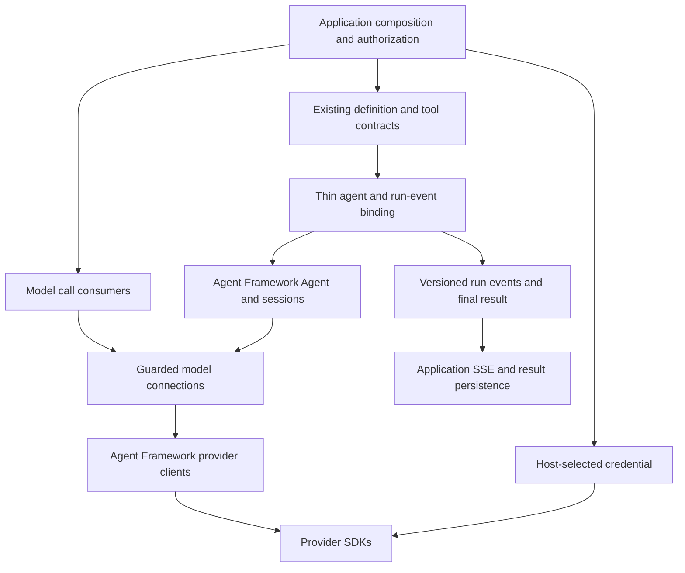

# LLM Interface: End-to-End Design

**Proposed for review, 2026-09-15. No production implementation or migration is claimed.**
The [value analysis](VALUE.md) identifies each responsibility we retain or add. The
[validation record](VALIDATION.md) separates reproduced behavior from acceptance still to run.

## 1. Outcome And Boundary

The primary product is a standardized, discoverable, low-friction interface a coding
agent can use correctly from one short caller guide. An application configures one trusted
connection, injects credentials and uses standard model or agent calls. Changing a
compatible connection does not require provider-specific branches in caller code.

The [caller guide](USAGE.md) is the first-use entry point. This architecture describes
implementation obligations; ordinary callers must not need to understand all its layers.
Low cognitive load is a hypothesis until a fresh caller completes the defined tasks using
that guide. Short pseudocode and passing framework tests alone do not establish it.

The public interface must support individual calls, structured output, embeddings and
multi-step agents with streaming text, tool-call arguments and tool results from the first
runtime increment. A text-only `ask()` helper is optional convenience, never the foundation.

The investigation app is a read-only reference, not an integration or migration target.
Its individual calls and streaming tool loop illustrate requirements. Design validation
uses independent synthetic consumers under this directory, never application imports,
tests, servers, data or browser sessions. Any later application adoption needs separate
agreement and an explicitly named target; none is selected by this packet.

### Non-goals

- Another provider SDK, universal query/prompt language, hand-written inference transport
  or fork of Agent Framework.
- New OAuth flows, token refresh implementation, role grants or authentication bypasses.
- New agent planning loop, generic workflow engine, memory system, YAML importer or ORM.
- Automatic model selection, silent fallback, cross-provider conversation-ID translation,
  exactly-once model execution or equal answer quality after a model swap.
- Remote agent provisioning, Foundry hosting, cloud infrastructure, live calls or publication
  during this design review. Hosted-agent invocation is addressed separately below.
- Moving domain prompts, evidence rules, datasets, application auth or existing skills now.

## 2. Existing Owners And Reuse

| Existing Owner | Observed Contract | Treatment |
| --- | --- | --- |
| [azllm](../../.github/skills/azure-llm-connectors/CONTRACT.md) | OpenAI Responses, sync/async, parsing, embeddings, safe projections and optional bounded MCP | Preserve behavior as a baseline; reconcile rather than copy the package wholesale |
| [modelaccess](../../.github/skills/managed-identity-model-clients/CONTRACT.md) | Similar model access plus explicit borrowed-client ownership, host allowlists and cross-account embedding rules | Prefer compatible existing safeguards; no parallel maintained copy after an authorized migration |
| [Application client](../../template_apps/investigation_app/app/components/azure_llm/client.py) | Lazy synchronous SDK client, explicit embedding endpoint, raw Responses objects | Read-only reference for synchronous/raw requirements; no migration selected |
| [Application stream bridge](../../template_apps/investigation_app/app/components/azure_llm/streaming.py) | Sync stream to asyncio, narrow pre-output transport retry | Read-only reference for cancellation/retry requirements; leave unchanged |
| [Agent service](../../template_apps/investigation_app/app/cybereye/backend/agents/service.py) | Handwritten tool loop plus domain diagnosis/citation behavior | Read-only reference for generic streaming/tool behavior; no replacement in this app is planned here |
| [Agent configuration](../../template_apps/investigation_app/app/cybereye/backend/agents/config.py) | Versioned prompts/tools, allowlisted imports, hard-coded deployment constraint | Read-only reference; new synthetic definitions use logical connections, not this model restriction |
| [modular-agents](../../.github/skills/modular-agents/SKILL.md) | Agent definitions, purpose-built tools, older framework binding and separate hosted runtime | Reuse compatible definition/tool contracts; version-test bindings before adopting them |
| Microsoft Agent Framework | Public chat/embedding protocols, provider clients, Agent, sessions, middleware and stream types | Primary dependency; no reimplementation of these mechanisms |
| Provider SDKs / Azure Identity | Native protocols, conditions, token acquisition, streaming parsing and connection pools | Native mechanisms remain upstream-owned, with explicit configuration and lifecycle |

Credential helpers currently exported from the reference app's model component are also
used by ARM, Search and inventory code. Those dependencies are context, not a work list;
all stay unchanged. In a future adopter, the host supplies a supported credential and
resource clients must not depend on an agent runtime. No new identity library is justified
merely to wrap Azure Identity.

No root architecture overview or manifest exists at this review. Dependency direction
below is proposed, not machine-enforced. The existing [portfolio design](../DESIGN.md)
already identifies the three model implementations as a reconciliation candidate. This
packet refines that model-access proposal, not other capabilities or skill retirements.

## 3. Dependency-First Architecture



One capability initially owns the connection and thin agent integration. It may contain
separate modules without creating speculative distributions. Model-only consumers need
neither the application nor a configured agent. The one tool loop is Agent Framework's.

Permitted direction: app/CLI/MCP -> public library -> framework/provider dependencies.
Reusable model rules never import template paths, skills, prompt files, application
configuration or the composition root. Existing configuration utilities can be consumed
as installed dependencies after compatibility/packaging decisions; no runtime `sys.path`
edits or imports from private sibling modules.

### Native Mechanism Versus Our Contract

Use `SupportsChatGetResponse`, `SupportsGetEmbeddings`, `Message`, `Content`,
`ChatOptions`, `ChatResponse`, `ChatResponseUpdate`, `GeneratedEmbeddings`, `Agent`,
`AgentSession` and `ResponseStream` rather than maintaining equivalent types locally.
Pin and test the exact supported framework contract. Provider SDK objects stay internal
to the supported portable surface; framework types are an intentional public dependency.

Reusable custom values are limited to connection configuration, declared capabilities,
operator policy/run authority, safe failure metadata, stable run events and receipts.
Do not force all of these into one generic `OperationResult` just to resemble data access.

## 4. Application Experience

The caller path and host setup are separate. Most coding agents editing business logic
receive an already authorized connection or agent from the host. They do not choose an
Azure SDK class, construct policies, implement a tool loop or translate native events.

The following is proposed API pseudocode, not executable package documentation. Existing
framework method names and types are retained; no second convenience API is required.

```python
answer = await connection.chat.get_response(messages, options=options)
vectors = await connection.embeddings.get_embeddings(texts, options=embedding_options)

stream = agent.run(message, session=owned_session, stream=True)
async for event in stream:
    application_events.publish(event)
final = await stream.get_final_response()
```

Host setup separately calls `connect(config, credential=..., policy=...)` and the agent
binding, supplies trusted authorization/context hooks and owns shutdown. The binding
obtains fresh per-run authority and budgets from those host hooks; caller examples omit
the wiring, not the enforcement. Do not reuse a user-bound view across principals or
reuse an exhausted budget for a new run. Single-operator and multi-user hosts must each
have a complete setup example before the library claims easy adoption.

Run authority is built by trusted application code after authenticating the caller. It
is not model input or something a HTTP request may deserialize into authority. It binds
principal, connection/policy identity, agent version, session and shared run budget.
Tools receive host context separately from their model-generated arguments.

Scope-specific complexity is progressive: response/embedding callers need only those
operations; agent authors also need instructions and registered tools; host authors own
credentials/authorization/lifetime; provider implementers alone need adapter internals.
Optional events, storage, MCP and advanced provider options cannot become mandatory
setup for a basic call. Safety defaults may be conservative, but authority is never inferred.

One-off calls use a host-scoped connection or an explicitly narrowed per-request view
of it. A tenant request cannot select a different endpoint, credential, model or policy
through `options`, framework middleware, `client_kwargs` or raw SDK options.

### Public Surfaces

| Surface | Proposed Contract |
| --- | --- |
| `connect(config, *, credential, policy, ...)` | Synchronous local validation/factory; no model request or credential acquisition; only caller-allowlisted provider factories |
| `connection.describe()` | Immutable target/capability/limit and verification metadata; no network, no credential values |
| `connection.chat.get_response(...)` | Framework-compatible awaited response or `ResponseStream`; typed common input/output, capability and policy enforcement |
| `connection.embeddings.get_embeddings(...)` | Framework-compatible embeddings with explicit target and validated alignment |
| `connection.aclose()` / async context | Idempotent owned-resource close; borrowed dependencies remain open |
| `bind_agent(...)` | Standard framework Agent composition, approved tool binding, per-call middleware and run-event adapter; no new orchestration loop |
| `agent.run(..., stream=False)` | Awaited framework `AgentResponse`; same rules and result finalization as streaming |
| `agent.run(..., stream=True)` | Framework `ResponseStream` carrying versioned `RunEvent` values and final `AgentResponse`; one execution, no second request to retrieve final result |

The chat and embedding surfaces exist even on an unsupported profile and refuse with a
typed `unsupported` error before I/O. Their presence is not permission or availability.
Single embedding deployments do not imply chat support or vice versa.

Direct `connection.chat` never automatically invokes tools. The approved agent binding
enables one framework function-invocation layer around the same guarded provider path;
it must not stack a second loop. Native public configuration/middleware implements this
composition. Per-internal-model-call hooks were verified; the packaged binding is not built.

The factory validates sufficient explicit configuration to avoid framework environment
fallbacks. Optional edge helpers may read operator config once; code below the edge never
discovers environments or selects credentials. Import and `describe()` stay side-effect-free.

## 5. Targets, Capabilities And Extensibility

Separate logical connection ID, provider integration ID, transport/API family, endpoint,
deployment/model and credential audience. One model family name is not a deployment
address. Embedding targets can be separate even when the application treats them as one service.

| Initial Integration | Reused Client | Target/Auth Distinction | Acceptance Status |
| --- | --- | --- | --- |
| Azure OpenAI Responses | `OpenAIChatClient` | Explicit Azure resource/v1 URL, deployment, Entra credential | Framework protocol tested through mock SDK; live Azure pending |
| Azure OpenAI Chat Completions | `OpenAIChatCompletionClient` | Same target controls, different protocol/profile | Two-protocol agent comparison passed; live Azure pending |
| OpenAI-compatible embeddings | `OpenAIEmbeddingClient` | Explicit embedding deployment/account; Entra for Azure | Alignment gap reproduced; production validator pending |
| Foundry project inference | `FoundryChatClient` | Project endpoint and Entra credential; not a hosted agent ID | Released constructors/docs inspected; execution pending |
| Foundry models embeddings | `FoundryEmbeddingClient` | Separate models endpoint; native injectable token-capable clients | Entra construction/lifecycle and alignment need provider-specific proof |
| Non-Azure provider | Existing framework provider client, selected by consumer need | Native trusted authentication and hosting policy | Proposed; real second-provider test still required |
| Service-managed agent | Framework hosted-agent integration | Remote agent/version/session; remote tool execution authority | Deferred separate invocation profile, not a fake model connection |

Use a caller-owned factory allowlist in Python. Configuration selects an ID, never an
import path, class expression, entrypoint command or code. Native plugin discovery may
not extend the allowlist automatically. Add a provider through its existing framework
client plus the smallest target/capability/semantic adapter and shared conformance tests.

Capabilities include chat, streaming, tool calling, argument deltas, JSON schema,
embedding input types, dimensions, supported modalities, reasoning summaries, retention
options, context/history modes and provider limits. Record support, constraints and the
source/date/version of evidence. `supported`, `authorized`, `reachable` and `live_verified`
are distinct. Unknown model capability is not inferred from a client class or successful import.

The agent declares required and optional capabilities. Missing required capability refuses
before model I/O. Optional omissions are visible in description/receipt, never synthesized.
A non-streaming tool-call provider can emit complete arguments once; it must not pretend
to stream deltas. No fabricated reasoning summary or claim to expose private reasoning.

Provider options are explicit versioned, namespaced profiles, validated before dispatch.
Recognized options may pass to upstream types, but unknown or unsafe fields refuse. No
generic `**kwargs` back door into model, endpoint, auth, retries, tools or retention policy.
Raw legacy Responses access remains an explicitly nonportable compatibility surface until
its consumers migrate; a portable caller cannot silently fall through to it.

## 6. Policy And Identity

Azure Identity acquires and refreshes tokens. The host selects and owns credentials:
managed identity for the workload, an explicitly selected operator credential locally.
No stored bearer-token string, API-key fallback, subscription discovery, role grant or
resource creation occurs in the library. Other providers use trusted native credentials
at the edge; this does not weaken the Azure Entra-only profile.

Endpoint allowlists are operator-owned and exact. Validate schemes, host/port/path shape,
audience, redirects and final dispatch targets. URL syntax alone is not destination trust.
Media URLs, file references and hosted tool destinations require their own policy; allowing
the model host does not authorize every resource a provider can fetch on the caller's behalf.

Policy is immutable per binding and contains allowed operations, target IDs, permitted
options, capability requirements, privacy/retention settings and execution ceilings.
Requests can narrow but not widen it. Missing inference/tool grants deny by default.
Application authentication, per-record access and data-service RBAC remain separate authorities.

### Enforcement Order

1. Authenticate the application caller; resolve owned session and permitted agent/version.
2. Resolve trusted connection and effective policy; snapshot mutable messages/options.
3. Validate target, capabilities, request shape, tool declarations and input bounds.
4. Atomically reserve the run's model-attempt allowance; acquire the bounded execution slot.
5. Invoke the framework/native SDK with explicit retries and deadline constraints.
6. Validate native evidence before lossy normalization; map safe failure metadata.
7. Before each tool, validate complete arguments, authorize against host context and reserve
   its allowance. Execute only registered functions; never execute argument fragments.
8. Bound and classify tool output, emit the correlated result, then repeat at step 3 for
   the next model call. Finalize the result and host persistence policy once.

Chat middleware was observed before each inner model call, not just the outer agent run.
Tool middleware is a usable execution hook, but policy failures swallowed as ordinary tool
errors are not enough: the binding records a terminal refusal and prevents further model/tool
dispatch. Matching negative integration tests are mandatory. No final-answer wrapper can
retroactively authorize a call already made.

Hosted provider tools require request-side approval and remote permissions. Local function
middleware cannot police execution inside a provider. An approved hosted tool may incur
additional charges or write data; these effects require explicit profile/grants or refusal.

This is cooperative application enforcement, not a sandbox. Code holding the credential
or native client can bypass a wrapper; least-privilege identities and host isolation remain essential.

## 7. Budgets, Retries And Lifetime

Configure operation and aggregate run deadlines, model attempts, tool invocations, iterations,
input/output bytes or characters, output tokens, concurrency and event queue bounds.
These count different things. Character limits are not tokenizer-verified token limits;
unknown usage stays unknown, and reported tokens are not a billing invoice.

Use one run budget across every internal model and tool call. Reserve before awaits so
concurrent calls cannot overspend it. Failed submissions consume their attempt. Queue wait,
tool time and stream consumption must fit the stated deadline semantics; no fresh timeout
for every iteration that makes the overall run unbounded.

Initial strict profile: zero hidden SDK retries and no whole-agent fallback. Later native
retry support must account for every transport attempt, respect Retry-After/deadlines and
disclose unresolved billing. Retrying before visible tokens does not prove the provider did
no work. Never replay a turn after tool side effects merely because the response was lost.

Use one async SDK client per appropriate event-loop/target/credential/policy boundary.
Reuse connections, not mutable run state. Session locks and budget state are per owner/run;
replica-wide quotas require a host-owned store, not an in-process counter. Clients are not
claimed safe to share across threads/event loops merely because concurrent async calls work.

Close once; borrowed clients, credentials and transports remain caller-owned. Explicit
ownership transfer is construction-time only. Cancellation stops local consumption and
pending work where possible, propagates `CancelledError` and closes streams. A synchronous
tool/thread or remote request may continue; report effect as unknown, not rolled back.

## 8. Results, Integrity And Retention

Keep framework content and usage values. Add safe metadata and receipts without flattening
everything to text or losing tool IDs, refusal, provider finish evidence or partial output.
Log only explicit safe projections; prompts, tool arguments/results, embeddings, credentials,
raw responses and provider exception chains are not automatic log payloads. Framework/SDK
telemetry configuration must obey the same rule; disabling our logger is insufficient.

| Outcome | Required Interpretation |
| --- | --- |
| `completed` | Observed valid terminal model/run completion; not proof the answer is correct |
| `incomplete` | Provider/host output bound reached; preserve partial output and reason |
| `refused` | Model refusal distinguished from malformed output or local authorization denial |
| `denied` / `unsupported` / `invalid` | Local pre-dispatch refusal with safe code; no new provider/tool call |
| `failed` | Known failure, including typed provider failure events |
| `interrupted` / `unknown` | EOF, lost response or ambiguous remote completion; never relabeled successful text |
| `cancelled` | Local cancellation; remote side-effect and billing status remain independently described |

Methods use typed exceptions for execution/contract failures and framework responses for
valid responses. Run-event terminal status preserves partial content/effect evidence.
Cancellation/system-exit exceptions propagate rather than becoming ordinary model errors.
A shared receipt records run/request IDs, binding and policy/definition digests, attempts,
usage as observed, terminal cause and persistence status; it contains no payload by default.

### Embedding Integrity

Validate the native response's count, unique complete index set, index types, vector widths,
finite numeric elements and declared dimensions before losing the native indices. Restore
input order from validated indices, not response position. Invalid batches yield no vectors
to an indexing caller. Empty-input behavior must be specified consistently, not inherited
accidentally from packages that disagree. Proposed common behavior: reject an empty batch.

Do not reject supported encoding merely to match a legacy limitation. Native base64 decoding
can be reused when its dimensions/byte format and numeric validation are covered; unsupported
input/encoding profiles refuse explicitly. Bytes, images and model-specific input types are
capabilities, not implied by a generic method name.

A public native response hook was shown to reject duplicate indices before framework
normalization. Production use needs per-request expected counts, bounded response reads,
concurrency-safe correlation and correct error classification. The probe is not that
implementation. Prefer an upstream fix when available; do not maintain a second SDK mapper.

### Streaming Completion

Track terminal evidence for each native call independently. Explicit failure events and
EOF without terminal evidence cannot produce `completed`. Output deltas can be delivered
before the failure is known; retain and mark them partial. Do not execute a partially
generated tool call after truncation. Handling fully completed calls from an incomplete
model response is explicit policy, with conservative refusal as the default.

### Retention And Persistence Are Different

`store=False` is the initial supported Responses retention request, applied and checked
where available. It is not a promise of zero service-side retention, no abuse monitoring,
no hosted-tool storage or no application logs. Profiles must disclose provider behavior.
No automatic server conversation is created to make streaming convenient.

Application result persistence is separately configured. Library-only use may return an
in-memory final response with `persistence=not_configured`. A future adopter with stateful
workflows uses its owning result store, authorizes owner-only read-back and observes the
stored value before reporting persistence success. Use synthetic stores to check the
integration contract here; do not connect to the reference app's store. No new generic
result database is proposed, and persistence is not a basic-call prerequisite.

If inference/tool work finishes but saving fails or times out, preserve the completed result
and run reference, distinguish `failed` from `unknown` save state, and retry only the save.
Never rerun the agent to repair persistence. Reuse the existing recoverable-output capability
if a named durable workflow requires it; installation alone does not create a journal.

## 9. Agent Definitions, Tools And Sessions

An agent definition owns ID/version, prompt references/composed instructions, registered
tool IDs, logical connection ID, required capabilities and narrowed execution preferences.
It owns no credential, arbitrary import permission, caller principal or elevated grant.

Reuse the existing definition/tool contracts once their compatibility tests pass. Retain
prompt composition, source provenance, tool allowlists and config digests. Do not copy the
application's deployment-name assertion or domain evidence constraints into generic code.
Tools remain normal callable capabilities used by both the agent and other authorized callers.

Exactly one runtime resolves tool calls, validates complete arguments, invokes tools and
feeds results back. The framework supplies that loop. Application-specific diagnosis sink
tools and evidence/citation resolution remain above it, using the same observed tool results.

Keep session identity, principal, agent version/digest, connection/profile/policy digest,
framework state and provider continuation identity distinct. A provider `previous_response_id`
is neither an application session ID nor an authorization token.

For portable history, the host owns a bounded canonical message/tool transcript and the
framework re-encodes it for a compatible client. For provider-managed history, advertise
the dependency and retention implications; it is not portable state. Tool references,
encrypted reasoning, files and remote memory may prevent lossless transfer.

On binding/model/tool-policy changes, start a fresh session by default. A transcript
transfer is an explicit authorized migration that validates supported content, tool scope,
budgets and privacy. Do not forward a foreign response ID or silently discard context.
Sessions serialize concurrent turns and isolate different owners; no shared global transcript.

## 10. Run Events And Browser Integration

SSE is an application adapter, not a model-client transport contract. Use framework
`ResponseStream` transformations and function hooks to produce a stable versioned run
event envelope. Substantive behavior remains callable without a browser.

Browser event names below are read-only reference examples. Validate a standalone event
consumer, not the investigation app's frontend. A browser adapter is optional integration
work; it must not be required to obtain text, embeddings or a final agent response.

Proposed common envelope: `schema_version`, `run_id`, monotonic run-local `sequence`,
`kind`, `agent_id`, `connection_id`, optional `call_id`, observed timestamp and typed payload.
Opaque identifiers carry no permission. Parallel tool order is arrival order; correlation
IDs, not list position, associate each result. No cross-host total ordering is claimed.

| Proposed Event | Meaning | Reference Browser Vocabulary |
| --- | --- | --- |
| `run.started` / `model.started` | Run/call receipt and status metadata | `status`, `metadata` |
| `text.delta` | Actual provider text fragment | `token` |
| `reasoning.summary.delta` | Provider-supported public summary, with item boundaries | `reasoning_start`, `reasoning_delta`, `reasoning_end` |
| `tool.call.delta` / `tool.call.ready` | Partial arguments / validated complete declaration | `tool_call_start`, `tool_call_delta`, `tool_call_end` |
| `tool.started` | Authorized execution has begun, distinct from model drafting a call | Tool running state/status |
| `tool.progress` | Tool-emitted bounded progress, not generated by the LLM | New optional progress display; not existing parity |
| `tool.result` / `tool.failed` | Correlated terminal result or safe failure | `tool_result` |
| `usage` / `run.metadata` | Observed usage and binding/config identifiers | `metadata` |
| `run.completed` / `run.incomplete` / `run.failed` / `run.cancelled` | Exactly one local terminal outcome, with persistence/effect state | Existing `done`, `error`, `aborted` mapping |

Maintain tool-call state by run/call ID; not all providers supply identical native start/end
events. Normalize honest complete updates when deltas are unavailable. Never call a tool
while its streamed argument JSON is incomplete. Terminal cleanup settles open UI tool entries
without inventing execution, success or rollback.

The app currently emits whole tool results on completion. Incremental tool progress needs
a new optional, host-injected emitter or supported async tool adapter. It cannot be model
supplied. One bounded async event channel merges tool progress and framework updates; async
emitters backpressure, thread producers require a bounded thread-safe bridge. On overload,
cancel or explicitly report coalesced progress; never silently drop final results or terminal
events. Reuse framework stream primitives, not a new general event bus.

Disconnect cancels the subscription/run according to host policy and closes local resources.
Resume requires a separately stored, owner-checked event journal; sequence numbers and
`Last-Event-ID` alone do not provide replay. Durable event replay is deferred, not an implicit
promise of SSE. The final result remains available through the stream's final-response API.

## 11. End-to-End Workflows

### Startup

Host loads non-secret connection configuration, selects credentials, constructs allowed
provider factories and policy, resolves definitions/tools and validates required capabilities.
Missing configuration fails locally. Import/description acquires no token and creates no
cloud resource. Host startup/shutdown owns connections and finalizers in dependency order.

### One-off Response, Structured Output Or Embedding

Caller authenticates through the app, selects an authorized logical connection and submits
bounded input. The library checks policy and reserves an attempt; the framework/SDK executes.
Integrity checks and result mapping preserve usage, refusals and partial states. The caller
reads the result and persists it only through its owning application service if required.

### Standalone Tool-Using Agent

A synthetic host binds instructions and a registered fixture lookup tool to a guarded
connection. Native Agent streams arguments, executes the approved tool and streams its
result and subsequent model response. One event consumer observes the final outcome without
reinvocation. A configured fixture store can check owner-bound result read-back independently.
This exercises the same interaction pattern seen in the reference app without importing,
running or changing it. Domain investigation/diagnosis rules are not library acceptance.

### Swap A Model Connection

Operator authorizes a different configured binding. Required capabilities, target/auth and
policy limits are checked at construction and dispatch. Fresh session is the default. The
same definition/tool/event-consumer code executes against the replacement. Contract tests
prove interaction parity; separate task evaluations assess quality, latency and cost.

### Failure, Cancellation And Recovery

Refused request emits no native call. Failed/interrupted inference preserves observed partial
output and attempts. Failed tools have correlated outcomes; authority/integrity failures stop
the run. Cancellation propagates without replay or rollback claims. Completed-but-unsaved
results are recovered by storage policy, not by another model/tool invocation.

### Existing Remote Agent

A future profile may wrap the framework's service-managed agent invocation with the same
run-event/receipt contract. It must bind remote agent ID/version, caller/session and approved
remote tool capabilities. Local tools are not automatically portable into a hosted definition;
remote retention, auth and execution limits require their own acceptance. Provisioning or
changing that agent stays with the hosting owner. This profile is deferred from first release.

## 12. Packaging And Proposed Layout

Use the [existing uv workspace convention](../README.md): independent distribution, explicit
membership, one coordinated lock, optional implemented providers and isolated artifact tests.
No member metadata, runtime package, extra or root lock change is made during this design.

```text
llm-interface/
  README.md                 review entry, later current package state
   USAGE.md                  short caller path and usability acceptance
  DESIGN.md                 this proposed architecture
  VALUE.md                  dependency/value comparison
  VALIDATION.md             evidence and acceptance
  tests/                    offline design comparisons now
  research/                 source list and acquisition metadata, not SDK copies
  pyproject.toml            future: package metadata after approval
  src/llm_interface/        future: one canonical runtime owner
    connection.py           factories, configuration, capabilities, lifecycle
    policy.py               explicit call/run policy and bounds
    integrity.py            common checks, with native adapters where required
    agents.py               framework composition, authorization hooks
    events.py               versioned run events and adapter
    providers/              only implemented provider-specific integration
```

The layout is not a requirement to create empty files. Keep responsibilities together until
real complexity justifies a split; do not create one wrapper per SDK method.

Initial Python target: 3.11+ for this repository's consumers, subject to artifact checks.
Core dependency: tested Agent Framework core range, with its public types. Provider extras:
only verified `openai`, `foundry` and subsequently named providers. `identity` is an optional
host convenience dependency; directly used SDK/HTTP support packages are declared where used.
Agent Framework core already contains Agent; an empty `agents` extra adds no value.
MCP belongs in an optional adapter extra only when implemented. No umbrella all-providers install.

Framework core and provider versions are independent. Observed comparison pins are evidence,
not published lower bounds. Test resolved upper and lower supported combinations, supported
Python versions, base/extras, missing-extra refusals and compatibility with consumer requirements.
The old modular-agents `openai<3` requirement needs reconciliation; this probe does not prove
there is no compatible OpenAI 2.x combination.

Build wheel/sdist without local sources; inspect/rebuild/install outside the checkout, with
no skill imports, editable siblings or `PYTHONPATH`. Retain required licenses/notices. Publish
only under separate authorization; registry availability and names are not established here.

## 13. Delivery And Optional Adoption

Current authorization is design and independent offline evidence only. After implementation
approval, the library sequence is:

1. Make the caller guide's shortest paths complete and executable against synthetic fixtures.
   Keep host setup separate but fully documented, including identity, grants and cleanup.
2. Build a guarded framework-compatible connection slice: one-off Responses, explicit
   policy/refusal and lifecycle. Existing implementations and reference applications stay unchanged.
3. Add the native framework agent binding and event mapping. Verify two protocol bindings,
   tool refusals, shared budgets, cancellation and terminal evidence with standalone consumers.
4. Add validated embeddings and Foundry-specific construction. Promote no profile before its
   native-evidence and optional-dependency checks pass.
5. Run the fresh-caller usability experiment against Agent Framework alone. Compare full setup
   as well as repeat calls. Simplify anything that increases choices without removing repeated work.
6. Check reusable definition/tool package compatibility before depending on it; do not rewrite
   unrelated hosting code. Verify installed artifacts, optional extras and supported versions.
7. Run live Foundry/actual second-provider checks only under their separate scoped authorization.
   Publish only after applicable evidence and registry authorization, not by design approval.

Application adoption is a different work item with an explicitly selected target and permission
to modify/test it. No target is selected here, including the investigation app. Only then freeze
that consumer's baseline, migrate in reversible batches, run its authorization/persistence/UI
journeys and consider retirement of superseded source. Do not make migrating an existing app
a prerequisite for a standalone library release or present synthetic examples as real adoption.

Release and deployment rollback use package/binding versions at a fresh session boundary,
not replay of completed agent work. Existing skill names, source ownership and imports remain
unchanged until a separately authorized migration proves compatibility.

Legacy skill command/tool names, sync lifetimes, `.client`/raw event access, deployment
defaults and environment prefixes are explicit compatibility decisions. New import name
avoids namespace collision but does not make caller behavior compatible automatically.

## 14. Acceptance And Review

The complete requirement-to-observation matrix is in [VALIDATION.md](VALIDATION.md).
The original objective requires a fresh coding agent to complete the short caller guide's
tasks using a standalone host, and compatible swaps without changes to the caller, tool or
event-consumer code. Run the end-to-end synthetic workflow as well as unit checks. No reference
application migration, browser test or server startup is part of this acceptance. Any later
adopter's integration has its own acceptance and authorization.

Open review decisions: accept framework types as public API; approve the strict no-raw-escape
portable profile; choose the first non-OpenAI provider by actual consumer need; decide required
host setup examples and caller diagnostics; keep optional persistence, progress and browser
adapters out of the basic path; select any future consumer migration separately.

No latency, cost, quality, maintenance reduction or developer-time improvement is measured
by these comparisons. Those are hypotheses to evaluate, not benefits claimed as delivered.