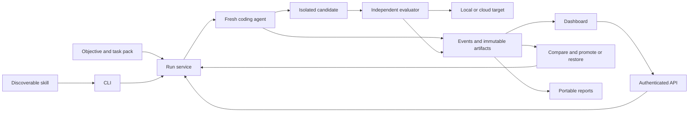

# Cooperative Optimization Framework Specification

Status: specification only, 2026-09-18. No runner, dashboard, skill installation,
benchmark result, architecture improvement, or deployment is delivered by these documents.

## Objective

Give a coding agent in any domain a simple, documented procedure and executable framework
for repeatedly changing a system, testing the result, measuring effort and outcome,
and promoting or restoring discrete versions through cooperative design with domain experts.
The framework automates execution and measurement; SMEs guide objectives, interpret evidence
and correct domain assumptions. Zero human participation is not a success criterion.

The primary product is the **automated optimization procedure**. Metrics, versioning,
deployment adapters, skills, visualization, and reporting make that procedure executable
and auditable. Investigation is the first use case, not the framework's domain model.

Success means less measured effort to obtain a verified change without weakened quality,
authorization, recovery, or maintainability. An attractive dashboard alone is not success.

## Read And Execute

An implementing agent reads these documents in order. A future operating agent starts with
the installed skill and the procedure, loading the other references only when needed.

| Document | Owns |
| --- | --- |
| [PROCEDURE.md](PROCEDURE.md) | Cooperative operating loop, operator inputs, skill and command contract |
| [CONTRACTS.md](CONTRACTS.md) | Domain-neutral records, lifecycle, telemetry, persistence and extension interfaces |
| [MEASUREMENT.md](MEASUREMENT.md) | Metric definitions, fair comparisons and improvement decisions |
| [ARCHITECTURE.md](ARCHITECTURE.md) | Deliverable code artifacts, ownership, reuse, dashboard and architecture experiments |
| [RECOVERY_AND_AUTHORITY.md](RECOVERY_AND_AUTHORITY.md) | Discrete versions, restore, Azure authority and resource lifecycle |
| [ACCEPTANCE.md](ACCEPTANCE.md) | Investigation tasks, fresh-overseer test, portability and staged delivery gates |

Normative terms: MUST is required; SHOULD permits a recorded reason for an alternative.
Requirement IDs in the documents are linked to checks in the acceptance matrix.
All code paths and command interfaces described as proposed are implementation contracts,
not claims that those files or commands currently exist.

## Unified Flow

Two loops share evidence: an inner loop repairs a candidate until accepted or stopped;
an outer loop changes architecture or procedure and compares equivalent change tasks.
Framework improvements themselves have versions and separately recorded construction cost.

## Scope And Open Inputs

The specifications include all four Investigation variations, real end-to-end deployment
acceptance, a dashboard, reusable reporting, fresh-agent adoption, and tested recovery.
Local synthetic checks come first; they never substitute for required live acceptance.

Before live execution, supply the actual Azure target, working identity, allowed operations,
data scope, spend/request/time limits, and cleanup policy. Before comparison, freeze the
task's quality thresholds, required metrics, trial count, and improvement threshold.
These values are intentionally unset, not inherited from historical sessions.

No current authority, resource, runtime observation, or improvement is inferred from this
specification. Existing implementation references and reuse decisions are recorded in
[architecture](ARCHITECTURE.md#existing-owners). No obsolete skill or historical record is
silently replaced. Implementation must publish a status and evidence for each acceptance gate.