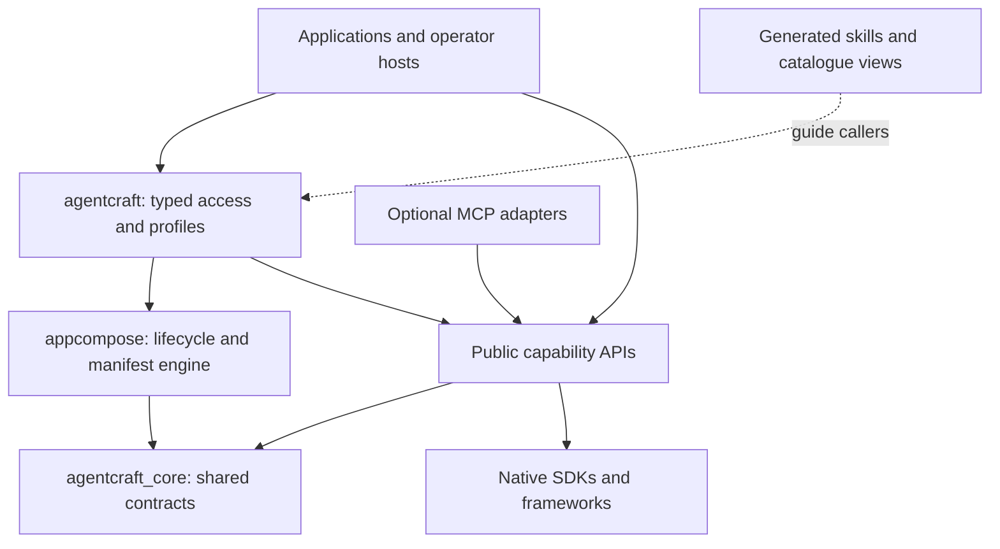

# 03. Framework And Interface Standard

This is the target standard under [0. Core Objective](0_CORE_OBJECTIVE.md). Shared meanings
and guarantees are binding; named types, packages and layouts are design candidates to
implement only when the current result needs them. Reuse a smaller existing public surface
when it meets the standard. Do not create empty wrappers to satisfy a diagram.

## Bounded Objective

- **Objective:** make retained libraries behave as one coherent framework without adding
  an unnecessary framework layer around them.
- **Done when:** 100% of retained runtime packages have F1-F8 conformance evidence or a
  concrete not-applicable reason, with zero undocumented deviations; one supported combined
  profile installs independently and performs its selected workflow.
- **Scope ceiling:** implement shared machinery only for an immediate consumer and an actual
  shared invariant or duplication reduction. No mandatory base class, speculative profile,
  all-to-all imports or package/type quota.
- **Stop condition:** the current capability conforms and its integration check passes.
  Extend the shared implementation only when the next concrete result demonstrates a need.

## Package And Dependency Architecture

| Target Owner | Responsibility | Allowed Direction |
| --- | --- | --- |
| `libraries/framework-core` / `agentcraft_core` | Small immutable descriptors, safe failures, execution context/budget contracts and conformance helpers | Standard library; no app, provider, framework root, MCP or UI dependency |
| Existing/selected capability packages | Native domain implementation, typed inputs/results, optional adapters, examples/tests/docs | Core only when it removes actual shared logic; declared lower-level capabilities and native dependencies |
| `libraries/app-composition` / `appcompose` | Configuration validation, explicit resolver, dependency/lifecycle/route/asset composition | Core; no import of assembling apps or framework root |
| `libraries/framework` / `agentcraft` | Unified install/profile discovery and typed access to explicitly bound capabilities | Composition and selected public capability packages; no business rules/provider engine |
| Capability-owned adapters plus optional `agentcraft` MCP host | Transport validation and mapping to installed public contracts | Public capabilities/core/composition; never `.github/skills` implementations |
| Host applications and deployment roots | Domain policy, authorization, actual identity/configuration/state/target ownership | Public framework or capability surfaces; neither is required to import an application |

One owner per source path. No cycles. Libraries never read application environment variables
deep inside operations or import a composition root. Declared public surfaces are checked;
unresolvable/dynamic edges are reported as unknown, not silently passed.

### Unified Access Without A Universal Operation

The public `agentcraft` root exposes a `Framework` composition handle and supported profile
descriptions. It binds configured capability IDs to explicitly supplied factories/handles
through `appcompose`. It provides typed data/model/inventory handles and delegates their
operations unchanged to the selected capability contracts. No arbitrary `execute(dict)`
method, caller-name branch or generic raw provider-options escape hatch.

Direct imports such as `azdata`, `llm_interface` and stateless frontend helpers remain valid.
Installing the root is convenience, not authority; callers can use a capability without an
HTTP server, MCP, browser or the full framework. One lifecycle implementation owns shared
startup/close; root accessors are not a second client pool.

Planned profile names: `core`, `data`, `models`, `identity`, `inventory`, `agents`,
`optimization`, `recovery` and `tooling`, with `mcp` opt-in. Create a profile only when its
capabilities and consumer exist; these names are not an upfront scaffolding requirement.
No extra may claim missing functionality. Prove the smallest current working combination
first, then extend toward `data + models + identity + inventory + agents` as needed.

## Shared Contracts

F1-F8 preserve the source audit's standard IDs. Code generation is not required to create
these contracts; typed definitions and wire fixtures are sufficient initially.

### F1. Identity And Description

`CapabilityDescriptor` is immutable and contains:

- Stable `capability_id`, `api_version`, distribution/version and public surface identifiers.
- Operations/profiles with `supported`, `experimental`, `unsupported` or `retired` status.
- Input/result schema references, required grants and credential kinds, state/lifecycle kind.
- Bound units/defaults and explicit guarantee/caveat identifiers.
- Declared dependencies, documentation/example references and verification requirements.

`describe()` is offline: no service calls, token acquisition, threads, subprocesses, writes
or inferred readiness. A separate readiness/probe call requires explicit policy and budget.
Configured, supported, authorized and observed-ready are separate facts. A descriptor must
not authorize itself, generate its own passing oracle or silently probe paid services.

The canonical capability catalogue records these source facts once; installed descriptors
and discovery/knowledge views are generated/validated against it. Chapter 04 owns that flow.

### F2. Installation, Types And Compatibility

Use uv for Python resolution/locks/builds; declare each direct imported dependency in its
owner. The reference composed profile targets Linux/Python 3.12. Standalone libraries can
retain earlier tested minima; test advertised floors rather than raising all packages
solely to simplify the workspace. Supported additional Python/OS combinations are explicit
coverage rows, not inferred from a broad metadata range.

Resolve on the maintained `llm_interface` native dependency family; remove conflicting legacy
model dependencies. Do not solve the conflict with sibling environments behind a facade.
Native C/driver/browser/PTY prerequisites stay optional and profile-specific.

Python artifacts include public typing metadata and no local-path requirements. Frontend
packages publish ESM, declarations and declared CSS/assets with peer dependencies; retain
framework-free packages where applicable. React 19 remains the current host profile;
validate the actual Node/TypeScript/bundler versions chosen for release. No forced Python
dependency in a frontend-only consumer or full UI stack in a simple decoder user.

During this migration, old signatures/wire shapes can break. Publish the old-to-new mapping
and update in-repo users. After target v1, normal versioned compatibility/deprecation policy
applies to the new contract; it does not revive the retired engines.

### F3. Configuration And Authority

The host passes validated immutable configuration and dependencies at the edge. Canonical
JSON with a safe YAML form is handled by `appcompose`; duplicate keys, unsafe aliases,
config-supplied imports/code, credential literals and ambiguous ownership refuse.
Required fields fail at binding, not halfway through a paid call.

Keep three concepts distinct:

1. `CallerContext`: host-established identity evidence/reference, tenant/owner identifiers
   where applicable and request/run correlation. Constructing this object is not authenticating.
2. Host authorization and capability `Policy`: exact allowed operations/resources/tool names,
   verification requirements and ceilings. No default mutation or inference grant. Target
   framework examples also state read/query grants explicitly; request data can only narrow.
3. Workload credential: borrowed native identity/provider passed to the exact bound service.
   The library never grants Azure access, fetches ambient credentials by default or accepts
   endpoint/grant overrides from a model/MCP request.

Policies stay typed by capability. Sharing vocabulary/context must not union permission sets
or equate `query`, `schema.delete`, infrastructure teardown, replay-store writes and model
inference. Operator interfaces are separately granted. Auth middleware produces evidence;
the same explicit host decision protects all user/agent adapters.

For the existing Cosmos read-only-key profile, the host explicitly supplies an exact-target
native key provider/identity and grants that lookup. Only read-only-key acquisition is
supported, in memory, never output/logged. Resource-token and read-only-key profiles cannot
substitute for each other or authorize writes implicitly. No new cloud auth change is
required merely to retire the old synchronous client.

### F4. Results, Failures And Effects

Do not wrap every return value in one universal result. Keep `OperationResult`, native
framework model values, typed auth evidence and UI props where they match their domains.
Use shared `FailureInfo` metadata on the documented failure surface:

| Field | Meaning |
| --- | --- |
| `code`, `category` | Stable machine code and config/invalid/denied/unsupported/auth/rate-limit/unavailable/interrupted/failed category |
| `operation`, `capability_id`, `run_id` | Correlation without returned data or secrets |
| `field` | Optional bounded config/input field identifier, not its value |
| `action` | Safe supported next action, not provider exception text |
| `effect` | `none`, `accepted` or `unknown`; never infer no write from a timeout |
| `retry` | `never`, `safe_after_correction`, `read_back_first` or `unspecified`; not an automatic retry command |

Empty results, missing records, denied operations, unsupported features, partial/pending
results and unknown delivery remain distinct. Per-item identities/order/effects survive
batch failures; an unattempted tail is not a failure of the same kind as an accepted write.
Provider errors become safe metadata; programming defects stay exceptions. Never log full
native responses, prompts, embeddings, signed bytes, private paths or credentials by default.

CLI/MCP/HTTP adapters serialize safe diagnostics consistently but retain protocol-specific
security behavior. An empty-body auth 401 must not be expanded to reveal tenant/key/claim
information to achieve stylistic consistency. Explicit payload serialization is opt-in.

### F5. Lifecycle And Cancellation

Stateless capabilities need no base class. I/O capabilities use async close/context by
default; retained native synchronous operator interfaces are explicit exceptions with
documented timeout/close behavior, not app-specific thread-runner packages.

Composition starts dependencies in declared order and rolls back successfully started
members on failure. It closes created resources once in reverse dependency order, including
streams/tasks/probes and partial startup. Borrowed credentials/transports/handles are never
closed by a child. Duplicate handles are deduplicated by identity at the owner, not double-closed.

Propagate cancellation and control exceptions; do not convert `CancelledError`, interrupts
or exits into successful/empty results or generic rule failure. Cancel/settle owned tasks,
await bounded cleanup and refuse new work after close starts. Native work may outlive a
timeout; report that uncertainty, never rollback or zero-charge guarantees.

### F6. Budgets And Attempts

`ExecutionContext` carries host run/trace correlation, deadline and a shared `ExecutionBudget`
reference, not new credentials or access. Bound calls within one run reserve atomically
before dispatch. Child limits are the minimum of host/run/capability ceilings; supplied
request limits never widen grants, concurrency, time or byte/token/call allowances.

Each operation declares units and whether bounds cover setup, slot wait, native work,
stream backpressure, returned content and cleanup. Count model attempts, tool executions,
native data/verification attempts, items, bytes and token ceilings separately. Uncertain
delivery retains a reservation and unknown usage; unknown is never zero. No billing quota,
distributed global limit or exactly-once side effect is implied by process-local accounting.

Reuse native retry/budget mechanisms behind one accountable owner. No blanket retry around
another retry loop. Reads may use an explicit bounded policy; mutations/paid calls are not
blindly replayed after possible effects or output. Required verification calls consume
budget and need their own grant before write submission.

### F7. Events And State

Common event metadata: `schema_version`, `capability_id`, `operation`, `run_id`, monotonic
run-local `sequence`, `kind` and typed `data`. Semantic event names remain capability-owned.
Native streams map through one adapter. The named SSE decoder only frames bytes; it does
not prove schema validity, terminal completion, replay or authentication.

Consumed operations have a declared terminal success/incomplete/refused/failed condition.
Quiet EOF without terminal evidence is not success. Cancellation may prevent terminal
delivery; close/exception state is authoritative. Backpressure, bounded event queues and
reader cleanup are tested. No automatic replay/resume without a selected durable contract.

State declarations identify owner, location, retention, expiry, concurrency, replica scope
and restart behavior. Model sessions, auth records, replay nonces, browser selection,
continuations and recoverable outputs remain distinct. Host-owned legacy records are
migrated/read-only/explicitly unsupported with a notice; never erased to make new tests pass.

### F8. Extension, Observability And Quality

Use explicit allowlisted factories/public APIs, not runtime skill imports or arbitrary
plugins from config. A provider adapter declares native behavior and conformance evidence;
unsupported native guarantees remain unsupported. An adapter claim is not its own oracle.

Reuse native OpenTelemetry support plus safe optional metadata hooks. The host controls
destinations and retention; no default content telemetry. Include trace/request IDs and
measured attempt/timing/usage counts only, with unknown values explicit.

Every public feature has an interface card, tested example and positive/refusal coverage.
Every major dependency/contract/serializer/lifecycle change reruns its affected checks.
Native behavior wins over invented wrappers when a wrapper adds no demonstrated rule or
usability benefit. Chapter 07 defines the evidence gates; chapter 05 defines usability.

## Explicit Design Tradeoffs

- One product experience is achieved by shared semantics and composition, not all-to-all
  imports or a single mega-distribution with every optional dependency installed.
- Target app results stay useful and safe, but app routes/events/session IDs may change.
  A translation at the host's presentation edge is allowed; a permanent old runtime is not.
- A shared error schema does not force auth claims or native data payloads into a generic
  dict. A shared lifecycle does not force a pure decoder to start a runtime.
- New data/model APIs are judged on the intended capability and independent developer task,
  not on how little code the legacy application needs to change.

Next: [04. Skills, MCP And Distribution](04_SKILLS_MCP_AND_DISTRIBUTION.md).