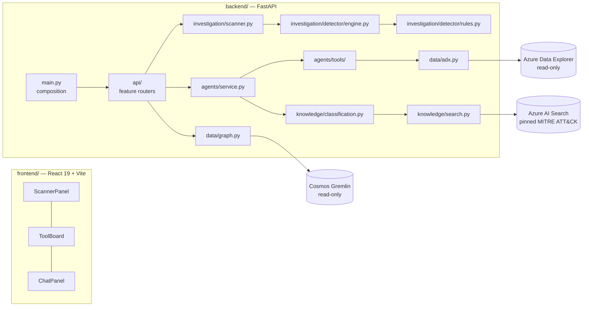

# CyberEye

**Copied reference documentation.** The template's [root README](../../README.md),
[migration map](../../docs/ARCHITECTURE_OVERVIEW.md) and [local runbook](../../deploy/README.md)
own current commands and status. Upstream deployment/container commands and paths below are
historical context, not supported launch instructions for this copy. ADX query transport now
uses the canonical Agentcraft library; other contracts below remain migration references.

A local analyst application over a static historical cybersecurity telemetry export.

**This is a replay of a fixed export.** It does not monitor, detect, prevent, or respond to
anything. Every result describes events that were already over before the file was written.
Nothing in this application writes to a telemetry store.

## Run it

```bash
az login                            # Entra ID; no secret is stored in this repository
./deploy/deploy.sh setup            # Python and Node dependencies, plus Chromium; no cloud write
./deploy/deploy.sh local -e prod    # backend, frontend, and the coordinates they need
```

`local` loads the committed environment file, resolves the Search endpoint from Azure and execs
`dev.sh`. Open <http://127.0.0.1:5173> in an ordinary browser — nothing to sign, nobody to sign
in as. The API is on <http://127.0.0.1:9000> and Vite proxies `/api` to it. A request that did
not come from this machine is refused exactly as the deployment refuses a stranger: see
[Access](#access).

Running `dev.sh` directly still works; it needs either `app/cybereye/.env` or `ADX_CLUSTER_URI`
in the environment, which `local` supplies. Retrieval is the deployed Azure AI Search index, so
no local corpus build is required to run the application; the corpus builders under
`cyber_kb/normalize/` are inputs to `search-load`, not to startup.

The top header switches between **Investigation**, **Data & Tools Catalogue**, **Agent Editor**
and **Agent Optimization**. Its **Configuration** cog
opens ADX status, model, replay-table count and the full caller identity in one dialog. Sign-out
lives there for authenticated sessions; local preview has no session to end. Workspace views
stay mounted when switching, preserving scanner inputs, chat drafts and catalogue selection.

Agent Optimization is local-only: GUIDE evidence and labels are prepared in SQLite; the real
GHCP CLI authors Python tools and refined prompts; generated scripts execute in isolated Linux
namespaces. Four independently resizable/collapsible columns separate dataset descriptors,
chronological tools, agent profiles/full validation metrics, and agent-version charts/progression
cards. Coding agent opens the separate CLI dialog. Versions appear in the catalogue/editor but are
never assigned to Investigator.

The process itself is not application code. Two reusable components own it:
[`situation_detector`](../components/situation_detector/README.md) is the query-test battery the
Perth scanner and every GUIDE detector both run, and
[`agent_optimization`](../components/agent_optimization/README.md) owns the generation ledger,
probes, sandbox, CLI contract and workspace UI. `backend/optimization/` keeps only GUIDE facts:
the profile, the dataset and thin adapters that inject CyberEye's `Principal`, model, knowledge
search and agent catalogue. The **Agent Optimization** workspace preselects `joint-10` — a
baseline plus ten CLI-authored successors, each pinning detector rulesets, tool set and
investigator prompt, each publishable only against a passed development probe of that exact
proposal. `joint-12` is the same protocol over twelve successors. The API default differs: a
`POST` to the experiments route with no `protocol` creates a `smoke` experiment, so the UI default
is a UI fact and not the contract default.
[Design and proof](../../docs/AGENT_OPTIMIZATION.md);
[prepare/start/verify sequence](../../deploy/README.md#guide-optimization-local-only).
The completed twelve-generation campaign — its run identity, accepted versions, outcome counts and
browser checks — is recorded once, in
[AGENT_OPTIMIZATION.md](../../docs/AGENT_OPTIMIZATION.md#completed-twelve-generation-climb); the
numbers are not duplicated here.

Container:

```bash
docker build -f app/cybereye/Dockerfile -t cybereye .
docker run --rm -p 8080:8080 --env-file app/cybereye/.env cybereye
```

The image copies `cyber_kb/normalized` in and sets `CYBEREYE_KB_DIR` to it, so build the
corpora before building the image. No Azure tooling is installed: every Azure call goes
through `DefaultAzureCredential` and the REST clients in `app/components/`. Deployment does not
use this path — `release` builds server-side with `az acr build`
([runbook](../../deploy/README.md)).

## Access

**Everything is refused until something proves who is calling.** Every method and every path:
the API, the built frontend, its assets, `/docs`, `/openapi.json`, and every path that matches
no route at all — an unauthenticated 404 still tells a stranger which paths exist. The refusal
is a bare `401` with no body, no reason and no `WWW-Authenticate` for API calls and subresources.
Top-level browser navigation to a protected non-API path receives a `303` to sign-in instead.
Both happen in pure ASGI before routing, body parsing and the static mount; neither publishes
protected content.

**There is no setting that turns this off.** No environment variable, no flag, no debug mode.
An application whose authorization can be disabled by a misspelled variable has an
authorization bug waiting for a typo. Access is granted by configuring a mechanism — or, on a
workstation, by the one mechanism that is chosen in code rather than configured at all:
[Local preview](#local-preview).

`GET /healthz` is the one exception: unauthenticated, `GET` and `HEAD` only, and it answers
`{"status":"ok"}` and nothing else. It exists for the platform liveness probe. `/api/health`
stays protected — it reports store reachability and agent configuration, which is exactly the
reconnaissance an anonymous caller would want.

| Piece | Where |
| --- | --- |
| `Principal` — the one identity type, `devkey:<fingerprint>:<slug>` or `entra:<tenant>:<oid>` | `backend/security/principal.py` |
| `AuthorizationGate` — deny by default, no configuration | `backend/security/gate.py` |
| What is mounted, and `register_principal_resolver` | `backend/security/composition.py` |
| Owner-bound chat sessions and the per-caller scan cache | `backend/security/sessions.py` |
| The signature verification itself | `app/components/signed_dev_access/` |

### Signed developer access

The mechanism available today, and how an agent drives the deployed application. An Ed25519
keypair: the private half never leaves the machine that made it, the public half is not a
secret and travels as `DEV_PUBLIC_KEY_ED25519`. Clearing that variable removes the signed path
entirely — the middleware is then not mounted at all.

```bash
./deploy/deploy.sh key-init                                          # once, per machine
./deploy/deploy.sh signed-request -e prod -- GET /api/health          # base URL resolved
./deploy/deploy.sh browser-verify -e prod tabs                        # drive the UI, signed
```

One signature covers one method, one path with its query and one body, so a browser's dozens
of requests need dozens of signatures; the pilot signs each at the network layer and never
lets a signature leave the origin. Contract and bounds:
[`signed_dev_access/README.md`](../components/signed_dev_access/README.md).

`DEV_REPLAY_LEDGER` is required as soon as a key is configured, has no default, and can only
ever name the durable ledger: a per-process one is emptied by a restart and duplicated by a
rollout, so `from_env` refuses it whatever the replica count.

### Local preview

`dev.sh` runs a different entry point — `backend/local_app.py`, the workstation composition. It
imports the same application behind the same gate and registers one resolver through
`register_principal_resolver`: a request whose TCP peer is loopback, whose `Host` is a loopback
name, and whose `Origin` — when a browser sends one — is loopback too, carries the fixed
principal `local:workstation`, issuer `local-preview`. Nothing else does. On a workstation the
request never left the machine, so there is no third party for a sign-in to distinguish.

That is a module, not a setting. No environment value selects it and none turns it off; the
provider variables are withheld across `main`'s import so a stray key or a half-filled Entra
block in `.env` cannot change what a workstation gets, and `dev.sh` starts uvicorn with
`--no-proxy-headers` so no forwarding header can claim to be loopback. The identity is reported
 honestly — **Configuration** reads **Local preview** and offers no sign-out, because there is no session
to end. The image runs `backend/main.py`, which has no such resolver and refuses every
unauthenticated request; nothing deployed imports the workstation module.

### Microsoft Entra ID

Implemented, and mounted whenever `AUTH_TENANT_ID` and `AUTH_CLIENT_ID` are both set.
`backend/security/entra.py` maps a verified token onto `entra:<tenant>:<oid>`, and
`backend/security/signin_routes.py` owns the four public sign-in routes — `/auth/login`,
`/auth/callback`, `/auth/session`, `/auth/signed-out` — Authorization Code + PKCE with no
client secret, ending in an `HttpOnly` cookie the store keys by its SHA-256. Cryptography and
token validation stay in `app/components/entra_auth/`. Tenant, application and session-store
configuration: [deploy/README.md](../../deploy/README.md#the-two-caller-mechanisms).

Both mechanisms arrive through the same seam, `register_principal_resolver(app, resolver)`: an
async callable that reads the ASGI scope and returns a `Principal` or `None`. Resolvers are
registered in process, by code, never named in configuration, so no deployed value can
introduce one and none can remove the gate. Signed access and a token path compose through the
same `Principal`; nothing authenticates twice.

### What ownership means here

The replay corpus is shared, historical and readable by every authenticated caller — that is
the point of it, and no row is owned by anyone. What is owned is what a caller *created*: the
chat session they opened and the scan result they ran. Another caller asking for either gets
the same answer they would get for something that never existed, because distinguishing
"not yours" from "not there" turns an identifier space into a directory.

## What runs where



| Module | Owns |
| --- | --- |
| `backend/main.py`, `local_app.py` | stable cloud and loopback composition roots; no feature rules |
| `backend/api/` | feature routers for health, agents, scanning/evidence, situations, graph, chat and sources; unchanged HTTP contracts |
| `backend/config.py`, `models.py` | runtime configuration and shared application payloads |
| `backend/data/` | bounded read-only ADX queries and ontology graph traversals |
| `backend/investigation/` | scanner facade, versioned detector rules, execution, synthesis and explanations |
| `backend/agents/` | fail-closed configuration, Responses orchestration and registered `tools/` |
| `backend/knowledge/` | Search retrieval, situation-type candidates and classification; no agent-tool dependency |
| `backend/optimization/` | the GUIDE half of optimization only: profile, dataset, joint configuration and thin adapters onto `app.components.agent_optimization`; local-only |
| `backend/inventory/` | catalogue manifest/probes plus source declarations and reachability reporting |
| `backend/security/` | the access edge: one principal model, deny-by-default gate, owner-bound sessions |
| `control/data_inventory.yaml` | **the allowlist**: which use cases exist and what is behind each |

The frontend follows the same responsibility-based structure:

| Module | Owns |
| --- | --- |
| `frontend/src/main.tsx` | browser entry point and ordered style imports |
| `frontend/src/app/` | composition, header, Configuration dialog and column sizing |
| `frontend/src/features/scanner/` | scan controls, situation list and rule explanations |
| `frontend/src/features/investigation/` | evidence board, diagnosis/summary flows and entity selection |
| `frontend/src/features/chat/` | conversation panel |
| `frontend/src/features/graph/` | graph navigation, time window and force layout |
| `frontend/src/features/agent-editor/` | agent forms, Markdown uploads, version selection and Investigator assignment |
| `frontend/src/features/optimization/` | transport only: wraps `@components/agent_optimization/frontend`'s workspace in the app's API provider and re-exports its types |
| `frontend/src/shared/` | application API/types, shared UI and agent-output renderers; mixed legacy styles stay in `styles/` with their cascade order preserved |
| `frontend/tests/unit/`, `tests/browser/`, `tests/support/` | stream/state contracts, browser journeys and their common harness |

App composition imports features; features import shared contracts/UI. Investigation reuses scanner
explanations and the graph; chat reads the investigation flow contract. Neither shared code nor
features import the app shell. Backend routers call services; agent tools call data/knowledge,
never the reverse. Source reports belong to inventory, not the read-only data clients.

Reusable transport lives outside CyberEye: `app.components.azure_llm.response_events` bridges
blocking SDK streams to async events with the existing bounded pre-output retry;
`@components/event_stream/frontend` decodes SSE for scan, summary, diagnosis and chat. Neither
component imports CyberEye, knows an endpoint, or decides authorization. Tool names and HTTP
contracts stay fixed; their configured import paths now point into `backend/agents/tools/`.

## Agents & Tools

**Data & Tools Catalogue**, beside **Investigation**, combines a datasource tree on the left, agents and tools
in the middle, and one viewer on the right. Selecting either tree replaces the visible detail
pane without discarding source previews or tool-viewer settings. Narrow screens stack the panes.
`ResourceExplorer` from `@components/resource_explorer/frontend` owns the view and shared navigation
styles; the app supplies `api.agents`. There is no standalone Data sources tab. Selecting a tool
reveals its declared datasources with green outlines, including multiple dependencies, without
changing source switches. Unknown IDs and tools with no external dependency highlight nothing.
The agent column lists the caller's assigned Investigator version and its registered tools.
Expand **Agents**, expand the agent, then select a tool for its description, parameters,
configured datasource and syntax-highlighted source with original line numbers, copy and word wrap.
Rendering uses `SourceCodeViewer` from `@components/source_code/frontend` (Shiki, VS Code Dark+).
Source previews include only the registered
function, capped at 200 lines / 18,000 characters; no arbitrary file path can be requested.
`GET /api/cyber/agents` requires the same authenticated caller as the investigation API and does
not execute tools. Datasource status describes configuration, not connectivity. Recording tools
have no external datasource; the KQL fallback shows its default target, not a fixed query scope.
Tool decorators accept a datasource key or tuple of keys. The catalogue resolves those bindings
against configured inventory coordinates and returns `datasource_ids` plus `datasources`; it
does not infer relationships from display names or claim that a query has executed.

## Agent Editor

Agent Editor has two panes: Agents and the configuration/tool viewer. It does not mount a data-source
tree or fetch inventory data; source browsing stays in **Data & Tools Catalogue**. The **+** in the
Agents column opens a blank configuration in the viewer.
Set a name, choose a configured LLM deployment, enter system instructions, upload `.md` files,
and add tools using the tool-row **+**. Selecting CyberDefender opens its existing instructions
and tools read-only in the same form. Required application policies are visible but not editable.

The toolbar is **version dropdown**, **Create New Version**, **Save New Version**, **Reset**.
**Create New Version** starts an editable draft from the selected version without writing a file.
The padlock beside the agent name can also unlock a version into a draft. Locking again freezes
editing but retains changes; tool inspection still works while locked. **Reset** restores the
selected version, drops unsaved files/tool changes, and returns to read-only viewing. New-agent
drafts start unlocked and use **Save Agent** for their first version.

Each version can have a short name such as `Focused triage` or `Broad investigation`. Dropdowns
show `v2 - Focused triage`; the permanent number identifies the saved version even if labels repeat.
Names are optional single-line labels of at most 80 characters, separate from the agent name and
its instructions. Older unnamed files stay readable as `v1`, `v2`, and so on without being rewritten.

**Save New Version** activates only for an unlocked draft whose label or configuration differs
from its source. Saving creates the next immutable number, including when starting from an older
version; history is never overwritten. Saving does not change the running Investigator: choose
the agent and exact version under **Role assignment**, then use **Assign Investigator**. Leaving
changed drafts requires confirmation; a failed save keeps the draft and reports the error.

Chat, diagnosis, summary and classification resolve the caller's assignment when a request
starts. Chat and diagnosis consume the saved instructions and selected tools; the fixed summary
and classification tasks use the selected model. In-flight requests keep their starting version.
A new chat turn after reassignment starts a fresh model response chain while the visible transcript
stays intact. Stream metadata identifies the actual agent/version, including older completed runs.

Storage defaults to `app/cybereye/.local/agents/<caller-sha256>/<agent-id>/versions/<number>.json`;
`<caller-sha256>/roles.json` pins the Investigator. Each JSON version embeds system text and uploaded
Markdown contents, so no original upload path is needed. Files survive local process restarts,
are caller-owned, and are excluded from Git, Docker context and deployment staging. The immutable
bundled CyberDefender is seeded from `control/` and is never rewritten by editor requests.
`version_name` carries the optional label, and `version_names` in catalogue/version responses
maps saved numbers to labels. The UI edit lock is a draft guard, not an authorization mechanism;
API ownership and immutable version writes remain enforced independently.

`CYBEREYE_AGENT_STORE_DIR` can point to another writable directory. This is a local Linux file
store, not a database or cross-replica store. A future container deployment needs a writable
persistent volume to retain authored configurations across image/revision replacement. Additional
compatible Responses API deployment names come from `CYBEREYE_AGENT_MODELS`; currently only
`gpt-5.6-luna` is configured. The editor neither provisions models nor accepts arbitrary tool code.

All endpoints below use the existing authentication gate plus explicit caller ownership:

| Method and path under `/api/cyber/agent-editor` | Result |
| --- | --- |
| `GET` on the prefix | own agents, allowed models/tools, required policies and current assignment |
| `GET /agents/{id}?version=N` | a saved version, or the latest when omitted |
| `POST /agents` | create version 1 |
| `POST /agents/{id}/versions` | create the next version; `base_version` records its source and `expected_latest_version` rejects stale saves |
| `PUT /roles/investigator` | pin a saved version, guarded by `expected_revision` and read back afterwards |

Missing/foreign agents return 404; anonymous requests return 401; unrecognized principals return
403. Unknown models/tools, duplicate tools and invalid uploads return 422; stale saves and role
assignments return 409. Markdown is UTF-8 text, at most 12 files, 64 KiB per file and 256 KiB of
combined instructions. Investigator requires evidence retrieval, MITRE search and the three
diagnosis/sequence output tools; an incomplete configuration can be saved but cannot be assigned.

Verification, from `app/cybereye/frontend` against a running local app:

```bash
ARTIFACT_DIR=/tmp/agent-editor node tests/browser/verify-agent-editor.mjs
CYBEREYE_EDITOR_LIVE=chat ARTIFACT_DIR=/tmp/agent-editor-chat node tests/browser/verify-agent-editor.mjs
CYBEREYE_EDITOR_LIVE=1 ARTIFACT_DIR=/tmp/agent-editor-full node tests/browser/verify-agent-editor.mjs
```

Use a scratch `CYBEREYE_AGENT_STORE_DIR` when launching the backend for these tests. They create
test agents and restore the previous role assignment; files remain in that scratch directory.
The first command needs no model call; `chat` proves two saved versions use distinct uploaded
instructions with the real model; `1` also runs a real ADX-backed situation investigation.
The last requires ADX running. API tests separately cover ownership, conflicts, file failures
and both runtime paths with a deterministic model double. No current cloud release includes
this editor yet.

## Data sources

The left column of **Data & Tools Catalogue**. It answers one question — *what is this deployment
actually connected to, per use case* — and it answers it by reading, now, not by repeating a
document.

Three use cases, five slots:

| Use case | ADX table | Cosmos graph | Search index |
| --- | --- | --- | --- |
| `Perth Cybersec POC_0` | `PerthCyber.EventsUnified` | `airportgraph/ontology` | — |
| `AIT` | `AitLogs.AitEvents` | `airportgraph/aitgraph` | — |
| `Open-Source CyberSecurity` | — | — | `MITRE ATT&CK @ 2026-08-29T16:32:57Z` |

Selecting a source reads its live metadata — row or element counts, schema, coordinates,
which connector answers for it — and `Preview contents` returns a bounded sample of real
rows. Every number carries the timestamp of the call that produced it.

**The one Search index holds knowledge, not telemetry.** 3,908 documents — 712 ATT&CK
techniques and tactics as candidate situation types, 3,196 ATT&CK analytics and detection
strategies — published by `app/data/data_pipelines/search` from the pinned
`enterprise-attack.json` mirror at commit `6cda5ad8462c` into the deployment's own service
(`srch-perth-cybereye-<suffix>`, Basic, keyword only). Configure it with
`CYBEREYE_SEARCH_ENDPOINT` plus `CYBEREYE_MITRE_SEARCH_INDEX`; left empty, the slot reports
`Not configured` and names those keys.

Neither replay files a Search index. An earlier version of this deployment published one
keyword document per telemetry row into `perth-events` and `ait-events` — a copy of rows ADX
already serves, filed as retrieval. Both indexes have been deleted; `deploy/verify_search.py`
asserts they stay gone.

**Retrieval is Azure AI Search only.** There is no local corpus at runtime and no BM25
fallback: with the index unreachable the knowledge tools say so and the agent answers from
telemetry alone, rather than quietly answering from a copy on disk whose provenance nobody
can check.

The service has local authentication disabled, so there is no key to configure. Reading needs
an identity holding `Search Index Data Reader`, which is what the deployment's managed identity
holds — and all it holds: the application cannot create, alter or delete an index, nor write a
document.

**One Cosmos account.** The Gremlin read-only key is resolved from ARM using
`GREMLIN_SUBSCRIPTION_ID` and `GREMLIN_RESOURCE_GROUP`, which name exactly one account. A
graph source declaring a different account is reported `unconfigured` naming both accounts,
before a client is built — it is never served the configured account's data under its own
name. A second account would need its own ARM coordinates declared.

**A preview is a bounded sample and says which bound bounded it.** Under the row count sits
the list of what was left out: rows beyond the sample limit, rows beyond the 1 MiB budget,
columns beyond 512, and cells shortened past 4,000 characters. A shortened cell carries
`… [N more characters not shown]` inside it, so a value copied out of the table cannot be
mistaken for the whole one. Nothing else about a value is changed — a URL in a row is the
URL the store holds.

### The manifest is the allowlist

`control/data_inventory.yaml` declares every use case and source the API will ever serve.
An identifier that is not in it is rejected before any client is built. Its schema is
documented in the file's own header. Coordinates are either literals or the *names* of
environment keys resolved at startup by `backend/inventory/manifest.py`.

**No secret travels this file, by any route.** Coordinates are served to the browser, so
they are validated at startup against a finite set per source type — `endpoint`,
`database`, `table` for a table; `account`, `database`, `graph` for a graph; `endpoint`,
`index` for an index. An `endpoint` must be a plain `https://` service address: embedded
credentials, a path, a query or a fragment are refused, which is what a SAS URL looks like.
Any other coordinate must look like a resource name. A coordinate whose *name* is a
credential name is refused at registry build. Every refusal names the coordinate and never
repeats its value. `coordinates_from_env` carries a non-secret value that differs per
deployment; it is not a channel for a secret, and authentication is injected separately.

Adding a source is: add a block, add its keys to `.env.example`, and register a probe under
its `connector` name in `backend/inventory/probes.py` if the connector is new. A manifest
that does not parse stops the app at startup rather than serving a partial inventory.

### Session selection

Each browser tab can switch a source off. The choice lives in that tab's `sessionStorage`
and is sent per request as `X-Inventory-Selection`; there is no server-side selection
store, so a second tab is unaffected and behaviour is identical on one replica or ten. The
server refuses a read for a switched-off source with `409 source_disabled` rather than
trusting the page to skip it.

**Recovery narrows, never widens.** When the declared sources change under a tab, the
stored selection names an id the server no longer accepts and the whole header is refused.
The tab re-reads `/selection` with `none` — which reads no source — and keeps only the ids
that survived; a list with no survivors becomes "none" and says so. Switching everything
back on would undo a scope the reader chose deliberately.

**Scope, stated in the UI and in the API:** selection narrows *this view*. It does not
change the replay scanner, the detection rules, the evidence queries or the agent's tools.

### Walk it yourself

Live at
<https://ca-cybereye-prod.mangodesert-6aa796ff.australiaeast.azurecontainerapps.io>, or
locally after `app/cybereye/dev.sh`. Six steps, each with what you should see:

1. **Click `Data & Tools Catalogue`**, the second top-level tab. The left tree shows `Data sources` with
   exactly three children, `Perth Cybersec POC_0`, `AIT` and `Open-Source CyberSecurity`.
   Nothing else — this is not a subscription browser.
2. **Expand them.** Two rows under each replay use case — an `ADX TABLE` and a
   `COSMOS GRAPH` — and one `AZURE AI SEARCH INDEX` under `Open-Source CyberSecurity`, five
   sources in all. The counter reads `5/5 sources on`.
3. **Click `Unified events table`.** `15,520 ROWS` and `181 COLUMNS` measured now, the
   endpoint/database/table it read them from, the connector that answered
   (`app.components.data_connector_library.KustoReader`), the full schema, and `Read at
   <timestamp>` — recompare it against your clock, it is this call and not a cached one.
4. **Click `Preview contents`.** 25 real rows, headed `25 of 15,520 · sample limit 25 rows ·
   truncated`, with the bounds that cut it listed underneath. Compare `AIT graph` with
   `Entity ontology graph`: different property names, because a graph's vocabulary is
   whatever wrote it.
5. **Open `Open-Source CyberSecurity` and click its index.** The live document count, the
   pinned commit in its provenance line, and a bounded preview of real ATT&CK documents.
   Unset `CYBEREYE_MITRE_SEARCH_INDEX` and it reports `Not configured` naming the two keys:
   no count is invented and no local corpus is substituted.6. **Switch `AIT events table` off** with its toggle. Its pane loses the preview button and
   says why. Reload: still off, because the choice is this tab's. Open the same URL in a
   second tab: on there, and it reads. The server is the enforcement point — a request for a
   switched-off source is refused `409 source_disabled`, for metadata as well as content.

Then click back to `Investigation`: the scanner, its scenario and its window are exactly as
you left them. Selection scopes this view and nothing else.

### API

All four are `GET`. There is no write verb and no arbitrary-query endpoint.

| Route | Answers |
| --- | --- |
| `/api/cyber/inventory/tree?node=<id>` | the root's use cases, or one use case's sources. Never probes |
| `/api/cyber/inventory/resource?node=<id>` | one source's metadata, read now |
| `/api/cyber/inventory/content?node=<id>&limit=<1..100>` | one source's bounded preview |
| `/api/cyber/inventory/selection` | every selectable source and whether this request has it on |

```bash
curl -s localhost:9000/api/cyber/inventory/tree | python3 -m json.tool
curl -s -H 'X-Inventory-Selection: none' localhost:9000/api/cyber/inventory/selection
```

`node` is opaque: only the server mints one, and it decodes to a use-case id and a source
id — never to an endpoint, a database or a table. A rejection echoes nothing that was
submitted.

| Failure | Status | Fixed by |
| --- | --- | --- |
| malformed, unknown, or cross-use-case `node` | `400 invalid_node` | requesting from a payload this server produced |
| unknown, repeated, or empty id in `X-Inventory-Selection` | `400 invalid_selection` | the client re-reading `/selection` and narrowing to what survives |
| `limit` outside 1–100, or not a number | `422 invalid_limit` | a bound in range |
| the source is switched off in this session | `409 source_disabled` | switching it back on |
| forbidden, unreachable, unconfigured, unavailable, empty | `200` with that `status` | see the pane; each names its own remedy |

Every response, including every rejection, carries `Cache-Control: no-store, private` and
`Vary: X-Inventory-Selection`.

## Extending it

### Connecting a new data source

Connecting a source is documentation and verification, not plumbing. Nothing is forced
through a common abstraction — the point is that the option exists, is proven, and is
findable.

1. **Declare it** in `backend/inventory/sources.py`: what it holds, the questions it can answer,
   where code reaches it, and which settings configure it.
2. **Give it a probe** that proves reachability and never raises.
3. **Add its settings** to `.env.example`. A test asserts this, so an undocumented
   connection fails the suite.
4. **Verify it** — `GET /api/cyber/sources` returns every declaration with a live check.

```bash
curl -s localhost:9000/api/cyber/sources | python3 -m json.tool
```

A declaration is a statement of availability, not a claim that anything uses it yet. Rules
and tools opt in by reaching for the source named in `reached_by`.

Exactly one source is `required` — the telemetry table. Every other source reports itself
unavailable rather than stopping the app, so a deployment can run with only what it has.

### A new telemetry table

One setting. `CYBEREYE_TABLE` binds the query gate, all 5 rule queries, the activity tools,
and the evidence projection together — they declare `{TABLE}` and are bound once at load.

```bash
CYBEREYE_TABLE=MyTelemetry            # the table everything is bound to
CYBEREYE_EXTRA_TABLES=SecondSource    # further roots a read-only query may use
```

Anything beyond a table with the same column names needs new rule queries and new tool
projections, but no change to the gate, the engine, or the transport.

### A new detection rule

Append a `Rule` to `_DECLARED` in `backend/investigation/detector/rules.py`. Execution, explanation,
the `/api/cyber/rules` registry, and the scanner UI all pick it up with no further edit.

Enabling, disabling or retuning an existing rule needs no code edit at all:
`control/situation_detector.json` selects rules by `{"builtin": "<rule id>"}` and shallow-merges
`parameters`/`processing` overrides — a threshold or score, for instance. `CYBEREYE_DETECTOR_CONFIG_PATH`
points at a different file. `GET /api/cyber/rules` lists the rules actually active, and the
authenticated `GET /api/cyber/detector/configuration` returns that configuration with its digest.
The window cap stays at 48 hours and a malformed configuration fails at startup rather than
scanning with fewer rules than intended. Full contract:
[`situation_detector`](../components/situation_detector/README.md).

`unknown:` `synthesize()` in `backend/investigation/detector/engine.py` still names three rule IDs
directly for correlation policy, so a rule that must participate in correlation needs a
change there too.

### A new agent tool

1. Decorate a function with `@agent_tool` in a module under `backend/agents/tools/`.
2. Add `module:function` to `control/agents/cyber.yaml`.
3. Add a display name to `control/agent_config.yaml`.

Loading is fail-closed: an unknown module prefix, a missing display name, or a malformed
schema stops the app at startup rather than at the first tool call.

### A new frontend tab

A tab *inside the investigation view*: add the key to the tab union in
`features/investigation/ToolBoard.tsx` and render a panel for it. Sections use the shared `Section`
primitive, records use `RecordGrid`, and every tab is fullscreen-capable through
`useFullscreen`.

A *top-level* workspace — the level `Investigation`, `Data & Tools Catalogue`, `Agent Editor` and
`Agent Optimization` sit at — is the `Workspace` union exported from `src/app/Header.tsx`, rendered
by `src/app/App.tsx` in one `.workspace` container. Both stay mounted and
are toggled with `hidden`, so switching never discards a running scan, a chat session, or a
half-read pane.

## Detection rules

| Rule | Role | Score | Threshold |
| --- | --- | --- | --- |
| `explicit_credential_burst` | anchor | 35 | ≥ 5 event-4648 records |
| `tool_url_in_session_title` | anchor | 30 | ≥ 1 CyberArk record naming the tool |
| `fixed_interval_dns` | anchor | 25 | ≥ 20 fixed-interval queries |
| `directory_enumeration_alert` | corroborator | 25 | ≥ 1 Defender LDAP alert |
| `event_volume_excursion` | contextual | 15 | ≥ 40 events for one entity |

Scores are fixed per rule, not computed. A situation sums them: `≥ 80` with two anchors is
critical, `≥ 50` or two qualifying rules is high, `≥ 25` is medium, below that low.

## The graph tab

`backend/data/graph.py` reads the ontology graph from Cosmos DB for Gremlin — 1,308
vertices and 2,429 edges — and the frontend draws it in the central board's **Graph** tab.
The `perth` pipeline builds and loads that graph; what each vertex and edge *means* is its
contract, in [`app/data/README.md`](../data/README.md). Nothing here writes to it.

| Route | Returns |
| --- | --- |
| `GET /api/cyber/graph/status` | availability, account, vertex and edge counts |
| `GET /api/cyber/graph/overview` | the whole graph, bounded, plus the observed extent |
| `GET /api/cyber/graph/core` | the navigable core — 34 vertices, 21 structural edges |
| `GET /api/cyber/graph/node` | one entity's neighbourhood, `depth` clamped to 1–3 |
| `GET /api/cyber/graph/search` | name search |
| `GET /api/cyber/graph/entities` | every entity a mention can point at |
| `GET /api/cyber/graph/selection` | several entities at once, narrowed by `scope` |

Set `GREMLIN_ACCOUNT`, `GREMLIN_RESOURCE_GROUP` and `GREMLIN_SUBSCRIPTION_ID` in `.env` — or
source `app/data/gremlin.env` before starting the backend — or the tab reports the graph
unavailable and offers a retry. Gremlin has no Entra data plane, so `_account_key()` resolves
a **read-only** key from ARM once per process using the ambient identity. The key is never
configured, written to disk, or logged.

### A window filters; it never refetches

`core`, `node` and `selection` accept `start` and `end`. With neither, the response is the
structural layer alone — every event edge is dropped rather than shown at its whole-export
total. With a window, every structural edge is still returned, because a window cannot make
what a thing *is* untrue, and each event edge is re-scored from its 15-minute buckets and
dropped if it did not fire in the window.

The tab's time control drives both parameters: **Structural** shows the timeless graph,
**Windowed** reveals event relationships, and the range handles move in 15-minute steps
across the observed extent. Cosmos accepts `min()` and `max()` over numbers only, so that
extent is read with `order().limit(1)` rather than an aggregate over timestamp strings.

### The scanner scenario drives the graph window

Choosing a scenario in the scanner's **Scenario** select does two things. It sets the
scanner's own start and end, and it pushes that same interval into the Graph tab, which
switches to **Windowed** and moves both range handles to it — so a situation you scanned for
and the relationships that were live while it happened are never silently different
intervals.

`App.tsx` owns the link: `selectScenario` emits a `graphWindow` of `{id, start, end, label}`,
`ToolBoard` forwards it, and `GraphPanel` applies each new `id` exactly once, so a re-render
never overrides a hand-set window. The link is visible and breakable — while it holds the
time control reads *"Following the scanner scenario <name>. Move a handle to detach."*
Moving either handle, pressing a preset, or switching to **Structural** clears it. Running or
not running the scan changes nothing about the graph.

### Navigating the canvas

Drag the background to pan, scroll to zoom anchored on the cursor, and drag a node to
reposition it — a dragged node is pinned and the layout stops moving it. The buttons at the
top right zoom in, zoom out, and reset the view to 100%.

Every relationship is labelled with its plain-language reading on the canvas itself and every
node shows its name above its ontology class, so neither needs a hover. Labels are placed by
a greedy pass, shortest edges first because they have the fewest viable slots, that tries
offsets along and perpendicular to each edge and takes the first clearing both node
footprints and already-placed labels — so the same graph always draws the same way. Hovering
a node explains the entity; hovering a relationship's label box explains the relationship,
its kind, and its basis. Both tooltips anchor to the element, not the cursor.

The SVG viewBox is deliberately close to the stage's rendered size — 780×700, or 1500×720
when the board is fullscreen. It was 1000×660 in a ~690px column, which scaled every label to
about 0.69x and rendered 8px type at 5.5px.

### Entity mentions jump into the graph

Entity names in the analysis are clickable. `GET /api/cyber/graph/entities` returns the ten
mention classes — `Host`, `Identity`, `KerberosService`, `VaultSafe`, `SoftwareReference`,
`SecurityAlert`, `Domain`, `Session`, `Application`, `IpAddress` — as
`{id, label, name, event_count}`. Measured against the deployed graph: **244 rows**. Only
named vertices are returned, so an unnamed one is silently absent rather than linked to a
blank.

The frontend builds one case-insensitive alternation from those names, longest first so
`SVPMN082$` wins over `SVPMN082`, and wraps each match. Only names the graph actually
contains are linked, so a mention can never point at a vertex that is not there. Mentions are
live in the scanner's observed facts, the situation summary, and the diagnosis headline,
narrative, supporting observations, and gaps.

### Selecting several entities at once

Clicking a mention does not navigate. It drops the entity into a tray in the top-right
corner, so a second and third click build a set rather than replacing the first choice. The
tray allows a single removal or a clear, and `Visualize N entities` switches to the Graph tab
and renders them together, then steps aside — on the graph the selection is already drawn.

`GET /api/cyber/graph/selection?id=…&id=…&depth=1&scope=only` drives it. The `show` control in
the graph toolbar picks how much is drawn:

| `scope` | Shows | Use |
| --- | --- | --- |
| `only` (default) | the picked entities and the relationships **between them** | "how do these relate" |
| `shared` | plus the entities two or more picks both reach | "what do they have in common" |
| `all` | plus everything each pick reaches | the full neighbourhood |

`only` is the default because it is the question a comparison is actually asking, and it is
the only view that fits on screen. Measured on the deployed graph for
`admLRhodes`, `SVPMN082` and `winPEAS` at depth 1, windowed across the whole export: 3 nodes
and 3 relationships at `only` — `admLRhodes` authenticated to `SVPMN082`, and both referenced
`winPEAS` — against 12 nodes at `shared` and 49 at `all`. An unrecognised `scope` narrows to
`only` rather than widening, so a bad parameter cannot flood the canvas.

Edges between two picks are asked for directly, with
`bothE().where(__.otherV().hasId(within(…)))` per selection, rather than being left to fall
out of the per-node `limit(220)` fan-out: a hub's first 220 edges need not include the one the
analyst selected against.

The response always carries `selected` and `shared` regardless of scope, so widening never
refetches; `shared` is every node reachable from **two or more** picks, excluding the picks
themselves. Selected entities carry a dashed cyan ring, shared nodes an amber one, and the
scale line counts them (`9 shared by all 3`) even in `only` scope, as a signpost that there is
more to reveal.

A selection defaults to **depth 1**, not the depth 2 a single focus opens at. At depth 2 the
same three picks return 52 of 57 nodes as shared, so the highlight stops discriminating. The
`reach 1 2 3` control is hidden in `only` scope, where reach is definitionally zero. Up to
`MAX_SELECTION` (8) entities are accepted, de-duplicated first, so the same entity clicked
twice cannot manufacture a meeting point. A picked entity is exempt from the filter below —
an entity that turns out to connect to nothing is itself the answer, not a dot to suppress.

Beyond one hop the frontier is restricted to `CORE_LABELS`: with `DnsName` and `IpAddress`
traversable, two hops from any account reach 1,296 of the 1,308 vertices through the DNS long
tail. Multi-hop edges come from one cached fetch of all 113 core-to-core edges filtered in
process, not from re-running the traversal — re-running it silently truncated at three hops
and returned almost no edges.

### Nodes with no relationship are not drawn

The canvas shows only entities with at least one relationship *in the current view*, after
the time window and the class filters have been applied. An entity with no visible edge is a
dot with nothing to say — it is on screen only because of a relationship the window or a
class chip removed. The count is reported rather than hidden: the scale line reads
`N with no relationship here hidden`. Re-enable a class, widen the window, or switch to
**Structural** to bring them back.

## Guarantees

- **Deny by default.** Every method and every path is refused without an authenticated
  principal, in pure ASGI before routing. There is no setting that disables it, and no
  self-asserted header — `X-User-Id`, `X-MS-CLIENT-PRINCIPAL`, a `Bearer` string — is an
  identity. Only `/healthz` answers a stranger, with two fields and no data.
- **Read-only.** `adx_service.py` admits one pipeline rooted at a configured table, rejects
  `;`, control commands, and every exfiltration plugin, and bounds both rows and bytes.
  The inventory API composes its own fixed queries and accepts none.
- **Fail-closed agent config.** `agent_config.py` validates the tool allow-list, schemas, and
  display names at startup. `inventory/manifest.py` does the same for the source allowlist.
  A signing key with no replay ledger named refuses to start rather than starting weaker.
- **No secrets in the repo.** Entra ID through `DefaultAzureCredential`; `.env`,
  `.env.example` and `control/data_inventory.yaml` hold endpoints and identifiers only. The
  signed-access public key verifies and cannot sign; the private half is written outside any
  working tree and the CLI refuses to write it inside one.
- **Nothing authenticated is cacheable.** Every response past the gate carries
  `Cache-Control: no-store, private`, refusals and static assets included.
- **Evidence is cited.** Every situation carries bounded `resource_id` values; one shared
  projection in `tools/base.py` serves both the HTTP route and the agent tool.
- **No number is repeated from a document.** Every datasource count the catalogue shows was read
  during the call whose timestamp is beside it. A count that could not be read is absent,
  never zero.

## Tests

`./deploy/deploy.sh setup` installs everything these need.

```bash
# backend, offline: no Azure account, no network
/usr/bin/python3 -m unittest discover -s app/cybereye/tests
/usr/bin/python3 -m unittest discover -s app/components/tests -t .

# the access edge, offline: wire agreement across all three client implementations
/usr/bin/python3 deploy/verify_signed_access.py --self-test            # 13 checks

# frontend, from app/cybereye/frontend
npm test
./node_modules/.bin/tsc -p tsconfig.app.json --noEmit
npm run build
```

`npm test` and `npm run build` also run inside `./deploy/deploy.sh deploy`, before any Azure
write. `npm test` checks the shared SSE reader used by scan, summary, diagnosis and chat, plus
their shared tool/reasoning state transitions: chunked UTF-8, split CRLF, multiline data,
terminal frames, malformed payloads, HTTP errors and cancellation. Playwright is a pinned
development dependency, so `npm ci` restores the browser checks rather than removing them.

The root `tsconfig.json` is a project-reference stub. `npx tsc --noEmit` against it checks
**nothing** — always pass `-p tsconfig.app.json`.

### The Data sources journey, in a real browser

Local tests prove nothing broke. This proves the feature works against the live stores, and
it is the command to re-run after any change to the inventory. Like the other pre-2026-09-07
walks it pins selectors from the frontend as it stood on 2026-09-06, so treat a red run as
drift to investigate rather than as a defect until its expectations are migrated:

```bash
# one terminal: the app, with the graph coordinates exported
set -a && source app/data/gremlin.env && set +a && app/cybereye/dev.sh

# another: 105 checks, real DOM, real geometry, two independent browser sessions
cd app/cybereye/frontend && node tests/browser/verify-inventory.mjs

# or against the deployed surface, which is what actually ships
cd app/cybereye/frontend && CYBEREYE_URL=https://<fqdn> node tests/browser/verify-inventory.mjs
```

Exits non-zero on any failed check and writes `artifacts/inventory-verification.json`
plus screenshots at 1440×900 and 390×844. It needs a running ADX cluster and reachable
Cosmos account; if either is stopped it reports the source as unreachable rather than
pretending.

Sections 1 to 11 are the journey. Sections 12 to 15 are the checks a walk that resizes
after the feature is already open cannot make: 12 loads the app **cold** at 390, 391, 480,
600 and 901 px in five fresh contexts and proves the Data sources tab hit-tests, opens on a
genuine click and leaves no horizontal overflow or overlapping panel; 13 presses real keys
on the focused switch and proves Space and Enter each toggle exactly once, keep the focus,
and never blank the tree; 14 proves the two identically-labelled Search slots are
distinguishable by accessible name and by pane; 15 proves the scenario control says it is
loading rather than showing an empty list, and that the header chip names the table it
counts.

The API side is proved separately by `./deploy/deploy.sh verify -e prod`, which walks the
inventory routes and refuses to pass an artifact that does not ship them. See
[deploy/README.md](../../deploy/README.md).

### The investigation journey, in a real browser

`tests/browser/verify_chat_tabs.mjs` is the current acceptance walk for this surface. It drives the two
workload tabs and the investigation they carry: exactly two tabs and their geometry at 1440×900
and 390×844, one diagnose request per selection, the SSE stream reaching a terminal state on the
wire and the flow settling in the DOM, tool cards terminal with their timers frozen, sequence
cards opening one at a time with their real record fields and provenance and collapsing from the
keyboard, model reasoning labelled as narration and absent from the evidence board, the MITRE
citation drill-through, the summary tab, an independent chat turn, and supersession on a second
selection.

```bash
# local, against dev.sh
cd app/cybereye/frontend && node tests/browser/verify_chat_tabs.mjs

# against the deployment, signed, through the one entry point
ARTIFACT_DIR=/tmp/tabs ./deploy/deploy.sh browser-verify -e prod tabs
```

It exits non-zero on any failed check or page error. A condition the window could not produce —
no reasoning summary emitted by the model, only one situation in the scan — is reported
`not-observed` and never counted as a pass. `ARTIFACT_DIR` decides where `report.json` and the
screenshots land; unset, they go to `/tmp/cybereye-tabs-proof/` and overwrite the previous run.

**The three older walks are legacy.** `tests/browser/verify-scanner.mjs`, `tests/browser/verify-ui5.mjs` and
`tests/browser/verify-inventory.mjs` were measured green against `--0000013` on 2026-09-06, before the
2026-09-07 frontend change, and pin selectors and a knowledge tool the current build no longer
presents under those names. Their assertions are deliberately unweakened and neither passing nor
failing them is evidence about the current release; migrating their expectations is open work.
What they cover, for whoever migrates them:

```bash
cd app/cybereye/frontend
CYBEREYE_URL=https://<fqdn> node tests/browser/verify-scanner.mjs   # 57 checks: the scan, streamed
CYBEREYE_URL=https://<fqdn> node tests/browser/verify-ui5.mjs       # 42 checks: what it renders
```

`tests/browser/verify-scanner.mjs` selects a scenario, runs the scan, and records the states the user is
actually shown while it streams — the button through `Scanning…`, the rule tally counting up
from `0 hit · 0 miss`, the per-rule status cells — then checks the settled result against
itself: the summary strip against the rendered situations, the rule header tally against the
row statuses, and the score ladder's stated total against the sum of the score cells above
it. It closes with geometry at 1440×900, 900×800 and 390×844, hit-testing the workspace tab
strip at each.

`tests/browser/verify-ui5.mjs` covers what a reader does next: the rule explanation on disclosure, the
factor derivation, every metric's definition and derivation, the pattern board, the evidence
boundary, the cited-evidence and board-query renders, two agent tool cards **matched by the
tool that produced them** rather than by position, and the column resizer by both pointer and
key.

Neither is trustworthy unless it can fail. `VERIFY_SELFTEST=1` renames one class in the live
page — the drift that broke both scripts before — and requires the same checker to go red:

```bash
VERIFY_SELFTEST=1 CYBEREYE_URL=https://<fqdn> node tests/browser/verify-scanner.mjs  # 6 failed, exit 1
VERIFY_SELFTEST=1 CYBEREYE_URL=https://<fqdn> node tests/browser/verify-ui5.mjs      # 3 failed, exit 1
```

Artifacts land in `artifacts/`: `scanner-verification.json`, `ui5-verification.json`,
screenshots at each viewport, and the `.selftest.json` pair from the negative runs.
`ARTIFACT_DIR` redirects them. The generated `frontend/artifacts/` directory was cleared and
is Git-ignored; it is not retained release evidence. Use a separate `ARTIFACT_DIR` when a run's
screenshots and report must survive the next local verification.
